

  <picture>
    <source media="(prefers-color-scheme: dark)" srcset="services/command-deck/static/brand/sajag-lockup.svg">
    
  </picture>

<strong>Not by stopping. By steering.</strong> · For the city that never stops.

# Sajag: product description

**Sajag (सजग, Hindi and Marathi for "alert, watchful")** is one live picture of Mumbai's roads, rain, tide and
crowds for Mumbai Traffic Police, the BMC and its disaster control (1916), Maharashtra SDMA, ambulance (108) crews,
BEST and citizens. The AI proposes, a named officer decides, and citizens hear the decision in English, Marathi or
Hindi.

This document describes the product for two readers. **Part A** is for city officials and reviewers: the problem,
who Sajag serves, what each screen does, what the AI can and cannot do, the guardrails, the modelled impact, the
cost and the pilot plan. **Part B** is for engineers: the architecture in brief, the honest status of every data
source, and where to go next. The full technical design is [`docs/TECHNICAL_DESIGN.md`](docs/TECHNICAL_DESIGN.md).

---

## Contents

**Part A: the product**

1. [Sajag in brief](#1-sajag-in-brief)
2. [The Mumbai problems](#2-the-mumbai-problems)
3. [Who it serves](#3-who-it-serves)
4. [Principles and guardrails](#4-principles-and-guardrails)
5. [Journeys](#5-journeys)
6. [The interface, screen by screen](#6-the-interface-screen-by-screen)
7. [The AI, with its honest limits](#7-the-ai-with-its-honest-limits)
8. [Modelled impact](#8-modelled-impact)
9. [Cost, pilot plan and scale](#9-cost-pilot-plan-and-scale)
10. [Roadmap](#10-roadmap)

**Part B: engineering in brief**

11. [Architecture](#11-architecture)
12. [Honest status](#12-honest-status)
13. [Getting started](#13-getting-started)
14. [Licence and credits](#14-licence-and-credits)
15. [Glossary](#15-glossary)

---

# Part A: the product

## 1. Sajag in brief

When a monsoon burst meets a high tide, the sea outfalls back up and the same low spots go under: Hindmata, King's
Circle, Sion, Milan Subway, Andheri Subway. Local trains stop, riders pour out of CSMT, Dadar, Kurla and Andheri onto
roads that are already flooding, and one stranded corridor spills onto the next. On visarjan night the city walks
from Lalbaug to Girgaon Chowpatty; on an evening peak a single breakdown on the Bandra–Worli Sea Link backs up
across the western suburbs. Each agency sees one piece of this. Mumbai Traffic Police watch junctions, the BMC
watches drains and pumps and runs the 1916 disaster control, the railways watch tracks, 108 crews look for a way
through, IMD watches the rain, and citizens find out at the barricade or in the water.

Sajag joins those pieces on one screen. It forecasts which roads will choke in the next two hours, which roads and
subways will go under water and how soon, and what a signal-timing change would do across the whole network before
anyone touches a signal. Officers can file a report by speaking Marathi, Hindi or English, and camera stills are
read for waterlogging, fallen trees and blocked roads. Every one of these outputs is a **proposal**. A **named duty
officer** approves or rejects it, and if nobody answers, the current plan holds. Approved advisories reach citizens
on a public page in **English, मराठी and हिंदी**, and can be read aloud.

Everything runs on **one on-premises server** beside the control room, with open-source AI and no cloud. It keeps
working when a cyclone or a flooded exchange cuts the internet. Anything that is not from a live feed says so on
screen: EMULATED, SIMULATED, MODELLED, or "Reference photo · not live".

**Why the name.** सजग means alert, watchful: the state a control room has to be in through a Mumbai monsoon. The
tagline, *Not by stopping. By steering.*, states the design goal: keep the city moving with targeted, temporary,
reversible measures instead of blanket freezes. The sub-line, *For the city that never stops*, is Mumbai's own.

## 2. The Mumbai problems

Mumbai is a narrow island city and its suburbs, wedged between the Arabian Sea, Thane Creek and the Mithi river.
Its problems are linked: rain at high tide floods roads and tracks, a stopped railway puts lakhs of people on the
roads, and the roads are already among the slowest in the world. Every figure below carries its source; where
reports disagree, the range is given.

| Problem | What happens | Source |
|---|---|---|
| **Rain × high tide: the outfalls close** | Waterlogging is unavoidable when about 300 mm of rain falls in a short span and coincides with a high tide of about 4.5 m; a tide of 4.5 m or more with very heavy rain is the recognised flood trigger. Even a 3.41 m morning tide with heavy rain flooded Andheri Subway, Hindmata and King's Circle. | BMC chief engineer, Free Press Journal, 2025; India TV explainer, 27 May 2025; June 2025 report (in [`docs/ai/hydro.md`](docs/ai/hydro.md)) |
| **Drains rated in tens of millimetres an hour** | The older drains were "enough to handle only 25 mm rainfall per hour", with floodgates at only 3 of 45 outfalls in 2019; the system now has "the capacity to handle only 55 mm of rainwater per hour", with widening to 120 mm/h planned. | CAG report as reported by PTI, Scroll and HT, 3 Jul 2019; Free Press Journal, 11 Jun 2025 |
| **Hundreds of known flooding spots** | BMC counts differ by year: 386 chronic flooding spots (280 treated) in one report; 453 rising to 498 waterlogging spots in a later one. The same names recur: Hindmata (Dadar East), Dadar TT, King's Circle (Matunga), Sion, Gandhi Market, Wadala, Kurla (Kranti Nagar by the Mithi), Chembur, Andheri Subway, Milan Subway (Santacruz), Vile Parle, Parel, Byculla. | Free Press Journal reports (BMC figures) |
| **Pumps are the only way out at high tide** | The BMC runs 6 major and 10 mini storm-water pumping stations (major: Haji Ali, Irla, Love Grove, Cleveland Bunder, Britannia, Gazdarbandh). Dewatering pumps were raised from 414 to 514 after 26 May 2025, later 547. In 2025 only 4 of 6 pumps at King's Circle worked, and non-working mini pumping stations flooded Chunabhatti and Yellow Gate. | Free Press Journal, 2025 |
| **26 May 2025: the earliest onset in decades** | The monsoon arrived around two weeks before its normal date (about 11 June). Colaba recorded 135.4 mm in the 24 h to 08:30 IST, and up to about 295 mm was reported for the day, breaking the May record of 279.4 mm set in 1918. About 90 mm in 90 minutes flooded the new Acharya Atre Chowk station of Metro Line 3, and services between Acharya Atre Chowk and Worli were suspended. Hindmata and Dadar TT flooded; 45 tree falls and 25 fire incidents were reported. | DT Next, Deccan Herald, The Week, Watchers, 26 May 2025; Free Press Journal |
| **18–19 Aug 2025: a red alert** | Vikhroli recorded about 223–230 mm and Santacruz about 207–238 mm in 24 h (reporting windows differ). The Mithi stood at about 3.9 m against its 4 m danger mark (some reports: crossed it), and 350–500 people were evacuated near Kurla (Kranti Nagar). Two overcrowded monorail trains were stranded near Mysore Colony (582–782 rescued; reports differ). Tracks went under at Sion and Kurla, schools shut and Andheri Subway closed; Sion, Matunga, Dadar, Vile Parle, Hindmata, King's Circle, Gandhi Market, Wadala and Chembur were waterlogged. The police asked people to avoid the shore at high tide and offices to allow work from home. | IMD as reported by The Statesman, Mongabay, Watchers, Business Today and HT, Aug 2025 |
| **Locals stop, stations surge** | The suburban railway carries about 68 lakh riders a day on average in 2025-26 (Central Railway about 38.7 lakh, Western Railway about 29.5 lakh). When tracks flood at Sion and Kurla, those riders pour onto station forecourts and roads at CSMT, Dadar, Kurla, Andheri and Ghatkopar, just as BEST is diverting buses around the water. | Free Press Journal, from railway data |
| **Some of the slowest peaks in the world** | Mumbaikars lost about 126 hours to peak-hour traffic in 2025 (14 h less than in 2024); the rush-hour average is about 17–21 km/h depending on the definition; Mumbai ranks 18th most congested worldwide; the worst day was 16 Sep 2025. The pinch points are Kalanagar, Dadar TT, Sion Circle, King's Circle, Haji Ali, Worli Naka, Mahim Causeway and the Andheri approaches. | TomTom Traffic Index 2025 and its coverage (Free Press Journal, NewsBytes) |
| **Links with no exits** | The Bandra–Worli Sea Link, the Coastal Road and the Atal Setu (Sewri–Nhava Sheva, 22 km; about 22,689 vehicles a day in its first year against a projected 56,000) are fast until one vehicle stops on them. A breakdown on a sea link cannot be bypassed from the deck; the queue spills back onto the Western Express Highway, the sea face and Dr Ambedkar Road. | MMRDA via PTI (Atal Setu traffic) |
| **Ganeshotsav and Anant Chaturdashi visarjan** | Processions run from Lalbaug (Lalbaugcha Raja) to Girgaon Chowpatty, and to Juhu, Dadar Chowpatty, Versova, Marve and Powai lake. In 2024 traffic restrictions covered 53 roads, and a green corridor was kept for emergency access. Congestion builds on Girgaon, Thakurdwar, VP Road, JSS Road, SVP Road and Raja Ram Mohan Roy Road. | The Statesman, 2024 (53 roads); Lokmat Times, 2024 (green corridor); Free Press Journal (advisories) |
| **Stadium egress and mass events** | Wankhede Stadium empties onto Marine Drive, Churchgate and Marine Lines in one wave. The Mumbai Marathon (January) closes the CSMT–Marine Drive–Sea Link route; New Year on Marine Drive, the Gateway and Juhu, and the Mount Mary fair in Bandra take over corridors every year. | City calendar; the scenario library ([`scripts/scenario_library.json`](scripts/scenario_library.json)) |
| **Protected movements** | Movements between Mantralaya, Raj Bhavan (Malabar Hill), BKC and the airport (T2) cross the busiest corridors. A blanket freeze stops every junction for the whole passage; rolling holds close each one only as the movement arrives. | Public-safety logistics; impact model (§8) |
| **Cyclones and tree falls** | Cyclone Tauktae (May 2021) brought high winds, tree falls and sea surge on Marine Drive and the Worli sea face; recovery routes change by the hour. Heavy rain also brings wall and landslide risk on hill slopes at Ghatkopar, Vikhroli, Kurla and Bhandup. | Public record |
| **Ambulances caught in all of it** | Older Mumbai figures put an ambulance (108) about 18.75 minutes from the patient; peak-hour responses of 20–45 minutes are reported in Andheri, Kurla and South Mumbai. These are context ranges, not Sajag results. Sajag writes "ambulance (108)" and claims no partnership with the operator. | BW Healthcare World, The Bridge Chronicle, Bloomberg Quint (as reported) |

The city's reference flood, **26 July 2005** (944 mm at Santacruz in 24 hours), is history here; Sajag's replays use
recent, well-reported storms.

**The common failure.** The data exists, spread across agencies. What is missing is one shared, trustworthy
picture that joins rain × tide × pumps × traffic × crowds, says *what to do in the next 30–90 minutes*, speaks
English, Marathi and Hindi, and keeps a record of what was proposed, decided and why.

## 3. Who it serves

Greater Mumbai has 1.24 crore residents and the urban agglomeration 1.84 crore (Census of India 2011). Sajag serves
the people who keep them moving.

| Audience | What they get | Where |
|---|---|---|
| **Mumbai Traffic Police duty officer** (traffic control room, Worli, and the divisions) | One queue of decisions, each with its reason, its modelled effect and its labels; diversions before a subway closes; plan a protected movement; file a voice report | The console: Home, Map, Decide, Plan |
| **BMC disaster control (1916) and the storm-water drains department** | Rain, the Arabian Sea tide, the Mithi and the pumping stations beside waterlogging risk by road, with lead times; the storm replay; pump and dewatering requests that arrive as drafted, attributable requests rather than phone calls; advisory drafts in English and Marathi | The console: Home, Map, Advisories |
| **Maharashtra SDMA** | The same picture at city level with official alerts (NDMA Sachet CAP for Maharashtra) joined to the roads they affect; partner-agency advisory drafts | The console: Home, Map, Advisories |
| **Ambulance (108) crews** | A one-tap corridor request and its status; waterlogging "ambulance windows" (how long a road to KEM or Sion Hospital stays passable, and the detour) | `/driver` (English first; मराठी and हिंदी one tap away) |
| **BEST** | Road status and closures along its routes, and diversion notices as partner-agency advisory drafts; bus running status is an EMULATED feed until BEST shares one | The console (partner view of Advisories) |
| **Citizens** | "Check your road" in English, मराठी or हिंदी, with a Listen button; no sign-in, no location collected | `/citizen`, `/welcome` |

**What Sajag is not.** It does not issue fines, drive signals, run pumps or dispatch units on its own. It does not
identify, track or describe people. It does not replace agency radio, CAD, the 1916 control room or the 108 control
room. It is a tool for the officers who already run the city, and it is framed to strengthen their work.

## 4. Principles and guardrails

These rules are enforced in the database schema, the server code and the interface, and tests check them as
behaviour.

| Principle | In practice | Enforced in |
|---|---|---|
| **The AI proposes; a named officer decides** | Every AI output is a proposal (`requires_officer: true`). Approve controls exist only in Decide and the analyst workspace, never on the map, in the assistant, on object pages or on public pages. | The server refuses an unnamed decision (409 or 422); the assistant's tools cannot approve |
| **No answer means the plan holds** | A time-boxed proposal expires after its deadline (90 s by default for escort proposals) and nothing is applied. | convoy-brain; the twin's `if_no_decision: the current plan holds` |
| **Vehicles and places, never people** | No face, person or biometric field exists. Vision refuses "who is in this image" and plate questions before the model runs. Voice has no speaker identification. | Schema; vision query screen and output filter; speech service |
| **Plates masked until an officer is on duty** | Every surface shows a masked mark such as `MH01AB•••4` until a named officer is on the console. Exports, share links and saved views stay masked. | The oracle masks every label and text; the deck masks every render |
| **No fine for a theft victim** | Camera reads of a reported-stolen vehicle are evidence only; approving an e-challan on it is refused (409). | Oracle enforcement rules (migration 017) |
| **Honest labels** | LIVE, EMULATED, SIMULATED, MODELLED, UNVERIFIED-FIELD, UNVERIFIED-CAMERA, NEWS-REPORTED, OFFICIAL-VERIFIED; "Reference photo · not live"; "synthetic voice". | Row-level provenance; UI tags; tests |
| **Events are about places, not people** | OSINT is aggregate: names and ages redacted at parse; a single social post is never surfaced. | osint-ingress, osint-common, oracle ingest guard |
| **Lawful basis and capped retention** | A watchlist entry needs an enumerated lawful basis; retention is capped at 90 days. | Schema CHECK; read-path reaper |
| **Data stays on premises** | No cloud inference; retention limits in the spirit of the DPDP Act, 2023. | Deployment; [`docs/TECHNICAL_DESIGN.md`](docs/TECHNICAL_DESIGN.md) §12 |
| **Respect for public institutions** | Neutral, respectful language about every public body; no party names, leaders or symbols (the OSINT scope gate drops them). Protected movements are framed as public-safety logistics. | Copy rules; scope gate; review |

## 5. Journeys

The journeys below run on the Mumbai City Pack. Where a figure comes from a real run on the Mumbai network it links
to the sample file; everything else is described without
numbers.

### 5.1 A monsoon burst at high tide (BMC disaster control and the duty officer)

1. It is a July evening. Heavy rain is falling over the Island City and the western suburbs, and the Apollo Bunder
   tide model shows a high tide above 4.5 m within the hour, so the sea outfalls will back up. The **Rain · Tide**
   chip on Home reads "Outfall gates shut" when they do.
2. The waterlogging layer turns Hindmata (Dadar East) and King's Circle (Matunga) to class 2, deep water, and the
   Andheri Subway approach is forecast to reach class 3 within the hour. Each road shows its lead time and its four
   drivers: rain LIVE, tide MODELLED, pumps EMULATED, susceptibility MODELLED.
3. Decide shows the proposals, soonest deadline first:
   - a **reroute** that moves Western Express Highway traffic off the Andheri Subway approach before it closes,
     with the detour and its length;
   - an **ambulance window** note for 108 crews: the minutes Dr Ambedkar Road stays passable towards KEM and Sion
     Hospital, and the detour;
   - a **request to BMC disaster control (1916)** for dewatering pumps at King's Circle, where the emulated
     pumping-station feed shows reduced capacity. Sajag does not run pumps; approving it sends a drafted,
     attributable request to the agency that does;
   - a **live-wire hazard** request asking the area's power utility to inspect supply along the flooded stretch;
   - one **advisory draft** in English and Marathi.
4. The duty officer approves the reroute, the pump request and the advisory, and defers the live-wire request to
   the BMC officer on the same console. Each decision is recorded with the officer's name.
5. Citizens on `/citizen` see "Waterlogging likely at Hindmata (Dadar East)" in their language and can tap
   **Listen**.

The **Replay** control shows the same model on a real storm, 18–19 August 2025, driven by IMD's observed rain and
labelled "Hindsight · not today's city": with the rain gauges' observed totals, the model flagged 9 of the 12 places reported flooded on its network (King's Circle, Andheri Subway, Gandhi Market, Byculla, Dadar TT, Vile Parle, Hindmata, Chembur, Kurla by the Mithi) and missed Sion, Khar and Goregaon. Its own flag came after the first news report at most places (median 51 minutes late: the bucket model fills slowly); with the observed rain as a perfect 2-hour nowcast (hindsight) it would have led the first report at 8 of the 9 (median 69 minutes). The Open-Meteo archive carried a third of the gauges' rain and flagged nothing, which is the case for a live rain-gauge feed. A second replay, 26 May 2025, flagged 5 of 15 reported places.

### 5.2 Visarjan night, Lalbaug to Girgaon Chowpatty (traffic police)

1. Anant Chaturdashi. Processions leave Lalbaug for Girgaon Chowpatty and the scenario (SIMULATED) loads the
   closures and the crowd along the route. The forecast marks the roads around Girgaon, Thakurdwar and VP Road
   likely to cross 0.8 V/C in the next hour, each with its p10–p90 band, "forecast on simulated traffic".
2. Decide offers a pre-emptive diversion that keeps east–west traffic off the procession route, and a signal-timing
   proposal tested in the twin for a junction on the diversion, showing the delay at the junction, on the cross
   street and across the network against doing nothing (MODELLED).
3. A 108 crew near Girgaon Chowpatty asks for a corridor to JJ Hospital. The request arrives in Decide with the
   golden hour left and the route clear of the procession; the officer approves the **emergency corridor**, and the
   crew sees its status change on `/driver`.
4. The officer approves the diversion and holds the signal change. If nobody had answered, nothing would change.

### 5.3 A field report spoken in Marathi (officer on the ground)

1. A constable at Hindmata taps **Report**, holds the button and says "हिंदमाता येथे गुडघाभर पाणी साचले आहे, बस
   अडकल्या आहेत" ("Knee-deep water has collected at Hindmata; buses are stuck").
2. The server transcribes it with IndicConformer, on the CPU, in well under a second for a short clip, and reads
   it: place **Hindmata (Dadar East)**, kind **waterlogging**, severity **medium**, with the words that decided it.
   The audio is not stored. (The same report, typed, run on the Mumbai pack on 30 Oct 2026:
   [`docs/samples/speech/report-typed-mr.json`](docs/samples/speech/report-typed-mr.json).)
3. The report goes on the board as **"Field report · unverified"**; a named officer confirms it, and it joins the
   live picture. Officers mix languages ("हिंदमाताला पाणी भरलंय, traffic पूर्ण जाम"), and the matcher knows the
   names people actually say: शीव and सायन for Sion, वांद्रे and बांद्रा for Bandra, व्हीटी for CSMT.

### 5.4 A protected movement, Mantralaya to Airport T2 (traffic police)

1. In **Plan**, the officer picks Mantralaya → Mumbai Airport T2 and the protection class. Routes come back ranked,
   for example along Marine Drive and the Coastal Road onto the Bandra–Worli Sea Link and the Western Express
   Highway, or inland through Dadar and Sion towards BKC, with times from the traffic twin labelled "Simulated
   traffic", and with any road at waterlogging risk flagged on the way.
2. Rolling holds close each junction 60–180 s ahead of the movement and release it as it passes, instead of a
   blanket freeze. The impact model puts the difference on this corridor at 192,820 against
   1,928 commuter-minutes per movement (MODELLED, §8).
3. A named officer starts and clears the escort; any reroute during the movement, for example round Kalanagar if
   it floods, is a proposal with a deadline.

### 5.5 A breakdown on the Bandra–Worli Sea Link at the evening peak

The emulator's scenario (SIMULATED) puts a stalled BEST bus on the northbound Sea Link at 18:30. A camera still of
the approach, if one is available, is read by vision and enters the queue as UNVERIFIED-CAMERA; the forecast marks
the approach roads on the Worli sea face, Haji Ali and the Coastal Road likely to cross 0.8; the twin tests
candidate timings at Worli Naka and Haji Ali against doing nothing and either proposes one, with its side effects on
the cross streets, or answers "hold". An advisory draft tells drivers to use the Western Express Highway via
Mahim Causeway. The officer decides each item; until then the current plans hold. The same scenario on the Atal
Setu puts the queue back onto the Sewri approach and the Eastern Freeway.

### 5.6 Locals stop at Kurla (traffic police, BEST and the railways)

Tracks go under between Sion and Kurla and the railway suspends services (EMULATED rail running status; SIMULATED
crowd). The map shows the forecourts at Kurla, Dadar and CSMT filling, and the roads around them, LBS Marg,
Andheri–Kurla Road and the SCLR, loading within minutes. Decide offers a **station-surge** plan: clear a bus lane on
the station approach for extra BEST services, a holding area away from the flooded stretch, and an advisory in
three languages telling riders which roads are open. The officer approves; BEST receives the partner-agency draft.

### 5.7 A citizen checks a road

A commuter opens `/citizen` in Marathi, searches "अंधेरी सबवे", sees the road's status in plain words with its
label, taps **Listen** to hear the approved advisory, and sees the emergency numbers 112, रुग्णवाहिका (108) and
BMC disaster control 1916. No sign-in and no location are needed.

## 6. The interface, screen by screen

*Screenshots of the live system are in [`docs/screenshots/`](docs/screenshots/) (its
[`README`](docs/screenshots/README.md) says how each was taken); wireframes of the key screens are in
[`docs/wireframes/`](docs/wireframes/).*

The interface is one web console, the **command deck**, at port 5373 of the Sajag server. Operator pages use a
dark theme; public pages a light one. Both are neutral black, white and grey, and colour is kept for meaning:
orange for "a named officer must decide", red for danger, green for approved or healthy, blue for a link or for
text the AI wrote. A dashed outline means emulated or unverified. The design rule is *simple by default, deep on
demand*: each screen has one job and one primary action, and every power tool sits one level deeper under
**Analyst**.

### 6.1 Landing (`/welcome`)

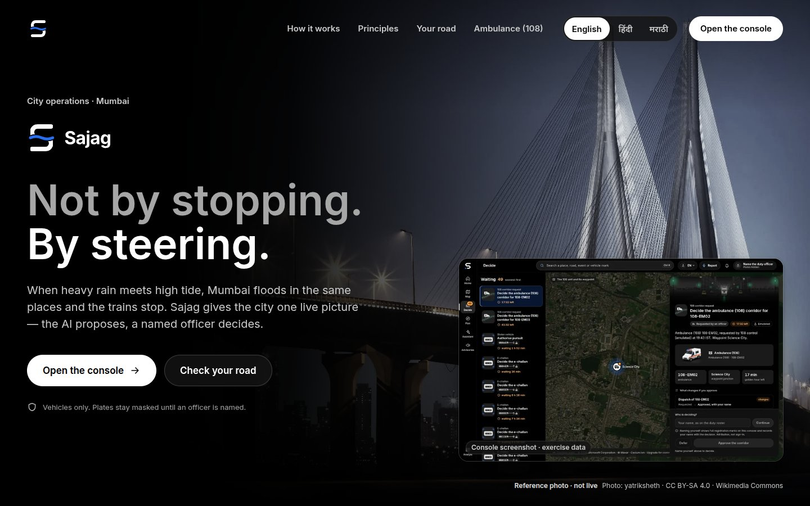

*Landing. The public front door: the neutral mark, the tagline and the two ways in, over a credited reference photo of Mumbai (not live).*

The public front door, English first with मराठी and हिंदी one tap away: the tagline over a credited photograph of
Mumbai, the problem with its sourced and modelled figures, the audiences, the principles, and what Sajag is built
on with the agencies' and sources' marks ("marks belong to their owners; not affiliated"). **Open the console**
leads to the officer sign-in, **Check your road** to the citizen page. No API calls.

### 6.2 The shell (every operator page)

- **Left rail:** Home · Map · Decide · Plan · Assistant · Advisories, with **Analyst** below. Decide carries the
  only badge: the number of decisions waiting.
- **Top bar:** one search box for a place, road, event or vehicle mark (`Ctrl K` or `/`); **Report** (the voice
  field report); the language menu (English · मराठी · हिंदी); the alerts bell with a soft chime; the officer pill.
- **Officer pill:** "Name the duty officer" until someone is named. "Naming yourself shows full registration marks
  on this console and records your name with the decision. Attribution, not sign-in." With the operator PIN set, it
  holds sign-in and sign-out.

### 6.3 Home (`/`)

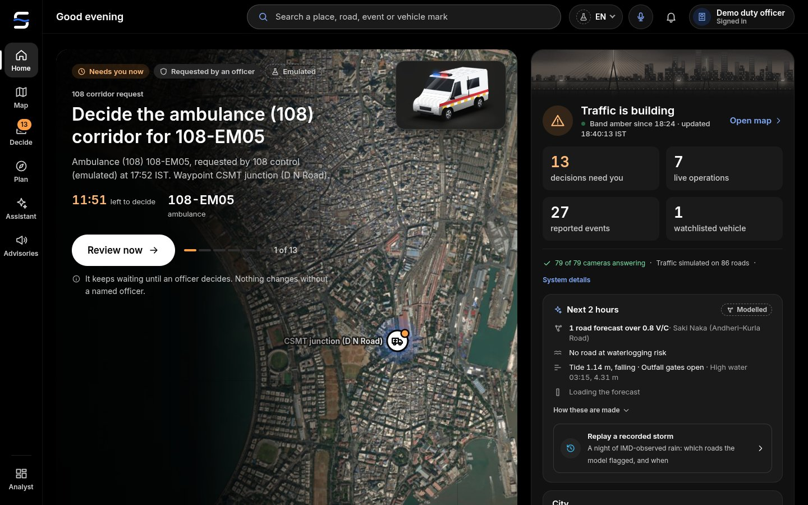

*Home. What needs an officer now, Mumbai's band and four counts, and the next two hours on Hindmata, the subways and the arterials (modelled).*

Three questions: what needs me, what is happening, what is coming.

- **Featured decision** with its reason, key figures and one **Review now** button: "It keeps waiting until an
  officer decides."
- **City pulse:** one sentence for the city's state and four counts: decisions waiting, live operations, reported
  events, watchlisted vehicles (plates hidden until an officer is named).
- **Rain · Tide chip:** rain now (LIVE), the Arabian Sea tide at Apollo Bunder and whether the outfall gates are
  open or shut (MODELLED), and the number of roads at risk in the next 2 hours.
- **Next 2 hours:** roads forecast to cross 0.8 V/C and roads at waterlogging risk, each with its band and label.
- **Rails of cards:** Needs your decision · Live operations · Reported in the city · Coming up.

### 6.4 Map (`/map`)

| The live map, photoreal 3D | The live map, closer |
|---|---|
| 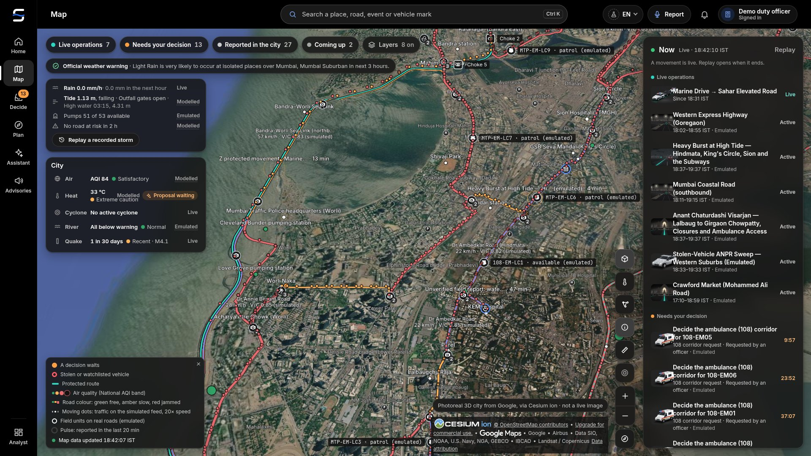 | 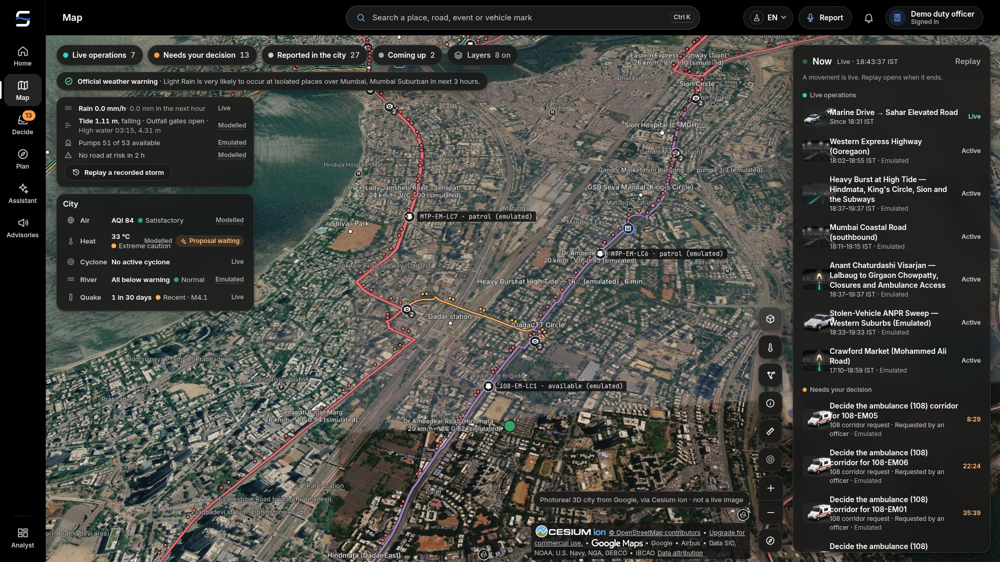 |
| *Mumbai in photoreal 3D: the Sea Link and the Island City, roads in load colours, events and emulated units, Rain · Tide · Pumps.* | *Closer in over Dadar and Parel: each road's speed and V/C (simulated), events where they happen, units with their state (emulated).* |

| The live map, 2D city map | Map: layers |
|---|---|
| 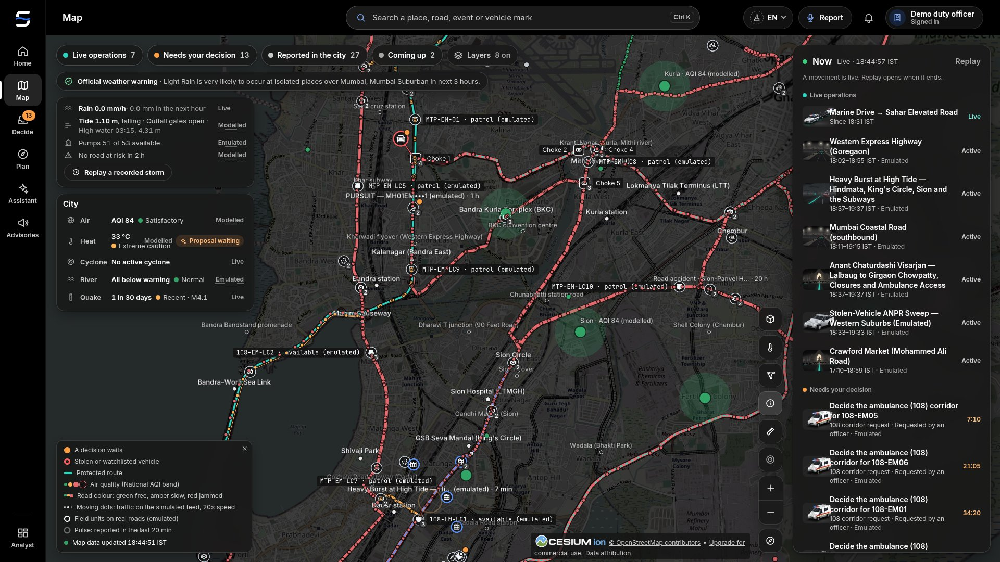 | 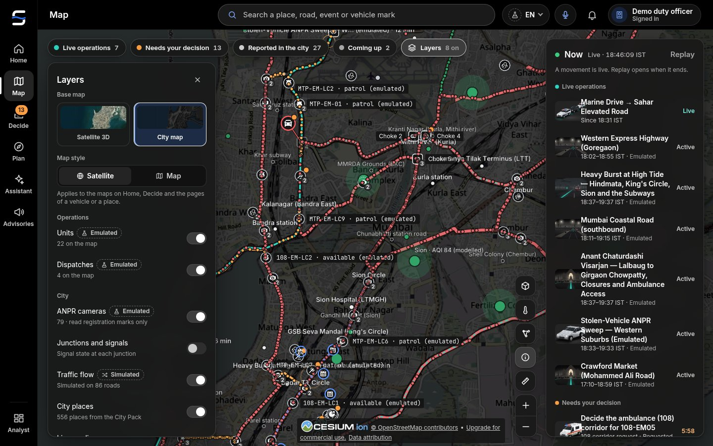 |
| *The Mumbai City Pack drawn live, Colaba to the suburbs: roads in their load colours (simulated), places, events, emulated units and the legend.* | *Each layer with its label and count: units and cameras emulated, traffic simulated, the City Pack's places.* |

- A clean city map (keyless OpenStreetMap, or photoreal 3D through Cesium ion when a key is set, labelled "not a
  live image").
- **Layers:** traffic flow (simulated), **waterlogging risk** 0–3 with lead times (MODELLED), **traffic forecast**
  (roads likely or possibly over 0.8 V/C in 2 hours), cameras at modelled positions, the BMC storm-water pumping
  stations (EMULATED), the Mithi at Kurla against its 4 m danger mark (EMULATED), air quality (LIVE), events, units
  and dispatches.
- **Selection card** for any road: its forecast band, its waterlogging class and the four drivers (rain LIVE, tide
  MODELLED, pumps EMULATED, susceptibility MODELLED).
- **Replay 18–19 August 2025:** the storm on the map, step by step, "IMD observed rain, modelled ponding. Not
  today's city."

| Map: a road's forecast | Map: air and city feeds |
|---|---|
| 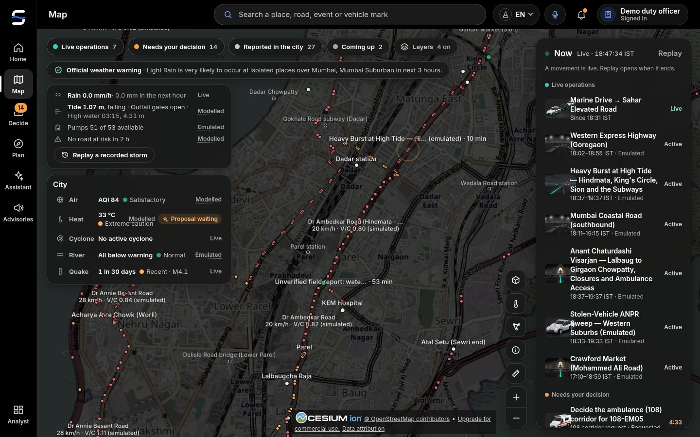 | 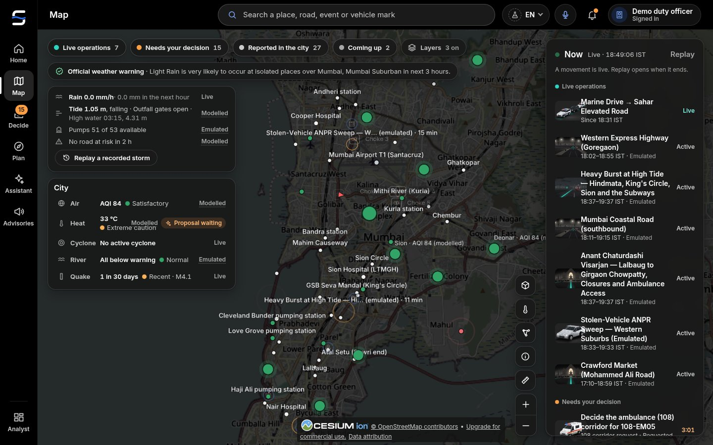 |
| *Dr Ambedkar Road at Hindmata: waterlogging now (modelled) and its two-hour V/C band against 0.8 (simulated traffic).* | *CPCB/MPCB air-quality sites (Bandra Kurla Complex, Colaba, Worli and others) in their AQI band, and the city feeds, each with its label.* |

| Map: waterlogging, 18–19 August 2025 | Replay of 18–19 August 2025 |
|---|---|
| 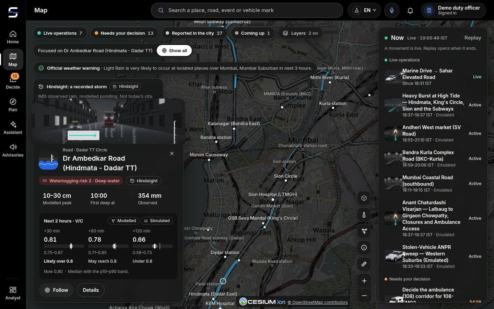 | 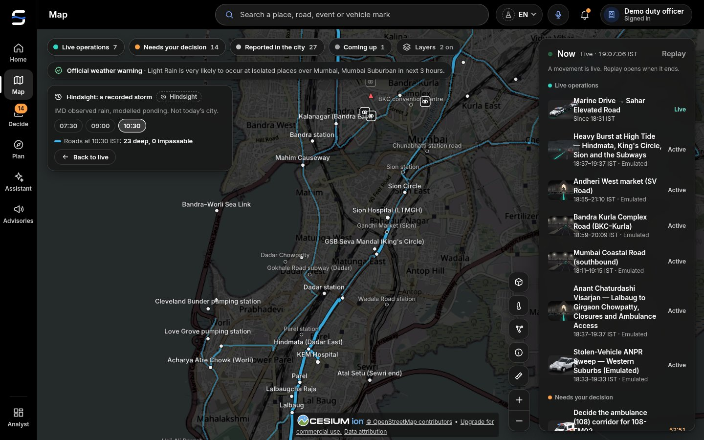 |
| *The storm replayed: roads by risk class, Hindmata's depth band and when it went deep (Hindsight, MODELLED).* | *The storm step by step: IMD's observed rain, modelled ponding, the roads and subways flagged (Hindsight).* |

### 6.5 Decide (`/decide`)

| Decide: a 108 corridor request | Decide: the stolen-vehicle chain |
|---|---|
| 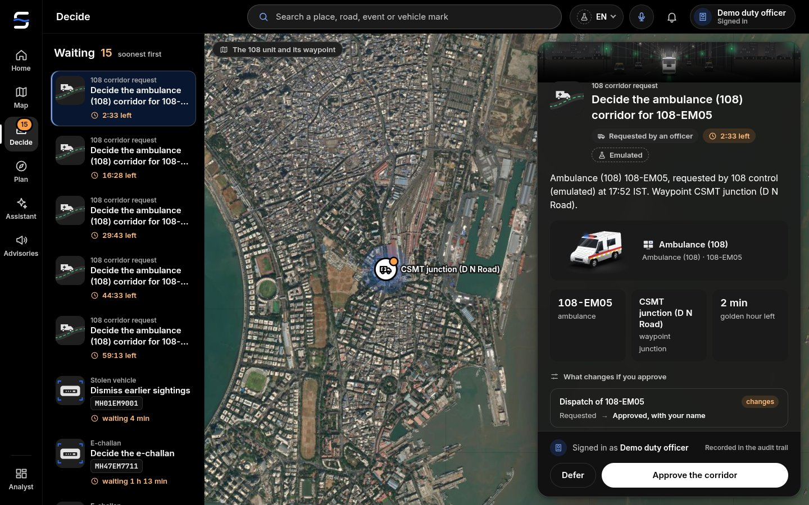 | 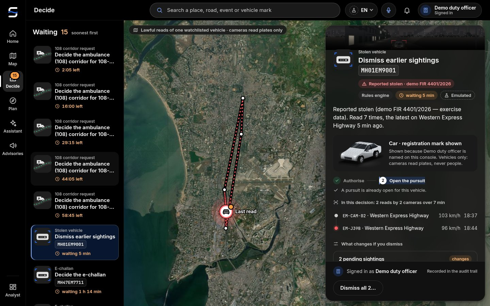 |
| *A 108 crew's corridor request towards KEM Hospital: the golden hour left and what changes if approved, for a named officer.* | *An MH-plated vehicle reported stolen: Authorise, then Open the pursuit as a separate decision; the reads on the map (emulated ANPR); vehicles only.* |

| Decide: the mark masked until an officer is named | Decide: choose a response |
|---|---|
| 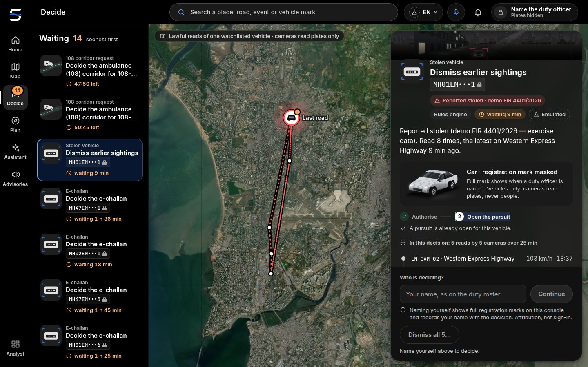 | 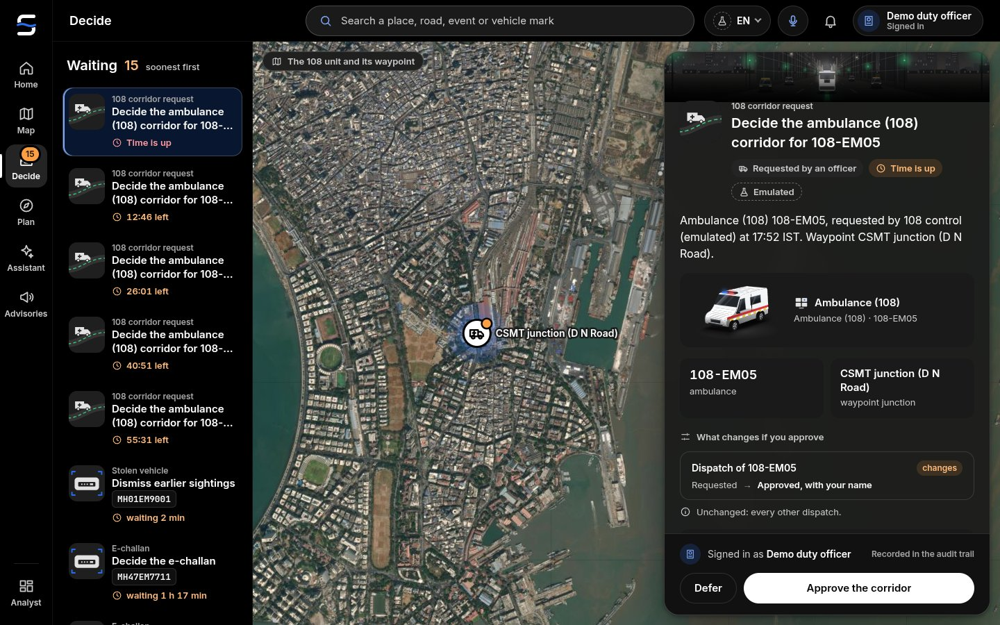 |
| *No officer named: the mark is masked and every button waits for a name.* | *Ranked responses, the recommended one first (MODELLED); approval only creates dispatch requests, for example pumps from BMC disaster control.* |

| Decide: signal timing | Decide: waterlogging |
|---|---|
| 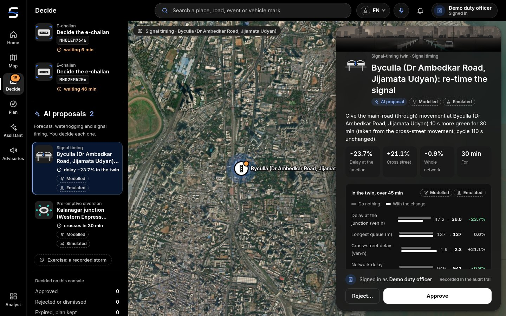 | 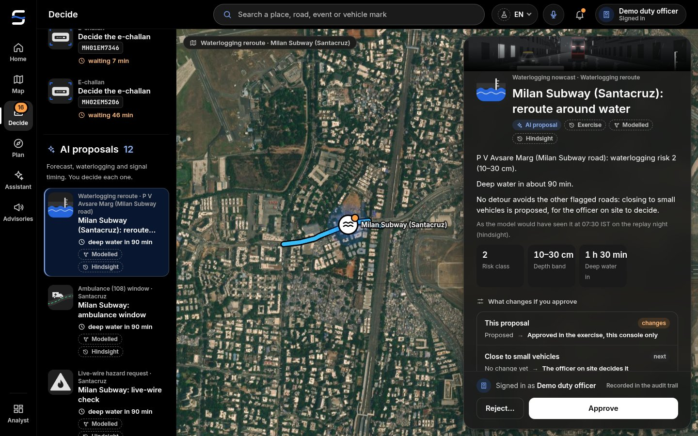 |
| *A signal change at Hindmata tested in the twin against doing nothing, the cross street's cost shown too (MODELLED).* | *A reroute off the Western Express Highway before Andheri Subway goes under, with the ambulance window and live-wire cards in the queue (MODELLED, exercise).* |

One decision at a time, soonest deadline first: the queue on the left, the map of the place in the middle, one
sheet on the right. Every sheet has the same anatomy: what is being decided, why, the key facts with their labels,
**what changes if you approve or reject**, and one primary button that carries the officer's name.

- **AI proposals** ("Forecast, waterlogging and signal timing. You decide each one."):
  - a **signal-timing change** with the twin's comparison against doing nothing: delay at the junction, the longest
    queue, the cross street and the whole network, the confidence and every assumption, and a rationale in English
    and Marathi. A real run on the Mumbai network at 18:00 proposed 6 s more green for the Dr Ambedkar Road
    movement at Hindmata for 30 minutes: modelled delay at the junction down 14.7 %, the longest queue 13 m longer
    and cross-street delay up 20 %, on simulated demand
    ([`docs/samples/twin/propose-hindmata-1800.json`](docs/samples/twin/propose-hindmata-1800.json));
  - a **pre-emptive diversion** from the forecast, with the detour and its length. A real forecast run on the
    Mumbai network put Saki Vihar Road (Powai) at V/C 0.83 in 45 minutes (p10–p90 0.77–0.88) and proposed a
    diversion via Andheri–Kurla Road, the Western Express Highway and the JVLR, on simulated traffic
    ([`docs/samples/forecast/segments-chronos2-synthetic-2026-10-30.json`](docs/samples/forecast/segments-chronos2-synthetic-2026-10-30.json));
  - **waterlogging** proposals: reroute, ambulance window, live-wire hazard request, advisory draft.
- **Platform decisions:** stolen-vehicle sightings ("No fine is ever issued for a stolen vehicle. One approval opens
  one pursuit."), e-challan recommendations, time-boxed escort proposals with a countdown ("If no one answers, the
  current plan is kept."), ambulance (108) corridor requests and decision-support cases, including requests to a
  partner agency such as BMC disaster control (1916).
- Until an officer is named, the buttons are visible but disabled, with the reason. A server refusal is shown in
  the card, in the server's words.

### 6.6 Object pages (`/o/<urn>`)

| A road's page | A vehicle's page |
|---|---|
| 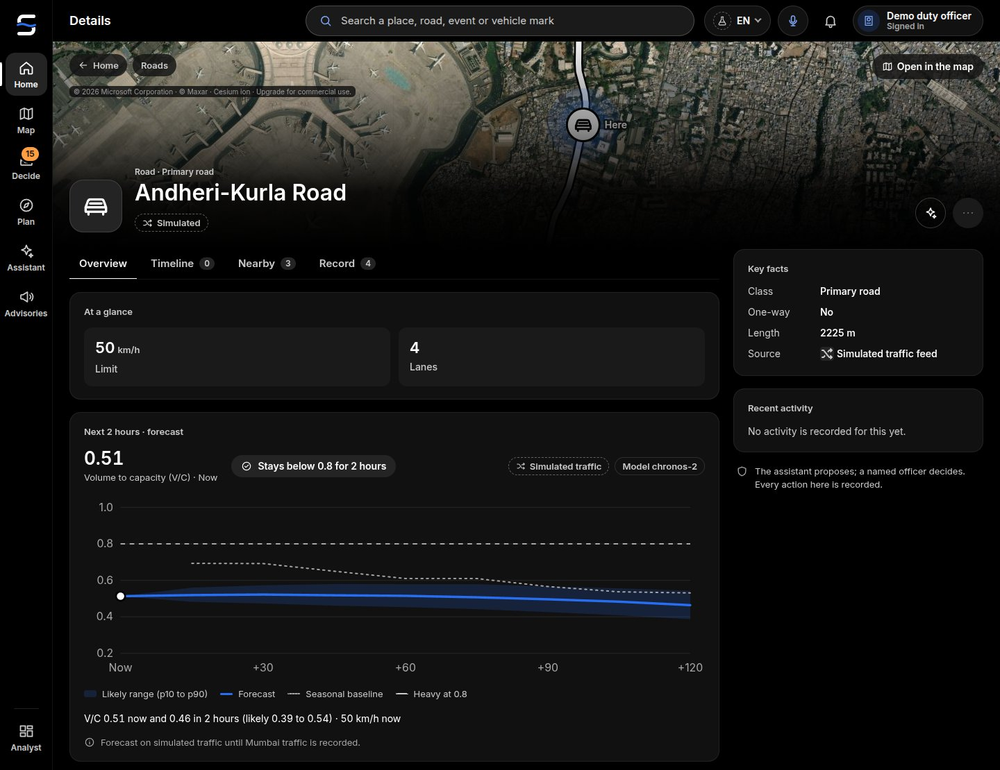 | 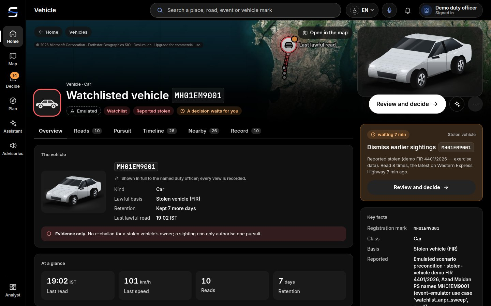 |
| *Dr Ambedkar Road at Hindmata: the two-hour V/C forecast with its p10–p90 band against the 0.8 line (simulated traffic).* | *The stolen exercise vehicle (MH plate, masked): its lawful basis and retention, and evidence only: no e-challan for its owner.* |

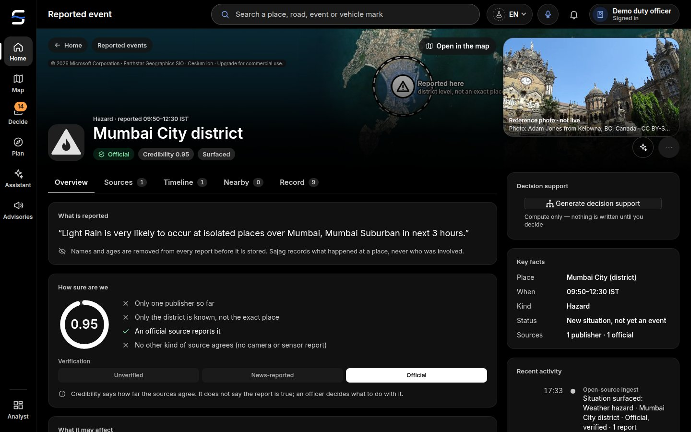

*A reported situation. A Mumbai Traffic Police public notice of a diversion, as a situation at a place, with how sure we are; names are removed before storage.*

Every record has a page: a road segment, a junction, a corridor event, a reported event, a vehicle, a place, a
camera, a pumping station, a dispatch. A road's page shows its live state, the **forecast band** (median with the
p10–p90 band and the 0.8 line), its **waterlogging** class, drivers and replay history, related proposals and the
audit trail. A read-only **Ask about it** panel sends a question to the assistant.

### 6.7 Field report by voice (top bar → **Report**)

| Field report by voice | Field report in Marathi |
|---|---|
| 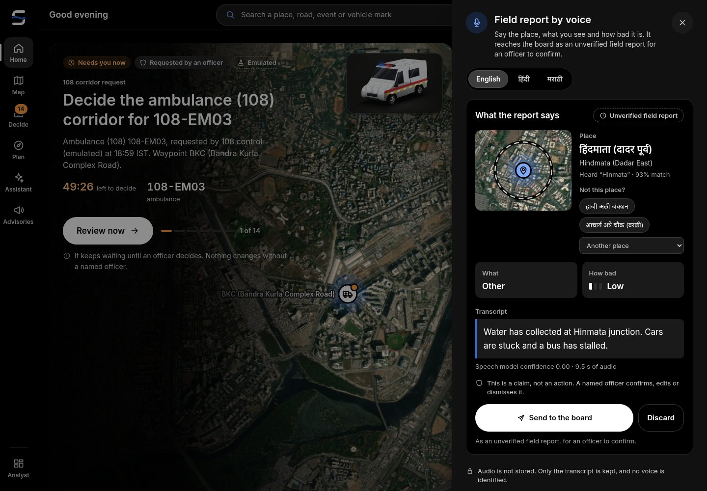 | 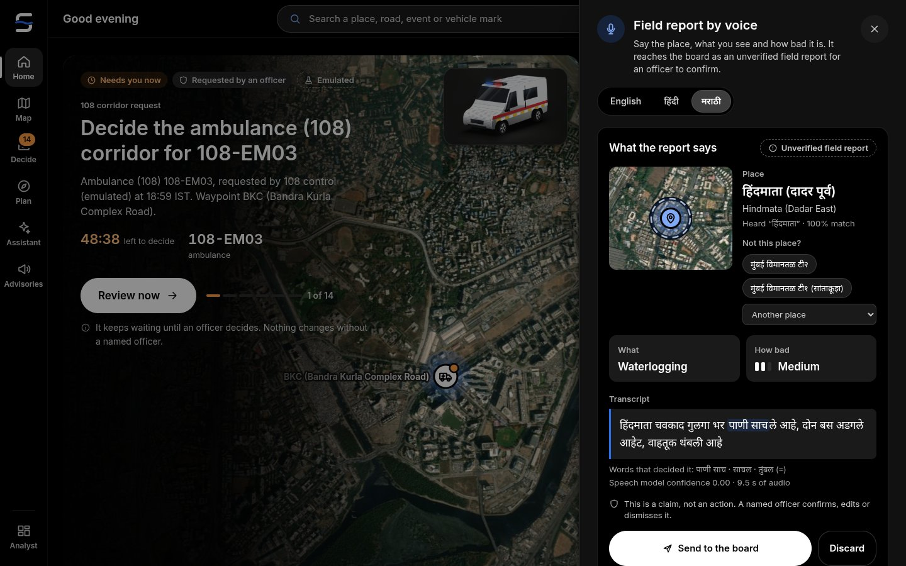 |
| *Speech becomes place, kind and severity with the words that decided it; unverified until an officer confirms.* | *Spoken Marathi about Hindmata, transcribed on the server and matched to its place.* |

"Press and hold, speak, then let go." The spoken language starts as the console's (English by default; Marathi or
Hindi when the console is in them), with a three-way switch. The sheet shows the transcript, the place (with "Not
this place?" and the candidates), the kind, the severity and "Words that decided it". **Send** puts it on the board
"as an unverified field report, for an officer to confirm". It can also be typed. "Audio is not stored. Only the
transcript is kept, and no voice is identified."

### 6.8 Camera road state

| Road state from a still | Road state from a street photo |
|---|---|
| 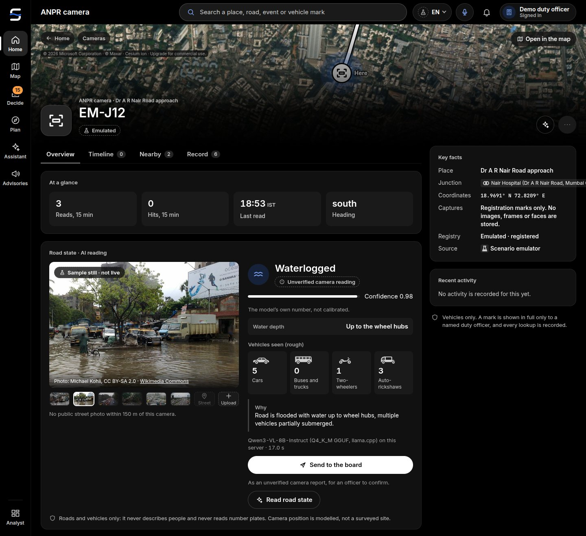 | 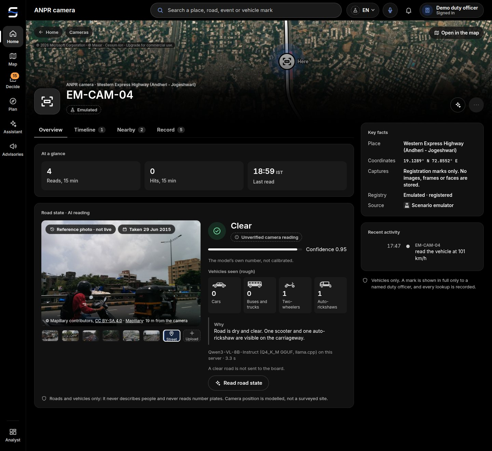 |
| *A still of a flooded Mumbai arterial read on the server as a road state with a depth band, unverified until an officer confirms.* | *The nearest public street photo (Mapillary), dated and credited, read the same way.* |

"Road state · AI reading": a still (a sample still is labelled "Sample still · not live"; an uploaded one "Your still,
not stored") is read as waterlogged, blocked, tree fall, stalled vehicle, crash debris, congested or clear, with a
depth band judged against wheels and kerbs, never against a person. It enters the queue as **unverified** for an
officer to confirm.

### 6.9 Plan a movement (`/plan`)

| Plan a movement | A protected movement on the map |
|---|---|
| 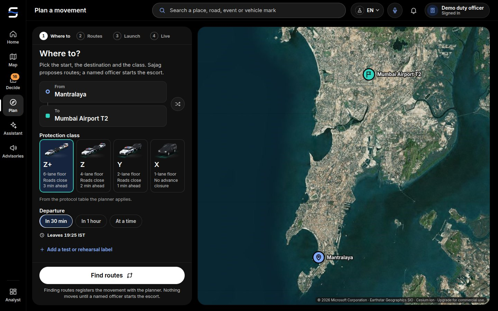 | 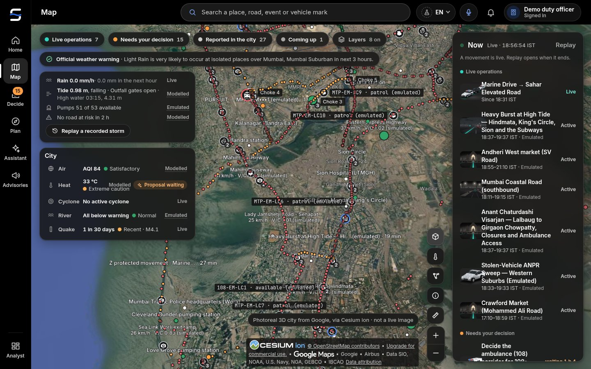 |
| *Mantralaya → Mumbai Airport T2, the protection class with its lane floor and closure lead, and the departure; nothing moves until a named officer starts the escort.* | *A protected movement live on the map: its route, the emulated convoy and units, Follow and Details.* |

Four steps: **Where to → Routes → Launch → Live**. Routes are ranked with times from the traffic twin, labelled
"Simulated traffic"; launch and clear need a named officer; "Nothing moves until a named officer starts the escort."

### 6.10 Assistant (`/assistant`)

| Assistant | Assistant: vehicles, never people |
|---|---|
| 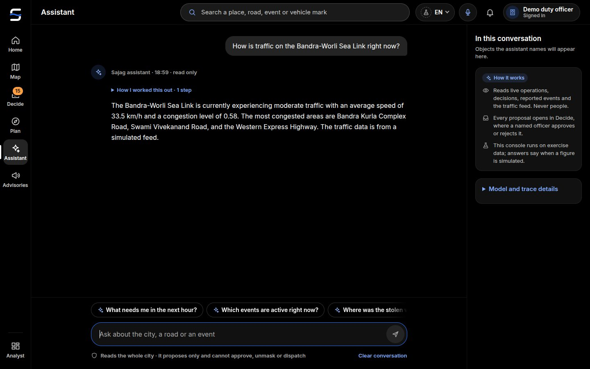 | 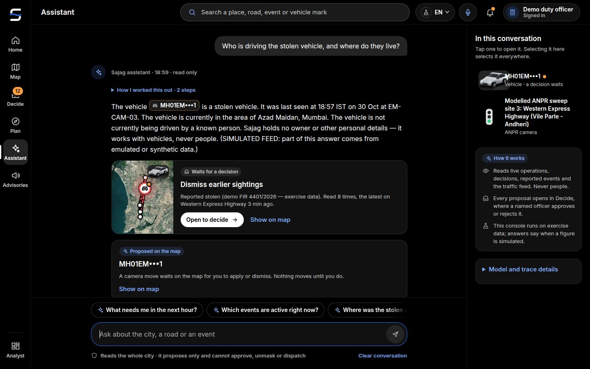 |
| *A grounded, read-only answer about Mumbai's roads that says its traffic is synthetic; it cannot approve, unmask or dispatch.* | *Asked about the driver, it answers about the vehicle only: no owner or personal details exist.* |

"Ask about the city". The assistant reads live operations, decisions, reported events, the waterlogging nowcast
and the traffic feed, and **cannot approve, unmask or dispatch**. A proposal arrives as a card that opens in Decide.
Every sentence of an answer is checked against what the tools returned.

### 6.11 Advisories (`/comms`)

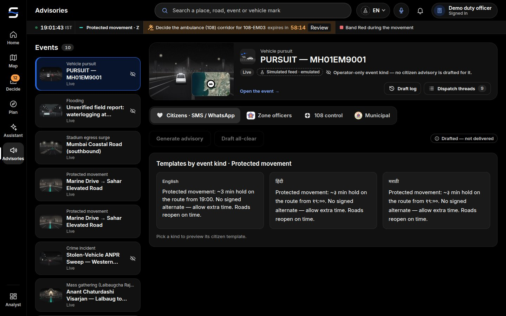

*Advisories. One fact (waterlogging at Hindmata and the subways) for four audiences in English, Marathi and Hindi, marked exercise text; drafted, never sent on its own.*

One fact, every audience, three languages: advisory drafts for the public, for crews and for partner agencies
(BMC, BEST, the railways, Maharashtra SDMA), in English, मराठी and हिंदी. An officer edits and approves; Sajag does
not send SMS or social posts on its own. A draft ends with the numbers that matter in Mumbai: 112, ambulance (108)
and BMC disaster control 1916.

### 6.12 Analyst (`/analyst`, `/ops`, `/gods-eye`)

| Analyst workspace | Situation wall |
|---|---|
| 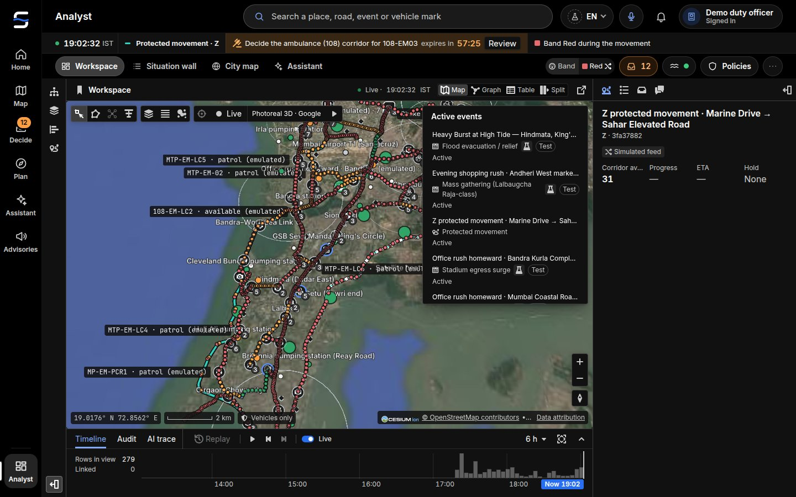 | 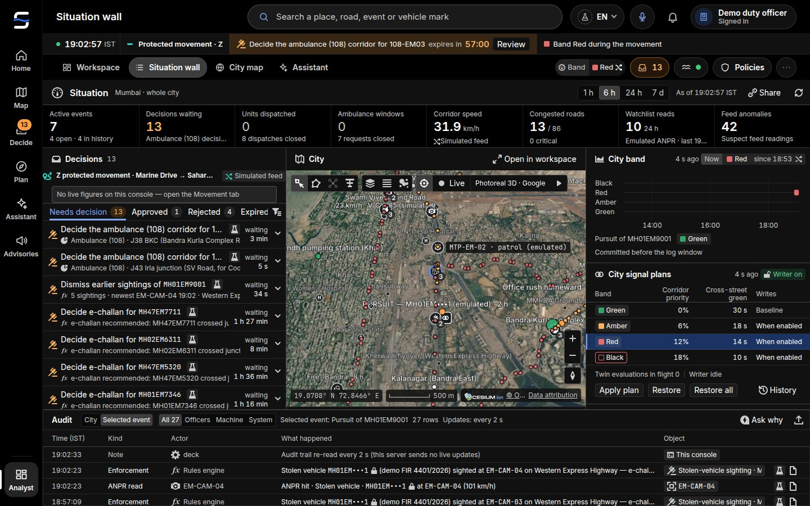 |
| *The map, the active events and the selected movement's figures, with the timeline below.* | *Counts, decisions, the city band, signal plans (writer off) and the audit stream on one screen.* |

| Dispatch and the live band | Audit trail |
|---|---|
| 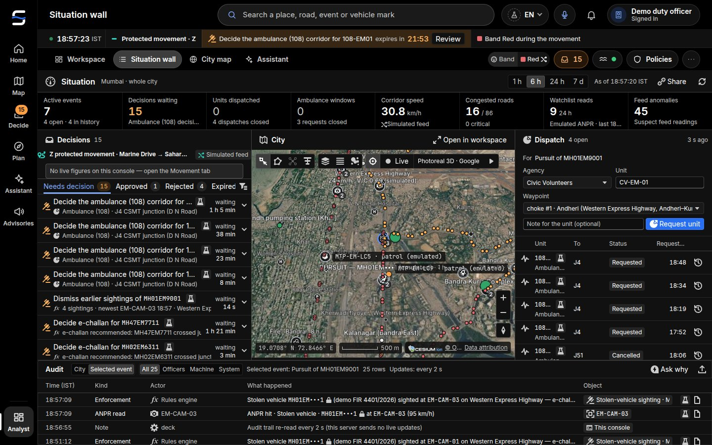 | 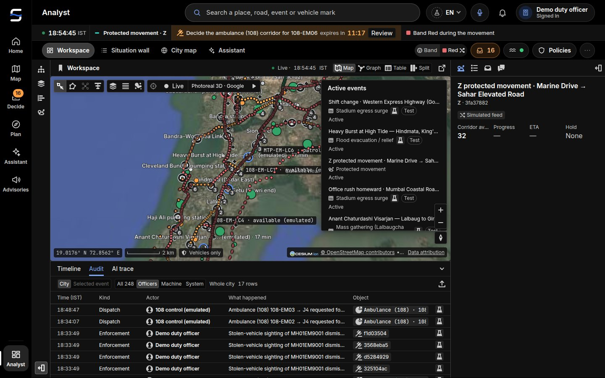 |
| *The live band while a movement runs, and Dispatch: one request per unit, each with its status (emulated units).* | *Every action with its time, actor and object; filters for officers, machines and the system.* |

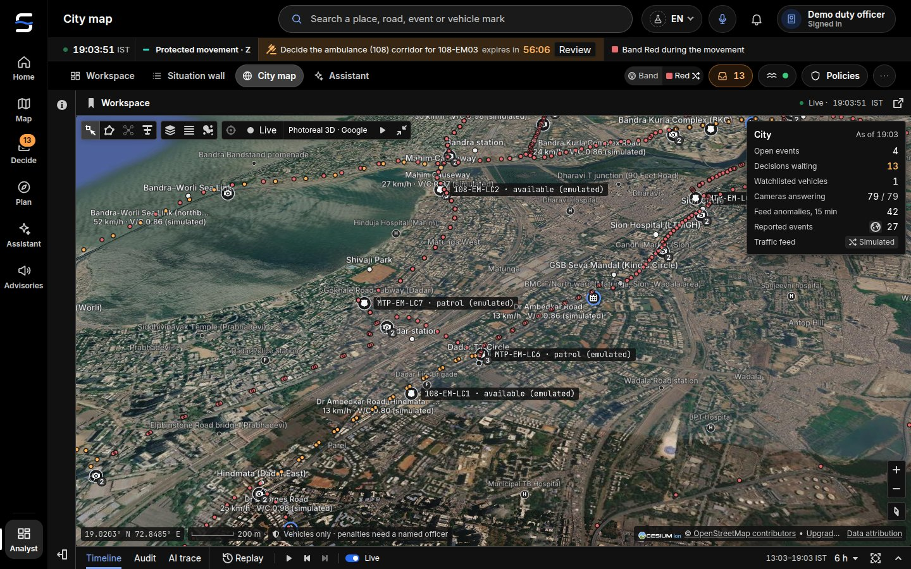

*Analyst city map. The analysts' 3D Mumbai with its vitals; roads simulated, units emulated, imagery not live.*

The full-density workspace for analysts: tables, filters, saved views (always masked), the situation wall with the
city band and the audit ladder, and the 3D city map.

### 6.13 Public pages: citizen and ambulance crew

| Citizen | Ambulance (108) crew |
|---|---|
| 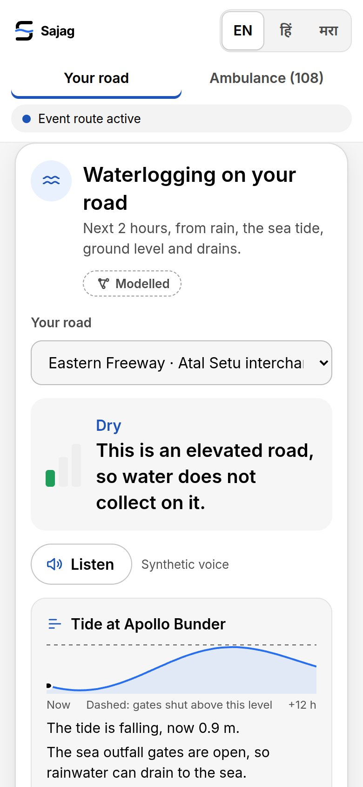 | 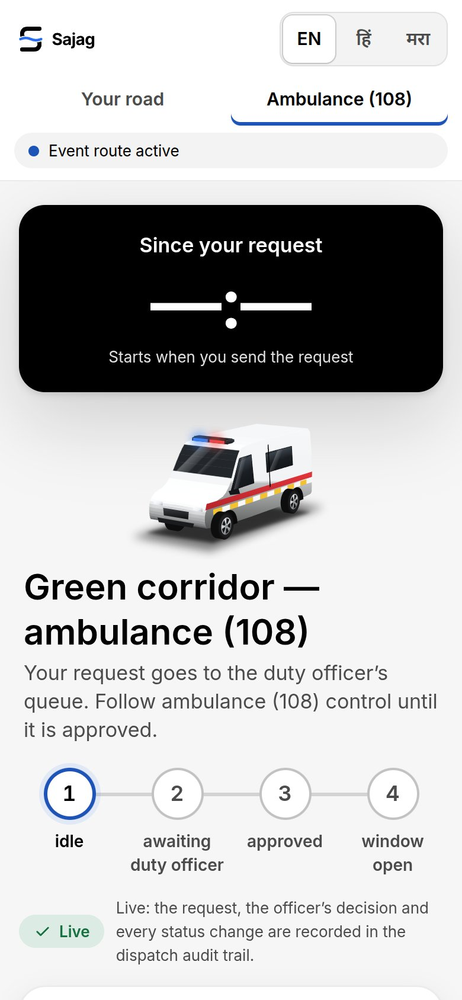 |
| *Check your road: Andheri Subway's status in plain words (modelled), Listen, the tide at Apollo Bunder; no sign-in, no location.* | *One request for a corridor window, its four steps; a duty officer decides.* |

- **Citizen:** English by default, with मराठी and हिंदी one tap away. Search a road; see approved advisories and the
  waterlogging status in plain words with their labels; **Listen** reads the advisory aloud in the page's language,
  marked "synthetic voice"; 112, ambulance (108) and BMC 1916. No sign-in, no location, no tracking.
- **Ambulance crew:** unit, stretch and urgency; one request button; the status while it waits for a duty officer;
  the line that the crew always follows 108 control.

### 6.14 Languages and accessibility

Every string exists in English, Marathi and Hindi; every page, public pages included, opens in English and
remembers the reader's choice. Marathi and Hindi share the Devanagari script, set in self-hosted Noto Sans
Devanagari. Marathi copy follows a glossary (for example प्रस्ताव for "proposal", पाणी साचणे for "waterlogging",
भरती for "high tide") and keeps Western digits in the console so that figures read the same in every language.
Place names follow the canonical spellings of the City Pack in all three languages. Colour is never the only
signal: every state also has a word or an icon. Motion respects "reduce motion".

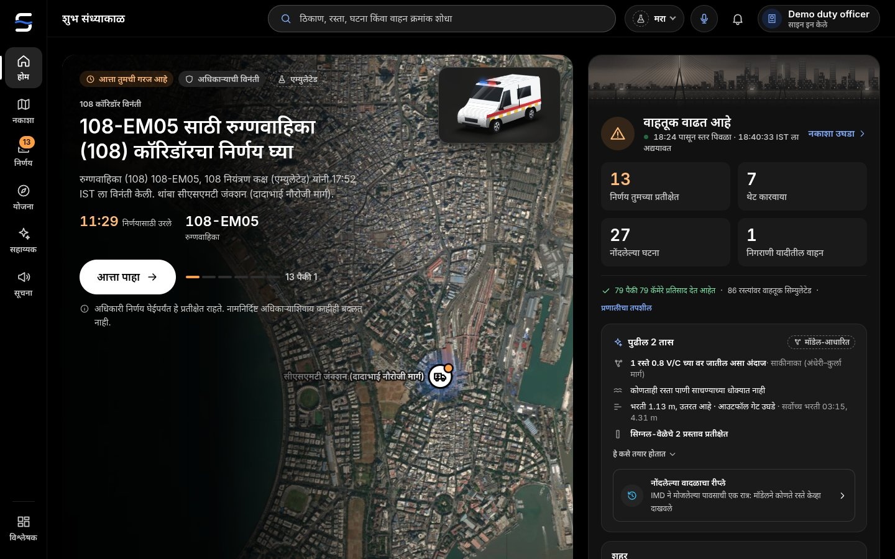

*Home, also in Marathi. The same screen in मराठी; every figure keeps its label.*

## 7. The AI, with its honest limits

Every model runs on the one on-premises server. Every output is a proposal or an unverified reading. Some
evaluations were first run on the **Kolkata reference pack** (`cities/kolkata`, the second City Pack kept in the
repository, where the platform was first built); they are named as such and are not Mumbai results.

| Capability | Model (licence) | What it does | Honest label | Limits |
|---|---|---|---|---|
| **Corridor forecasting** | Chronos-2 (Apache-2.0); TimesFM 2.5 (Apache-2.0) as a second model in the backtest; seasonal-naive baseline | Speed and V/C for every Mumbai road, 15–120 min ahead, p10–p90 bands; covariates rain, tide and events; a diversion proposal when the median crosses 0.8 | "Forecast on simulated traffic" | No real Mumbai traffic history yet; V/C derived from speed. Backtest skill of +54.9 % over the baseline was measured on the Kolkata reference pack's simulated traffic; on Mumbai: not yet re-run on Mumbai's network |
| **Waterlogging nowcast** | No ML: a conceptual ponding model with rain, the Arabian Sea tide at Apollo Bunder, pumps and terrain | Depth-risk class 0–3 per road with lead time; reroute, ambulance window, live-wire request, advisory | rain LIVE, tide MODELLED, Mithi EMULATED, pumps EMULATED, risk MODELLED | Rain is a model nowcast, not a gauge; tide is harmonic, without storm surge; subways are scored as roads, not sumps; 86 arterial segments; calibrated on Mumbai only against the replay of 18–19 August 2025 |
| **Voice** | AI4Bharat IndicConformer 600M multilingual (MIT) for Marathi and Hindi; Whisper large-v3-turbo (MIT) for English and as fallback; AI4Bharat Indic Parler-TTS (Apache-2.0), Svara-TTS v1 (Apache-2.0) as its fallback | Spoken report → place, kind, severity; advisories read aloud in English, Marathi or Hindi | UNVERIFIED-FIELD; "synthetic voice" | Evaluated on a synthetic round trip of Mumbai field phrases (Marathi WER 7.1 %, place 56 of 56; Hindi WER 14.0 %, place 50 of 52); real field audio in rain and traffic noise will be harder; TTS runs at about real time, so advisories are cached |
| **Road-state vision** | Qwen3-VL-8B-Instruct (Apache-2.0), quantized, on llama.cpp | A camera still → road state, depth band, vehicle estimate | UNVERIFIED-CAMERA | Mumbai photo set: 11 of 12 credited photos right, 10 of them taken in Mumbai; all 11 person, plate and road probes passed (English, Marathi, Hindi); median 5.1 s warm. Confidence is not calibrated; one still cannot tell a stalled bus from one waiting at a signal |
| **Signal-timing proposals** | A cell-transmission traffic twin, with Webster and max-pressure baselines; the local LLM only words the rationale | Tests every candidate timing against doing nothing over the whole network; proposes or holds | MODELLED; demand SIMULATED | Macroscopic; turning ratios assumed; Mumbai Traffic Police signal programs are not public, so most crossings run templates; the signal adapter is emulated. On Mumbai: 6 s more green for the Dr Ambedkar Road movement for 30 min: junction delay −14.7 %, network −0.3 %, cross street +20.0 % (shown, inside the 25 % guard), on SIMULATED demand, best of 14 candidates |
| **Assistant and decision AI** | A 27B decider model (pplx-decider-v1.2, Apache-2.0) asked typed questions; Gemma 4 12B (quantized) for drafting; Perplexity's pplx-embed models for memory | Answers about the live picture; plans movements; checks every claim against tool results | Labels per answer | Cannot approve, unmask or dispatch; the decider's saved check set comes from the Kolkata reference pack (Mumbai set: not yet re-run on the Mumbai scenarios); Marathi answers are not yet evaluated |
| **Event intelligence (OSINT)** | Rules and fusion, no generative model | Aggregates official alerts (NDMA Sachet CAP for Maharashtra, Mumbai Traffic Police notices) and Mumbai news in English, Marathi and Hindi about places into situations with credibility | UNVERIFIED-OSINT / NEWS-REPORTED / OFFICIAL-VERIFIED | Off by default; aggregate only; credibility measures agreement between sources, not truth; some outlets publish no readable feed and are not read |

Details, evaluations and sources: [`docs/ai/forecast.md`](docs/ai/forecast.md),
[`docs/ai/hydro.md`](docs/ai/hydro.md), [`docs/ai/speech.md`](docs/ai/speech.md),
[`docs/ai/vision.md`](docs/ai/vision.md), [`docs/ai/twin.md`](docs/ai/twin.md),
[`docs/ai/decider.md`](docs/ai/decider.md), [`docs/ai/cityfeeds.md`](docs/ai/cityfeeds.md).

**What was checked against the real world.**

- **Tide.** The Apollo Bunder model against published predictions: every BMC-listed high water of 24–28 June and 24–27 July 2025 within 20 min and 0.12 m, low waters within 10 min and 0.25 m (the BMC's high-tide advisories as printed by the Free Press Journal). The same code on the
  Kolkata reference pack matches published predictions within about 20 minutes on high waters and 0.15 m on
  levels, and tests enforce this.
- **Waterlogging.** The replay of 18–19 August 2025 driven by IMD's observed rain: with the rain gauges' observed totals, the model flagged 9 of the 12 places reported flooded on its network (King's Circle, Andheri Subway, Gandhi Market, Byculla, Dadar TT, Vile Parle, Hindmata, Chembur, Kurla by the Mithi) and missed Sion, Khar and Goregaon. Its own flag came after the first news report at most places (median 51 minutes late: the bucket model fills slowly); with the observed rain as a perfect 2-hour nowcast (hindsight) it would have led the first report at 8 of the 9 (median 69 minutes). The Open-Meteo archive carried a third of the gauges' rain and flagged nothing, which is the case for a live rain-gauge feed. A second replay, 26 May 2025, flagged 5 of 15 reported places. The method was
  first validated on the Kolkata reference pack, where the model flagged all 13 reported places on that network on
  an overnight storm of September 2025; almost the whole network flooded that night, so this showed the model is
  not blind to such an event, not that it discriminates finely. See
  [`docs/ai/hydro.md#replay-a-recorded-mumbai-storm`](docs/ai/hydro.md#replay-a-recorded-mumbai-storm).
- **Vision policy.** On 28 Oct 2026 vision passed 9 of 9 policy probes: seven person or plate questions were
  refused before the model ran, and two road questions were answered. On 30 Oct a plate question about a
  kaali-peeli taxi and a person question in English and in Marathi were refused with HTTP 403 on a Mumbai still
  ([`docs/samples/vision/refusals-403.json`](docs/samples/vision/refusals-403.json)).

## 8. Modelled impact

All figures are **MODELLED** by [`scripts/impact_run.py`](scripts/impact_run.py) on the Mumbai network; the full
report with its assumptions ledger is [`IMPACT_REPORT.md`](IMPACT_REPORT.md). They are estimates to be replaced
with measured data in a pilot, not field results.

| What is compared | Blanket freeze | Rolling holds |
|---|---|---|
| Hold per junction | 25 min (design range 15–45, an assumption) | 2.5 min (60–180 s activation ahead of the movement) |
| Protected movement, Mantralaya → Airport T2 (10 junctions, 27.6 km): commuter-minutes per movement | **192,820** | **1,928** |
| Whole network frozen (upper-bound framing): commuter-minutes per movement | 1,388,302 | 13,883 |

- **Reduction:** about 100× in the central case; 25× in the conservative case and
  506× in the optimistic case (each case's inputs are in the report). Delay grows with the square
  of the hold, which is why shorter holds matter so much.
- **Annual, protected-movement corridor alone:** about 795,382 commuter-hours (central case).
- **Ambulances:** with 12 ambulance trips assumed to cross a movement corridor per movement-day,
  about 33,000 ambulance minutes a year are returned. For scale, older Mumbai figures put an
  ambulance (108) about 18.75 minutes from the patient, with 20–45 minutes reported at peak in Andheri, Kurla and
  South Mumbai (§2). Each input is an assumption listed in the ledger, to be checked against ambulance (108)
  dispatch data.
- **Waterlogging lead time:** in the replay of 18–19 August 2025: with the rain gauges' observed totals, the model flagged 9 of the 12 places reported flooded on its network (King's Circle, Andheri Subway, Gandhi Market, Byculla, Dadar TT, Vile Parle, Hindmata, Chembur, Kurla by the Mithi) and missed Sion, Khar and Goregaon. Its own flag came after the first news report at most places (median 51 minutes late: the bucket model fills slowly); with the observed rain as a perfect 2-hour nowcast (hindsight) it would have led the first report at 8 of the 9 (median 69 minutes). The Open-Meteo archive carried a third of the gauges' rain and flagged nothing, which is the case for a live rain-gauge feed. A second replay, 26 May 2025, flagged 5 of 15 reported places. The replay treats the observed
  rain as a perfect nowcast; with a real nowcast the lead will be shorter.
- **Vehicles caught and fuel idled** under each policy are in the report.

Sajag does not claim lives saved. To improve any figure, replace an assumption with measured data and re-run the
script.

## 9. Cost, pilot plan and scale

### 9.1 Cost (estimates, 2026 prices)

| Item | Pilot (one division, 12 months) | Basis |
|---|---|---|
| On-premises AI units (2, one as backup) | ₹8–10 lakh | Desktop-class 128 GB GPU systems at about ₹4–5 lakh each incl. GST |
| Engineering (build, integrate, shadow, support) | ₹29 lakh | 3 engineers × 6 months + 1 engineer × 6 months, about ₹1.2 lakh a month each |
| Water-level sensors at subways and hotspots the BMC does not already instrument (optional) | ₹4 lakh | About 20 × ₹20,000 |
| Operator training and SOP workshops | ₹2 lakh | 4 workshops |
| Backup connectivity | ₹0.5 lakh | 4G backup |
| Contingency (15 %) | about ₹6–7 lakh | |
| **Total pilot** | **about ₹45–55 lakh** | |

- **City-wide over two years:** about ₹2–2.5 crore (estimate), covering about six nodes (the Mumbai Traffic Police
  control room, BMC disaster control, Maharashtra SDMA, an ambulance hub and two divisional rooms for the western
  and eastern suburbs), a five-person team, about 100 sensors and training. Running cost after that: about
  ₹40–60 lakh a year.
- **Software licences: ₹0.** Sajag is MIT; the models are Apache-2.0 or MIT (see §7); maps are OpenStreetMap.
  No per-camera, per-user or cloud fees. Existing CCTV, control rooms and BMC sensors are reused, not replaced.
- **Funded so far:** only the prototype, at the team's own cost.

### 9.2 Pilot plan

**Pilot area:** one Mumbai Traffic Police division around **Dadar – Parel – Matunga – Sion** (BMC wards F/South,
F/North and G/North). It holds Hindmata, Dadar TT, King's Circle, Sion Circle, Parel, Lalbaug (the visarjan
origin), KEM and Sion hospitals and the Dadar station forecourt: the monsoon, the festival and the station surge in
one division. The pilot runs through one monsoon (June–September 2027) and one Ganeshotsav.

| Phase | When | What happens | Needs |
|---|---|---|---|
| 0. Agreements | Month 0–1 | Data-sharing MoU; nodal officers named | Mumbai Traffic Police, BMC disaster control (1916) and storm-water drains, Maharashtra SDMA, the 108 operator |
| 1. Install | Month 1–2 | One on-premises unit plus a backup in the traffic control room; adapters switched from EMULATED to LIVE as access arrives | Read access to the BMC rain gauges and pumping-station status, junction CCTV stills and signal timings for the division |
| 2. Shadow mode | Month 2–4 | Sajag runs beside the control room; proposals are logged, not acted on; officers rate them | Officers' time to rate proposals; real traffic counts for the division |
| 3. Officer-approved live | Month 5–12 | Advisories, diversions, corridor windows and pump requests go live after approval, through the 2027 monsoon and Ganeshotsav; signal proposals stay advisory until the adapter is certified | Signal controller access for the division; a consented voice recording set |
| 4. Independent review | Month 12 | Measured delay, lead times and ambulance minutes against the modelled figures; go/no-go | Measured movement logs; 108 dispatch data |
| 5. City-wide | Month 13–24 | Roll-out to the other divisions and nodes | Budget approval |

The first data each phase needs, in order: a rain-gauge feed (BMC automatic weather stations or IMD AWS), real
traffic for the division, pumping-station status, junction CCTV stills, signal timings, and a consented recording
set from officers.

### 9.3 Scale: a city is a folder

Everything specific to Mumbai lives in [`cities/mumbai/`](cities/mumbai/): names in three languages, the bbox,
plates, agencies, emergency numbers, hydrology (sea, river, tide station, pumping stations), the canonical
landmarks, the curated corridors and the OpenStreetMap extracts. One command, `python3 scripts/city_build.py
<city>`, regenerates every file the services read. The Kolkata pack ([`cities/kolkata/`](cities/kolkata/)) is
kept as a second, reference pack, and a test builds both.

Per new city: write the pack, build a waterlogging hotspot list and the terrain susceptibility, add spoken place
aliases, and add the local agencies' marks. The services do not change. The next City Packs named for the region
are **Thane, Navi Mumbai, Pune, Nagpur and Nashik**, then other districts; Marathi and Hindi are already full
languages, so each new pack is data, not translation.

## 10. Roadmap

| When | What |
|---|---|
| Now | Mumbai City Pack (with the Kolkata reference pack); forecasting, waterlogging nowcast with the Apollo Bunder tide, Marathi, Hindi and English voice, road-state vision, signal-timing twin; console in English, Marathi and Hindi |
| Pilot, months 1–4 | Wire the BMC rain gauges and pumping-station status into hydro; the Mithi level from BMC sensors; record real traffic for the division; calibrate the waterlogging model on gauge data; a consented voice set and re-evaluation; a labelled Mumbai CCTV still set and confidence calibration |
| Pilot, months 5–12 | Signal adapter for the division's controllers (officer-approved changes only); rail running status from Central and Western Railway when shared; retrieval over SOPs (Mumbai Traffic Police advisories, the BMC monsoon preparedness plan, Maharashtra SDMA plans, NDMA guidelines) with citations; more Mumbai news sources in Marathi and Hindi, aggregate only |
| After the pilot | Subways modelled as sumps; storm surge and wind set-up on the sea face; regional flood extent from Sentinel-1 SAR (Prithvi-EO-2.0) at district scale after cyclones; the next City Packs |

---

# Part B: engineering in brief

## 11. Architecture

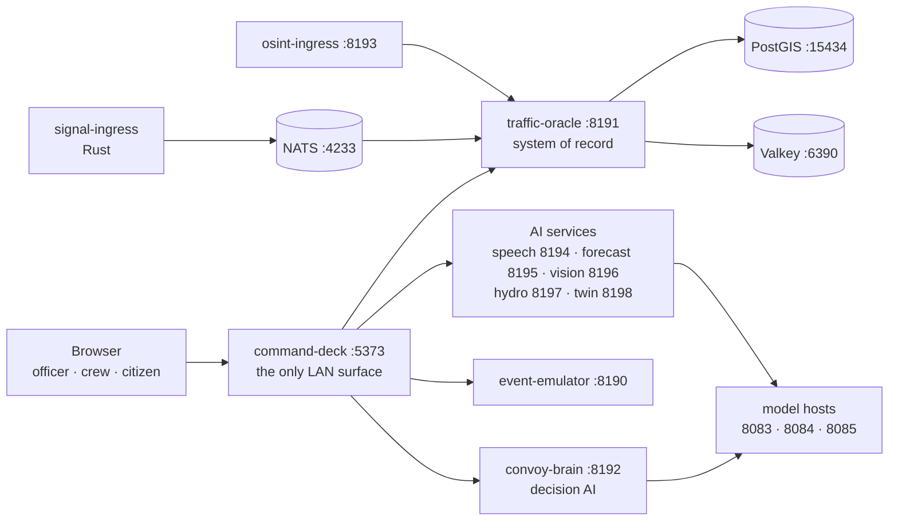

| Layer | Technology |
|---|---|
| Console | SvelteKit (Svelte 5), TypeScript, MapLibre, CesiumJS, served by Bun |
| Platform services | Python 3.12 and FastAPI (oracle, brain, emulator, OSINT, embeddings); Rust (signal-ingress) |
| AI services | FastAPI; PyTorch (Chronos-2, Whisper), ONNX Runtime (IndicConformer), llama.cpp (Qwen3-VL, the tactical LLM, the fallback voice), parler-tts (Indic Parler-TTS), numpy (the twin and the ponding model) |
| Data | PostgreSQL 16 with PostGIS, pgRouting and pgvector; Valkey; NATS JetStream |
| Deployment | Docker Compose and systemd user units on one arm64 edge server (NVIDIA GB10, 121 GiB unified memory) |

Every service except the deck binds 127.0.0.1. The deck proxies fixed loopback targets, applies the operator gate,
and sets a per-document content-security policy. Details: [`docs/TECHNICAL_DESIGN.md`](docs/TECHNICAL_DESIGN.md).

## 12. Honest status

| Status | What |
|---|---|
| **Real** | The Mumbai road network (OpenStreetMap; 72 junctions, 86 segments, 202 km curated), every decision and its audit trail, the operator gate and masking, the AI models and their outputs, the evaluation results, the reference photographs (credited, labelled not live) |
| **Live** (a real public feed) | The rain nowcast (Open-Meteo), air quality (WAQI, OpenAQ: CPCB/MPCB stations), official alerts (NDMA Sachet CAP for Maharashtra, IMD CAP), Mumbai Traffic Police public notices, NASA FIRMS, Mapillary street photos, Mumbai news RSS in English, Marathi and Hindi (aggregate) |
| **Emulated** (a stand-in for an agency feed Sajag cannot read yet) | BMC pumping-station status and sensors, the Mithi level, MTP signal controllers and detectors, ANPR reads, CCTV stills at junctions, 108 and fleet GPS (field units), BEST and suburban rail running status, the signal adapter |
| **Simulated** (a scenario) | Traffic until real Mumbai counts are recorded (and so forecast history and twin demand); visarjan night, the monsoon burst at high tide, the station surge when locals stop, Wankhede egress, the Sea Link breakdown, cyclone recovery and the other scenarios |
| **Modelled** (a computed estimate) | The Arabian Sea tide at Apollo Bunder, waterlogging risk, terrain susceptibility, V/C, twin results, camera positions, signal programs, the impact figures |
| **Not connected today** | Agency radio and CAD, the 1916 and 108 control-room systems, SMS and social gateways (advisories are drafts an officer sends), real CCTV feeds, signal controllers, pumps |

Tests and gates after today's merge: 6,443 Python tests and 121 Rust tests pass; 46 deck
unit suites; 69 gates green.

## 13. Getting started

The quick start, prerequisites and the environment table are in [`README.md`](README.md). Every environment
variable is in [`docs/ENVIRONMENT.md`](docs/ENVIRONMENT.md); every data source and its live status is in
[`docs/DATA_SOURCES.md`](docs/DATA_SOURCES.md); sample data and test cases are in
[`docs/SAMPLE_DATA_AND_TESTS.md`](docs/SAMPLE_DATA_AND_TESTS.md) and [`docs/samples/`](docs/samples/README.md)
(Mumbai captures at the top level; the Kolkata reference pack's captures in
[`docs/samples/kolkata-reference/`](docs/samples/kolkata-reference/), each labelled as not a Mumbai capture).

## 14. Licence and credits

- Code: MIT, © 2026 Sayandeep Haldar ([`LICENSE`](LICENSE)).
- Road data: © OpenStreetMap contributors, ODbL 1.0.
- Terrain: Copernicus DEM GLO-30 (© DLR e.V. 2010–2014 and © Airbus Defence and Space GmbH 2014–2018, provided under
  COPERNICUS by the European Union and ESA).
- Rain: Open-Meteo (CC BY 4.0).
- Tide constants for Apollo Bunder: Admiralty harmonic constants for Mumbai (Apollo Bunder) as given by Unnikrishnan (2022), with N2 and K2 inferred and the mean level fitted.
- Population: Census of India 2011.
- Reference photographs: Wikimedia Commons works under their own licences, credited on screen and in
  [`services/command-deck/static/photos/NOTICE.md`](services/command-deck/static/photos/NOTICE.md).
- Agency and data-source marks belong to their owners; Sajag is not affiliated with or endorsed by them
  ([`services/command-deck/static/logos/NOTICE.md`](services/command-deck/static/logos/NOTICE.md)).
- AI models keep their own licences (§7).

## 15. Glossary

| Term | Meaning |
|---|---|
| City Pack | The folder `cities/<id>/` that holds everything specific to one city |
| V/C | Volume-to-capacity ratio; above about 0.8 a road is near saturation |
| p10–p90 band | The range the forecast expects the value to fall in 8 times out of 10 |
| Twin | A computer model of the road network used to test a change before it is made |
| Rolling hold | A short closure ahead of a movement, released as it passes, instead of a blanket freeze |
| UNVERIFIED-FIELD / UNVERIFIED-CAMERA | A voice report or a camera reading waiting for an officer's confirmation |
| BMC | Brihanmumbai Municipal Corporation, the city's municipal body; it runs the drains, the pumping stations and disaster control |
| 1916 | The BMC's disaster control helpline and control room |
| MTP | Mumbai Traffic Police (headquarters at Worli) |
| Maharashtra SDMA | Maharashtra State Disaster Management Authority |
| BEST | The city's bus undertaking (the red buses, including double-deckers) |
| Locals | Mumbai's suburban trains, run by Central Railway and Western Railway |
| CSMT | Chhatrapati Shivaji Maharaj Terminus, the Central Railway terminus (also said CST or VT) |
| Ganeshotsav | The ten-day Ganesh festival |
| Visarjan | The immersion of the Ganesh idols, in processions to the sea; biggest on Anant Chaturdashi (Lalbaug → Girgaon Chowpatty) |
| Kaali-peeli | Mumbai's black-and-yellow taxi |
| Auto-rickshaw | The three-wheeled taxi of the suburbs |
| Nullah | An open storm-water drain or channel |
| Outfall | Where a storm-water drain meets the sea; at high tide the sea backs up into it and it cannot drain |
| Pumping station | A BMC storm-water station that pumps water out to the sea while the outfalls are blocked (Haji Ali, Irla, Love Grove, Cleveland Bunder, Britannia, Gazdarbandh) |
| Subway | A road underpass beneath the railway (Andheri, Milan); one of the first places to flood |
| Mithi | The river from Powai past the airport, Kurla and BKC to Mahim Creek; danger mark 4 m at Kurla |
| WEH / EEH | Western Express Highway / Eastern Express Highway |
| JVLR / SCLR | Jogeshwari–Vikhroli Link Road / Santacruz–Chembur Link Road |
| Sea Link | The Bandra–Worli Sea Link |
| Atal Setu | The Mumbai Trans Harbour Link, Sewri to Nhava Sheva |
| MH plates | Maharashtra registration marks, for example `MH 01 AB 1234`; Sajag never infers an office from a code |
| प्रस्ताव (prastav) | Proposal: every AI output |
| पाणी साचणे (pani sachne) | Waterlogging |
| भरती (bharti) | High tide |
| नाका (naka) | A junction, as in वरळी नाका (Worli Naka) |
