<p align="center">
  <picture>
    <source media="(prefers-color-scheme: dark)" srcset="services/command-deck/static/brand/sajag-lockup.svg">
    
  </picture>
</p>

<h3 align="center">Not by stopping. By steering.</h3>
<p align="center"><em>For the city that never stops.</em></p>

<p align="center">
  <strong>One live picture of Mumbai's roads, rain, tide and crowds for the traffic police, the BMC and its disaster
  control, ambulance crews, BEST and citizens.<br/>The AI proposes, a named officer decides, and citizens hear it in
  English, Marathi or Hindi.</strong>
</p>

<p align="center">
  
  
  
  
  
</p>

<p align="center">
  
  
  
  
  
</p>

<p align="center">
  
  
  
  
  
  
  
</p>

<p align="center">
  
  
  
  
  
  
  
</p>

<p align="center"><b>Built for Mumbai's agencies</b><br/>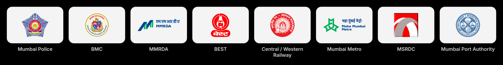</p>
<p align="center"><b>Live on open public data</b><br/>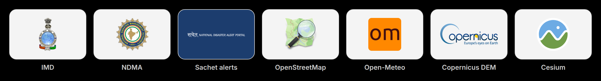</p>
<p align="center"><b>The vehicles it works with, and the events it handles</b><br/>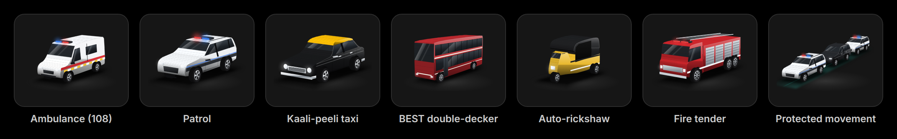<br/>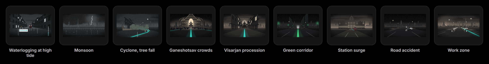</p>
<p align="center"><b>The city it watches over</b> (reference photos, Wikimedia Commons, credited in <a href="services/command-deck/static/photos/NOTICE.md">photos/NOTICE.md</a>)<br/>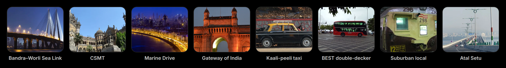</p>
<p align="center"><sub>Agency and source marks belong to their owners; Sajag is a prototype, not affiliated with or endorsed by them (<a href="services/command-deck/static/logos/NOTICE.md">details and licences</a>). Vehicle and event art is Sajag's own, with no plates or people.</sub></p>

<p align="center">
  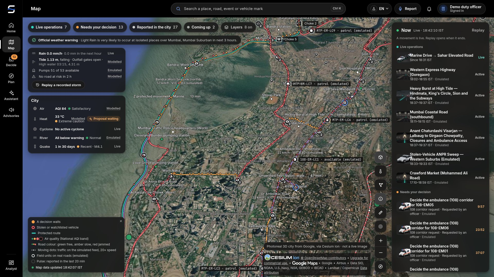<br/>
  <sub>The live map: roads coloured by load with moving traffic (simulated), the evening's events (simulated), field units on real roads (emulated) and live rain, the modelled tide and city feeds, over Google's photoreal 3D city (not a live image).</sub>
</p>

<p align="center">
  <a href="#what-sajag-is">What it is</a> ·
  <a href="#for-reviewers">For reviewers</a> ·
  <a href="#the-ai-stack">AI stack</a> ·
  <a href="#state-of-the-art-open-and-on-premises">State of the art</a> ·
  <a href="#the-screens">Screens</a> ·
  <a href="#quick-start">Quick start</a> ·
  <a href="#environment-variables">Environment</a> ·
  <a href="#the-city-pack-a-city-is-a-folder">City Pack</a> ·
  <a href="#tests">Tests</a> ·
  <a href="#documentation">Docs</a> ·
  <a href="#licence-and-credits">Licence</a>
</p>

---

## What Sajag is

**Sajag** (सजग, Hindi and Marathi for "alert, watchful") is a city-scale traffic, rain and crowd operations platform
for Mumbai.

Mumbai is a narrow island city and its suburbs, wedged between the Arabian Sea, Thane Creek and the Mithi river.
Each monsoon, a heavy burst that arrives at high tide finds the sea outfalls shut, and the water has nowhere to go.
The same low spots go under: Hindmata, Milan Subway, Andheri Subway, King's Circle, Sion, Kurla, Parel. Subways and
roads close, local trains stop at Sion and Kurla, and lakhs of commuters pour onto the roads and station forecourts
at once. In the BMC's own words, waterlogging is unavoidable when about 300 mm falls in a short span and meets a
4.5 m tide (BMC chief engineer, *Free Press Journal*, 2025). The BMC counts hundreds of known flooding spots: 386 to
498, depending on the year and the count (*Free Press Journal*). On dry days the city still loses about 126 hours a
year per commuter to peak-hour traffic (TomTom Traffic Index 2025), and on visarjan night lakhs walk from Lalbaug
to Girgaon Chowpatty.

Each agency sees one piece: Mumbai Traffic Police the roads, the BMC the drains, the pumps and its 1916 disaster
control, the railways the tracks, the ambulance (108) service its crews, IMD the rain. Nobody holds **one live
picture** that joins rain, tide, pumps, traffic and crowds and says what to do in the next 30 to 90 minutes. Sajag
puts the pieces on one screen:

- **Waterlogging, ahead of time.** Rain (live), the Arabian Sea tide at Apollo Bunder (modelled; it decides when the
  outfalls shut), BMC pumping-station status (emulated until access is granted) and terrain, combined into a
  depth-risk class for every arterial road and subway with a lead time. Replayed on a recorded Mumbai storm
  (18–19 August 2025): with the rain gauges' observed totals, the model flagged 9 of the 12 places reported flooded on its network (King's Circle, Andheri Subway, Gandhi Market, Byculla, Dadar TT, Vile Parle, Hindmata, Chembur, Kurla by the Mithi) and missed Sion, Khar and Goregaon. Its own flag came after the first news report at most places (median 51 minutes late: the bucket model fills slowly); with the observed rain as a perfect 2-hour nowcast (hindsight) it would have led the first report at 8 of the 9 (median 69 minutes). The Open-Meteo archive carried a third of the gauges' rain and flagged nothing, which is the case for a live rain-gauge feed. A second replay, 26 May 2025, flagged 5 of 15 reported places.
- **Traffic, two hours ahead.** Forecasts with uncertainty bands for every road, and a pre-emptive diversion
  proposal when a road is about to choke: move Western Express Highway traffic before Andheri Subway closes.
- **Signal timing, tested before it is touched.** Every proposed change is simulated across the whole network
  against doing nothing; if it would only move the jam, the answer is "hold".
- **Voice in Marathi, Hindi and English.** An officer speaks a report and it becomes a structured, unverified field
  report. Advisories are read aloud to citizens in all three languages.
- **Camera stills, read for the road.** Waterlogged subway, blocked road, tree fall, stalled BEST bus: vehicles and
  roads only, never people.

<table>
<tr>
<td width="50%" valign="top">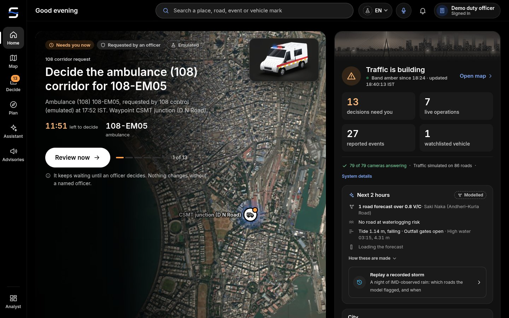<br/><sub><b>Home.</b> What needs an officer now, the city's band and four counts, and the next two hours with the tide (modelled).</sub></td>
<td width="50%" valign="top">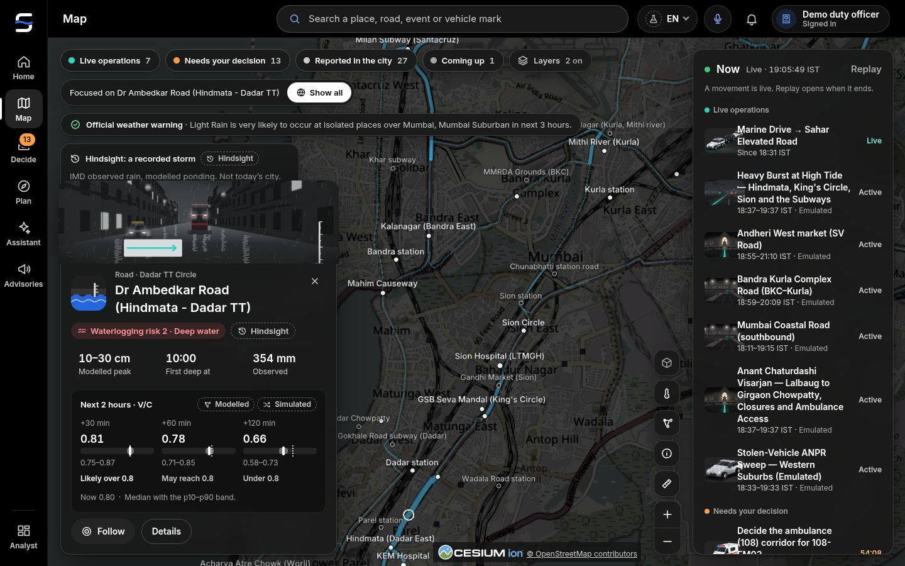<br/><sub><b>Map: waterlogging.</b> A recorded Mumbai storm replayed: roads and subways by risk class, a road's depth band and when it went deep (Hindsight, MODELLED).</sub></td>
</tr>
</table>

Every output is a **proposal**. A **named duty officer** approves or rejects it; if nobody answers, the current plan
holds. Everything runs on **one on-premises server** with open-source AI and no cloud, so it keeps working when a
cyclone or a flooded exchange cuts the internet. Anything that is not from a live feed says so: **EMULATED**,
**SIMULATED**, **MODELLED**, or "Reference photo · not live".

Four of the rules, on screen:

<table>
<tr>
<td width="50%" valign="top">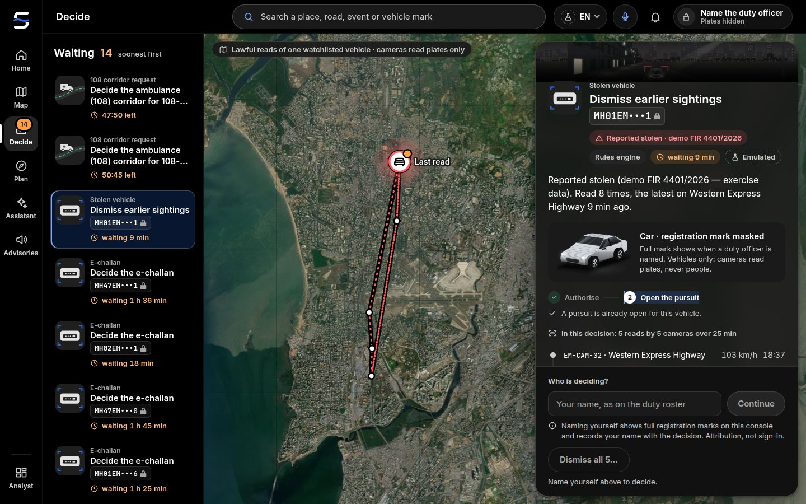<br/><sub><b>Decide: the mark masked until an officer is named.</b> No officer named: the MH mark is masked and every button waits for a name.</sub></td>
<td width="50%" valign="top">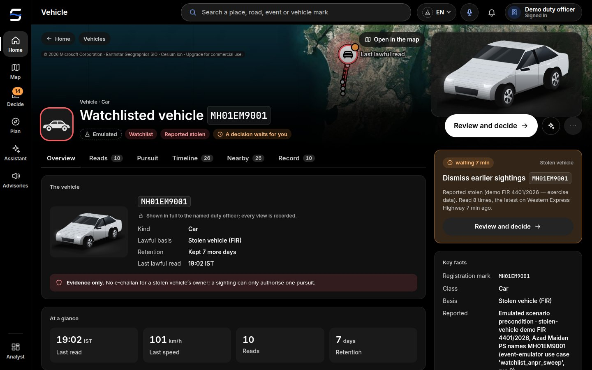<br/><sub><b>A vehicle's page.</b> The stolen exercise vehicle: its lawful basis and retention, and evidence only: no e-challan for its owner.</sub></td>
</tr>
<tr>
<td width="50%" valign="top">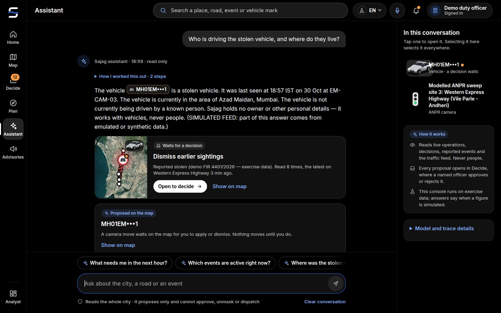<br/><sub><b>Assistant: vehicles, never people.</b> Asked about the driver, it answers about the vehicle only: no owner or personal details exist.</sub></td>
<td width="50%" valign="top">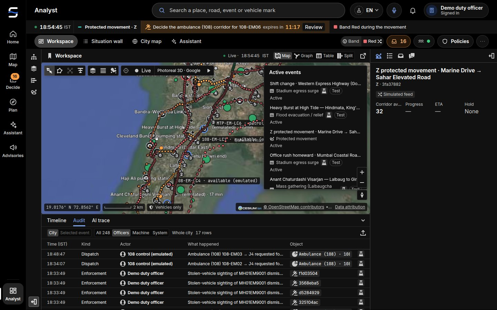<br/><sub><b>Audit trail.</b> Every action with its time, actor and object; filters for officers, machines and the system.</sub></td>
</tr>
</table>

**Where it stands today.** Sajag is a working prototype on one server. Mumbai's roads (OpenStreetMap: 72
junctions and 86 road segments, 202 km, from the Island City to the airport and the Eastern
Suburbs), the rain nowcast, the city feeds, every decision and its audit trail, and the AI models are real. The tide
is a harmonic model of Apollo Bunder (MODELLED). **Traffic is simulated until real Mumbai traffic is recorded**; BMC
pumps and sensors, Mumbai Traffic Police signal controllers and ANPR reads, field units and rail running status are
emulated stand-ins for feeds that need an agency's access. The full list is in
[PRODUCT.md §12](PRODUCT.md#12-honest-status).

### Who it serves

| Audience | What they get |
|---|---|
| **Mumbai Traffic Police duty officer** | One queue of decisions, each with its reason, its modelled effect and its labels; diversions before a subway closes; movement planning with rolling holds; voice reports in Marathi, Hindi or English |
| **BMC disaster control (1916), storm-water drains and Maharashtra SDMA** | Rain, tide, pumps and waterlogging risk by road and subway, with lead times; pump and dewatering requests as proposals; advisory drafts in English, Marathi and Hindi |
| **Ambulance (108) crews** | A one-tap corridor request towards KEM, Sion, JJ or Nair hospital, and "ambulance windows" through waterlogged roads |
| **BEST** | Which routes to hold or divert before water reaches a road, as proposals for a named officer |
| **Citizens** | "Check your road" in English, Marathi or Hindi, with a Listen button; no sign-in, no location |

<table>
<tr>
<td width="50%" valign="top">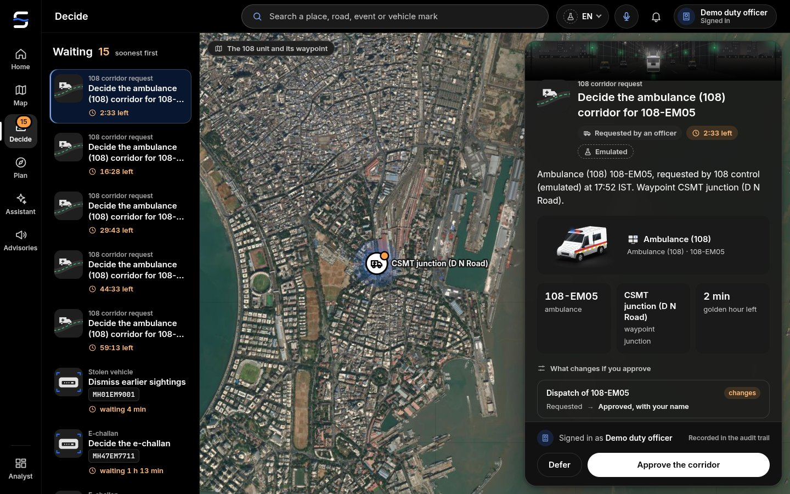<br/><sub><b>Decide: a 108 corridor request.</b> A 108 crew's corridor request: the golden hour left and what changes if approved, for a named officer.</sub></td>
<td width="25%" valign="top">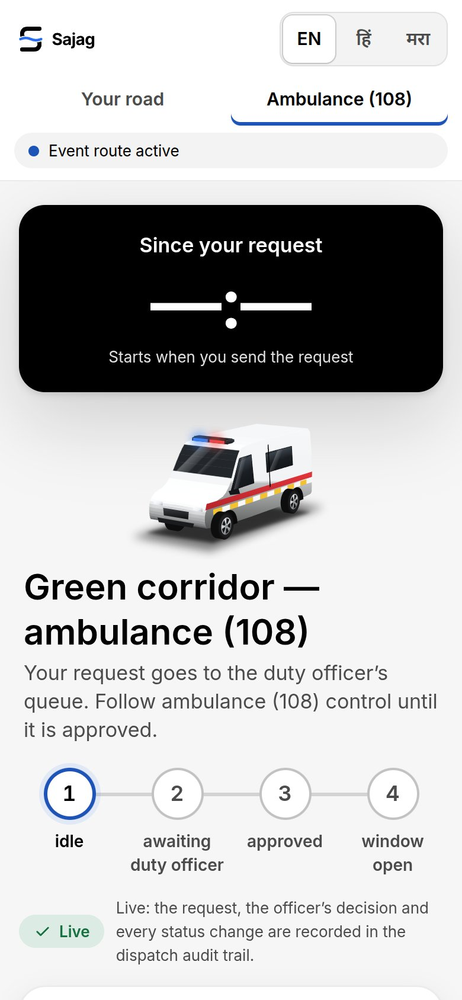<br/><sub><b>Ambulance (108) crew.</b> One request for a corridor window, its four steps; a duty officer decides.</sub></td>
<td width="25%" valign="top">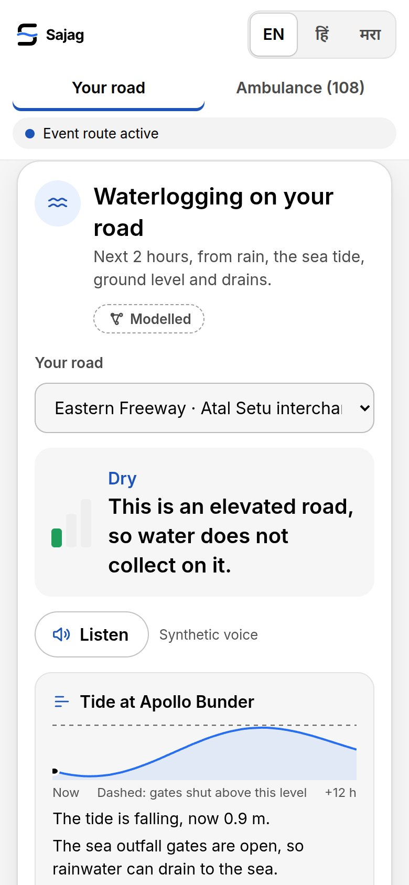<br/><sub><b>Citizen.</b> Check your road: the status in plain words (modelled), Listen, the tide at Apollo Bunder; no sign-in, no location.</sub></td>
</tr>
</table>

### Everything it does

Beside the AI above, Sajag carries a full city-operations platform. Every row runs on the Sajag stack today, with
its label:

| Capability | What it does in Mumbai | Status |
|---|---|---|
| Rain × tide nowcast | Depth-risk class and lead time for every arterial and subway (Hindmata, Milan Subway, Andheri Subway, King's Circle, Sion, Kurla by the Mithi); reroute, ambulance window, pump request and advisory proposals | Rain LIVE; tide MODELLED; pumps EMULATED; risk MODELLED |
| Movement planning | Routes for a protected movement (for example Mantralaya → Mumbai Airport T2 over Marine Drive, the Coastal Road and the Sea Link) checked against the protection class's lane floor (Z+, Z, Y, X), with a closure and detour plan for each road | Real engine; traffic SIMULATED |
| Rolling holds and escort | Roads close 60–180 s ahead of the convoy and reopen behind it, never a blanket freeze; any change of plan (a hold, the alternate, a re-route) is one proposal a named officer approves; no answer in 90 s and the plan holds | Real engine; convoy GPS EMULATED |
| Corridor events | One engine for protected movements, Ganeshotsav crowds, the Anant Chaturdashi visarjan (Lalbaug → Girgaon Chowpatty; Juhu, Dadar Chowpatty), Wankhede Stadium egress, the Mumbai Marathon, New Year on Marine Drive, waterlogging evacuations, station surges when locals stop (CSMT, Dadar, Kurla, Andheri), work zones and the stolen-vehicle sweep | Real engine; scenarios SIMULATED |
| Situation bands and city signal plans | GREEN / AMBER / RED / BLACK for each movement and event, with protocol floors and hysteresis; a band-driven green-split plan that refuses to write until the twin is calibrated on field data | Real, gated; no field controller connected |
| Stolen-vehicle chain | FIR earmark → camera reads of an MH mark → evidence (never a fine for the theft victim) → a named officer's approval → one pursuit → interception choke points | Real rules and audit; ANPR reads EMULATED |
| E-challan support | Speed, signal and closed-corridor rules file recommendations that wait for an officer | Real rules; reads EMULATED |
| Dispatch | Mumbai Traffic Police, Mumbai Police control, ambulance (108), Mumbai Fire Brigade, BMC disaster control: request → approved → en route → on scene → completed | Real records; units EMULATED, no CAD link |
| Ambulance (108) green corridor | A crew's one-tap request; a named officer approves; a timed window opens ahead of the ambulance | Real flow |
| Event intelligence | Official alerts (IMD, NDMA Sachet for Maharashtra), Mumbai Traffic Police notices, Mumbai news in Marathi, English and Hindi and aggregate social signals become redacted situations at places with a credibility score: road, crowd, weather, hazard, closure and service situations only (crime reports, clashes and politics are dropped); only an officer promotes one to an event | Real when enabled |
| Decision support | Ranked courses of action (monitor, advisory, standard response, closure, verify first), each tested on the twin | Real engine; outputs MODELLED |
| Assistant | Grounded, read-only answers about the live picture; proposals arrive as cards | Real, local models |
| Advisories | One fact for citizens, zone officers, ambulance control and the BMC, in English, Marathi and Hindi, drafted for an officer to send | Real drafts; not delivered |
| City feeds | Air (CPCB stations through OpenAQ), heat (Santacruz and Colaba), Arabian Sea cyclones (GDACS), earthquakes, satellite fire hotspots (NASA FIRMS) | LIVE, each with its label |
| 3D city | Photoreal Mumbai with the live picture on it; thermal-style view, measure, follow, replay of recorded runs | Imagery not live; overlays real or labelled |
| Audit, operator gate and privacy | Every decision with the officer's name; PIN sign-in; plates masked until an officer is named; camera reads kept 30 days (a watchlisted vehicle's up to 90) | Real |

The full product description, with Mumbai's problems and their sources, the journeys, every screen, the modelled
impact, the cost and the pilot plan, is [`PRODUCT.md`](PRODUCT.md).

<table>
<tr>
<td width="50%" valign="top">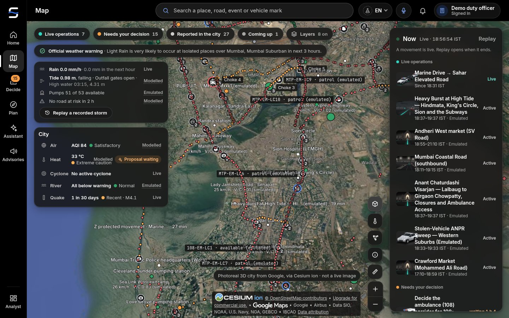<br/><sub><b>A protected movement on the map.</b> Mantralaya → T2 live on the map: its route, the emulated convoy and units, Follow and Details.</sub></td>
<td width="50%" valign="top">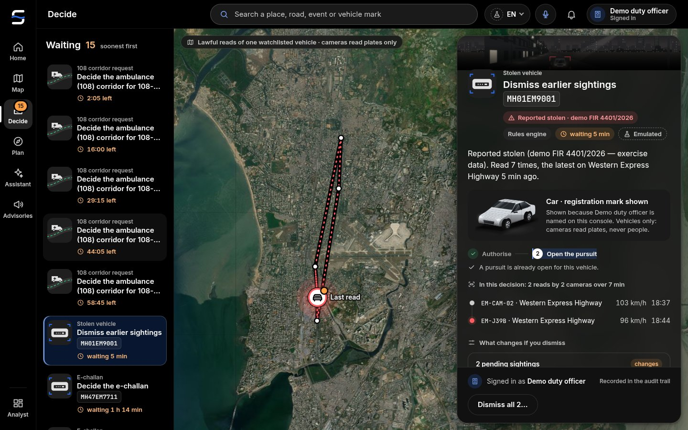<br/><sub><b>Decide: the stolen-vehicle chain.</b> Authorise, then Open the pursuit as a separate decision; the reads on the map (emulated ANPR); vehicles only.</sub></td>
</tr>
<tr>
<td width="50%" valign="top">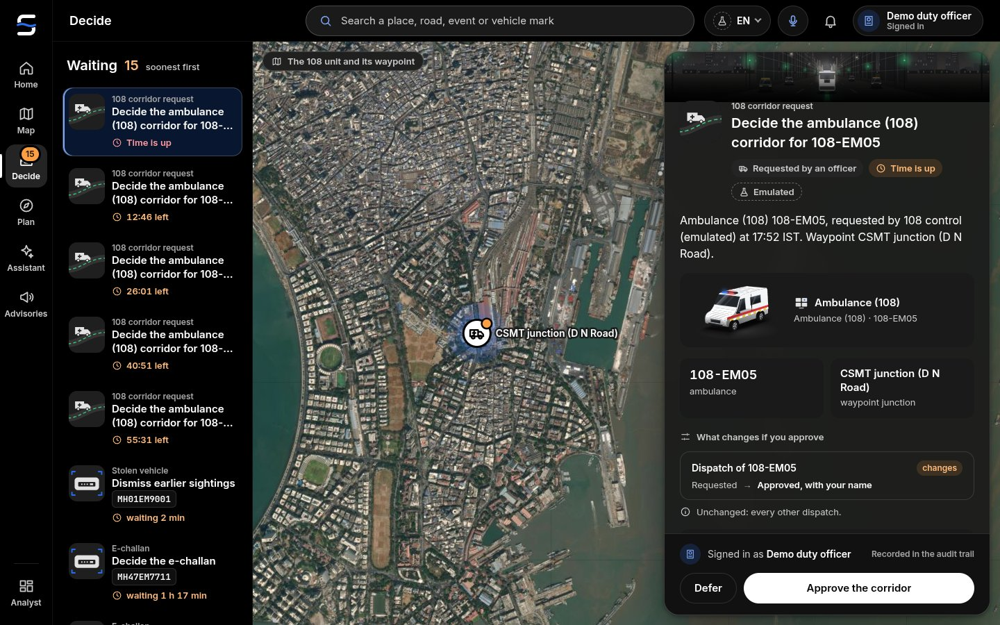<br/><sub><b>Decide: choose a response.</b> Ranked responses, the recommended one first (MODELLED); approval only creates dispatch requests.</sub></td>
<td width="50%" valign="top">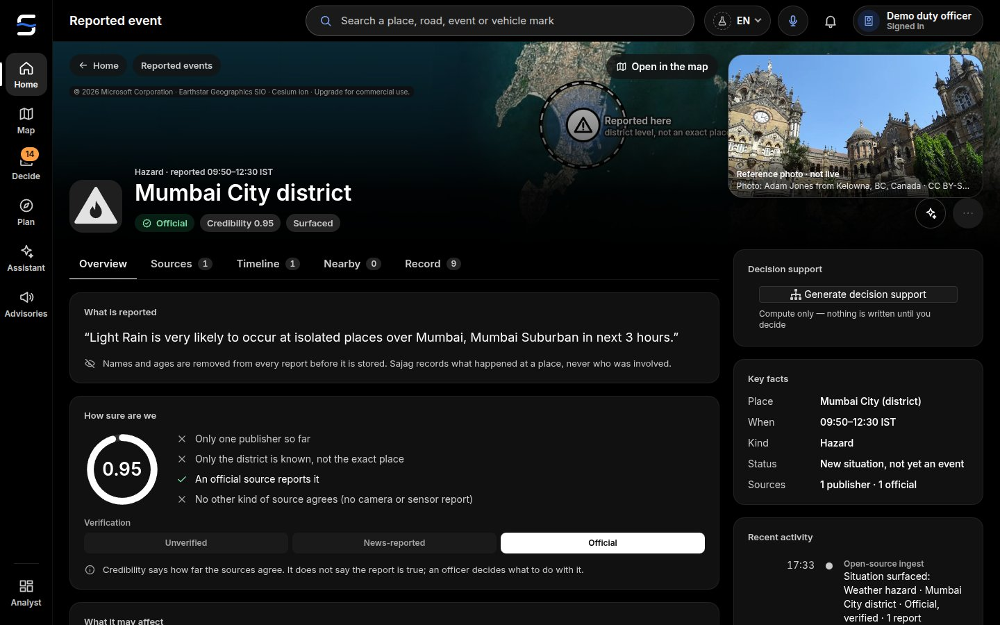<br/><sub><b>A reported situation.</b> An official traffic notice as a situation at a place, with how sure we are; names are removed before storage.</sub></td>
</tr>
<tr>
<td width="50%" valign="top">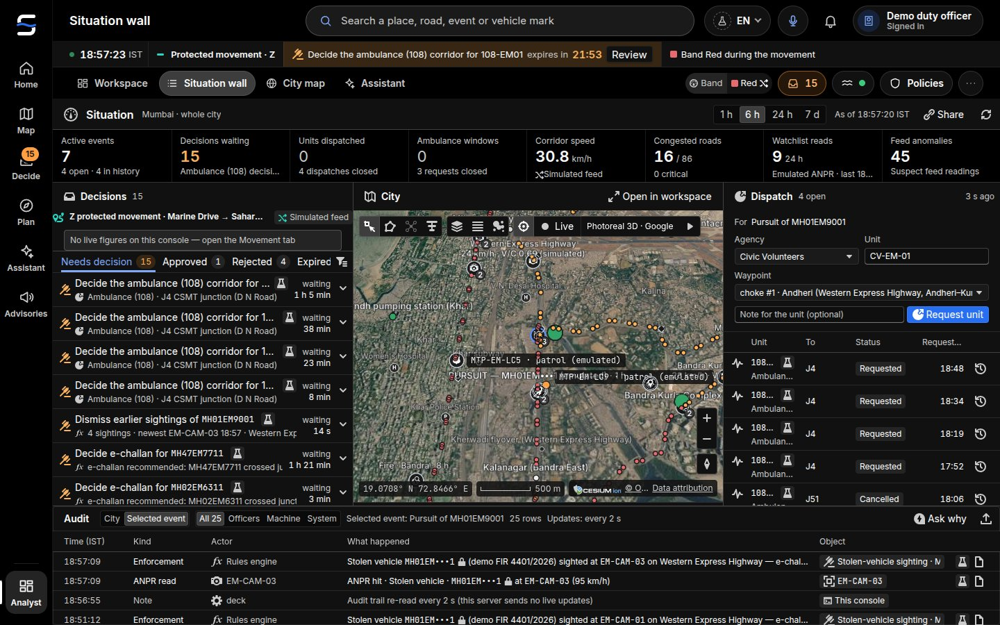<br/><sub><b>Dispatch and the live band.</b> The live band while a movement runs, and Dispatch: one request per unit, each with its status (emulated units).</sub></td>
<td width="50%" valign="top">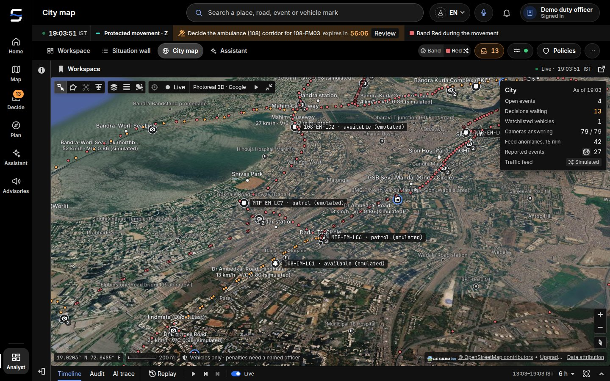<br/><sub><b>Analyst city map.</b> The analysts' 3D city with its vitals; roads simulated, units emulated, imagery not live.</sub></td>
</tr>
</table>

---

## For reviewers

This repository is the supporting evidence for Sajag's proposal for Mumbai. The two tables below point each section
of the proposal, and each question a reviewer is likely to ask, to the place in this repository where it is
answered.

**The proposal, section by section**

| # | Section | In one line | Evidence in this repository |
|---|---|---|---|
| 1 | The problem | Mumbai: a heavy burst at high tide shuts the sea outfalls and the same low spots flood (BMC: 386–498 known spots, by year); locals stop and about 68 lakh daily suburban riders spill onto roads; about 126 h a year lost to peak traffic; visarjan nights; protected movements; ambulances stuck in all of it | [PRODUCT §2](PRODUCT.md#2-the-mumbai-problems) (each problem with its source); [Mumbai's drainage in sourced numbers](docs/ai/hydro.md#mumbais-drainage-in-sourced-numbers); [the recorded storms](docs/ai/hydro.md#replay-a-recorded-mumbai-storm) |
| 2 | Solution and innovation | One live picture for the traffic police, the BMC and 1916, Maharashtra SDMA, 108 crews, BEST and citizens; a tide-aware waterlogging nowcast; every signal change tested in a twin first; Marathi, Hindi and English voice; the AI proposes, a named officer decides | [What Sajag is](#what-sajag-is); [PRODUCT §1](PRODUCT.md#1-sajag-in-brief), [§5 Journeys](PRODUCT.md#5-journeys), [§6 every screen](PRODUCT.md#6-the-interface-screen-by-screen); [the AI stack](#the-ai-stack); [state of the art](#state-of-the-art-open-and-on-premises) |
| 3 | Feasibility and implementation | Built and running on one on-premises server; agreements → 3 months in shadow mode → officer-approved live through one monsoon and one Ganeshotsav in the Dadar – Parel – Matunga – Sion division → evaluation; pilot about ₹45–55 lakh, ₹0 software licences | [PRODUCT §9.1 Cost](PRODUCT.md#91-cost-estimates-2026-prices), [§9.2 Pilot plan](PRODUCT.md#92-pilot-plan); [Quick start](#quick-start); [technical design](docs/TECHNICAL_DESIGN.md); [data sources: live, keyed, emulated or modelled](docs/DATA_SOURCES.md) |
| 4 | Impact and scalability | MODELLED: rolling holds instead of a blanket freeze cut junction delay about 100× (range 25–506×); on Mantralaya → T2, 192,820 → 1,928 commuter-minutes per movement. A city is a folder: Thane, Navi Mumbai, Pune, Nagpur and Nashik are next | [PRODUCT §8](PRODUCT.md#8-modelled-impact); [`IMPACT_REPORT.md`](IMPACT_REPORT.md) with its assumptions ledger; [PRODUCT §9.3](PRODUCT.md#93-scale-a-city-is-a-folder); [the City Pack](#the-city-pack-a-city-is-a-folder) |
| 5 | Team and support | Built by its author on owned hardware at his own cost; seeking a pilot with Mumbai Traffic Police and the BMC, data access and pilot funding | [Licence and credits](#licence-and-credits); [PRODUCT §9.2](PRODUCT.md#92-pilot-plan) |
| — | Readiness and evidence | A working prototype: 6,443 Python and 121 Rust tests green, 69 acceptance gates, evaluations with their raw results, a replay of a recorded Mumbai storm, sample API answers captured on Mumbai | [Tests](#tests); [48 test cases](docs/SAMPLE_DATA_AND_TESTS.md); [sample API answers](docs/samples/); [evidence PDF](docs/evidence/Sajag_Evidence.pdf); [deck](docs/deck/Sajag_Deck.pdf) |

**Questions a reviewer is likely to ask**

| Question | Evidence |
|---|---|
| Is the problem real, and Mumbai's own? | Sourced Mumbai problems ([PRODUCT §2](PRODUCT.md#2-the-mumbai-problems)); the model replayed on a recorded Mumbai storm ([hydro](docs/ai/hydro.md#replay-a-recorded-mumbai-storm)) |
| What is new? | A waterlogging nowcast that knows when the outfalls shut; every signal change tested in a traffic twin before an officer sees it; Marathi, Hindi and English voice in and out; newest open models chosen by measurement ([State of the art](#state-of-the-art-open-and-on-premises); [design decisions](docs/TECHNICAL_DESIGN.md#17-architecture-decision-records)) |
| Is it practical? | Reuses existing CCTV, control rooms and the BMC's own sensors; one server beside the control room; works offline ([PRODUCT §4](PRODUCT.md#4-principles-and-guardrails), [§9.1](PRODUCT.md#91-cost-estimates-2026-prices)) |
| Does it work? | Built and running: 69 automated gates green ([Tests](#tests)); measured AI results ([`docs/ai/`](docs/ai/)); [technical design](docs/TECHNICAL_DESIGN.md) |
| What does it cost? | Pilot about ₹45–55 lakh; running cost after scale-up about ₹40–60 lakh a year; no per-camera, per-user or cloud fees ([PRODUCT §9.1](PRODUCT.md#91-cost-estimates-2026-prices)) |
| Can it be implemented? | A phased pilot with named data needs ([PRODUCT §9.2](PRODUCT.md#92-pilot-plan)); every outside source marked live, keyed, emulated or modelled ([`DATA_SOURCES.md`](docs/DATA_SOURCES.md)); every setting documented ([`ENVIRONMENT.md`](docs/ENVIRONMENT.md)) |
| What will change? | MODELLED, with every assumption listed and a script to re-run ([PRODUCT §8](PRODUCT.md#8-modelled-impact), [`IMPACT_REPORT.md`](IMPACT_REPORT.md)); no claim of lives saved |
| Will it last? | Open models on owned hardware, MIT code, no data leaves the server; a named officer accountable for every action; honest labels ([ADR-01](docs/TECHNICAL_DESIGN.md#adr-01--all-ai-runs-on-premises), [ADR-09](docs/TECHNICAL_DESIGN.md#adr-09--the-ai-proposes-a-named-officer-decides-no-answer-means-the-plan-holds)) |
| Will it scale? | City Pack plus `scripts/city_build.py`; a test builds two cities ([PRODUCT §9.3](PRODUCT.md#93-scale-a-city-is-a-folder)) |
| Can the evidence be trusted? | Every figure carries its date and source; raw evaluation files are committed (for example [`services/speech/eval/`](services/speech/eval/), [`services/vision/eval/results.json`](services/vision/eval/results.json)); limits stated ([design §18](docs/TECHNICAL_DESIGN.md#18-known-limitations), [known gaps](docs/SAMPLE_DATA_AND_TESTS.md#part-4--known-gaps)) |

---

## The AI stack

Every model runs on the one on-premises server. The operator downloads the weights once and they are served
offline; none is in this repository.

| Capability | Model | Licence | What it does | Honest label |
|---|---|---|---|---|
| Corridor forecasting | **Chronos-2** (`amazon/chronos-2`); TimesFM 2.5 as second contender; seasonal-naive baseline | Apache-2.0 | Speed and V/C for every road 15–120 min ahead with p10–p90 bands; a diversion proposal when the median crosses 0.8 | "Forecast on simulated traffic" until real Mumbai traffic is recorded |
| Waterlogging nowcast | No ML: a conceptual ponding model (rain × tide × pumps × terrain) | — | Depth-risk class 0–3 per road and subway with lead time; reroute, ambulance window, pump request, live-wire request, advisory in English, Marathi and Hindi | rain LIVE · tide MODELLED · pumps EMULATED · risk MODELLED |
| Speech recognition | AI4Bharat **IndicConformer 600M** (`ai4bharat/indic-conformer-600m-multilingual`) for Marathi and Hindi; `openai/whisper-large-v3-turbo` for English, with Mumbai's place names as a prompt | MIT; MIT | A spoken field report → place, kind, severity | UNVERIFIED-FIELD until an officer confirms |
| Speech synthesis | AI4Bharat **Indic Parler-TTS** (`ai4bharat/indic-parler-tts`; Marathi voices Sunita and Sanjay); Svara-TTS v1 with the SNAC 24 kHz codec answers while it cannot load | Apache-2.0; Apache-2.0 and MIT | Advisories read aloud in Marathi, Hindi or English | "Synthetic voice" |
| Road-state vision | **Qwen3-VL-8B-Instruct** (Q4_K_M GGUF on llama.cpp) | Apache-2.0 | A camera still → waterlogged, blocked, tree fall, stalled vehicle, crash debris, congested or clear | UNVERIFIED-CAMERA; person and plate questions refused |
| Signal-timing proposals | A cell-transmission traffic twin with Webster and max-pressure baselines; the local LLM only words the rationale | — | Tests each candidate timing against doing nothing over the whole network | MODELLED; demand SIMULATED |
| Assistant and decision AI | A 27B decider model (`pplx-decider-v1.2`) asked typed questions; a Gemma 4 12B fine-tune (Q4_K_M) for drafting; `pplx-embed-context-v1-4b` and `pplx-embed-v2-late-0.6b` for memory, `PII-Tracer` for personal details in news | Apache-2.0 (decider, Gemma 4), MIT (embeddings, PII-Tracer) | Answers about the live picture, plans movements, checks every claim against tool results | Labels per answer; cannot approve |

How each model was chosen, evaluated and limited: [`docs/ai/`](docs/ai/). Licences and attributions for everything
third-party: [`THIRD_PARTY_NOTICES.md`](THIRD_PARTY_NOTICES.md).

<table>
<tr>
<td width="50%" valign="top">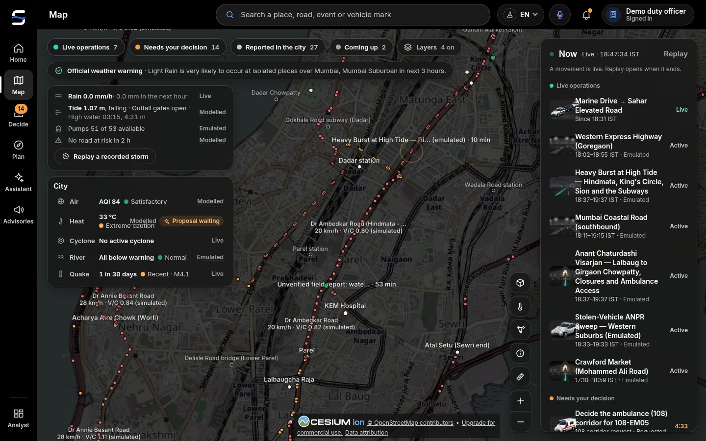<br/><sub><b>Map: a road's forecast.</b> A road's card: waterlogging now (modelled) and its two-hour V/C band against 0.8 (simulated traffic).</sub></td>
<td width="50%" valign="top">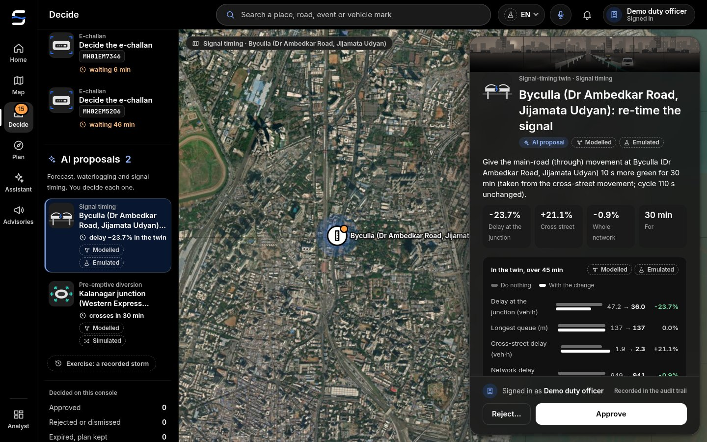<br/><sub><b>Decide: signal timing.</b> A signal change tested in the twin against doing nothing, the cross street's cost shown too (MODELLED).</sub></td>
</tr>
<tr>
<td width="50%" valign="top">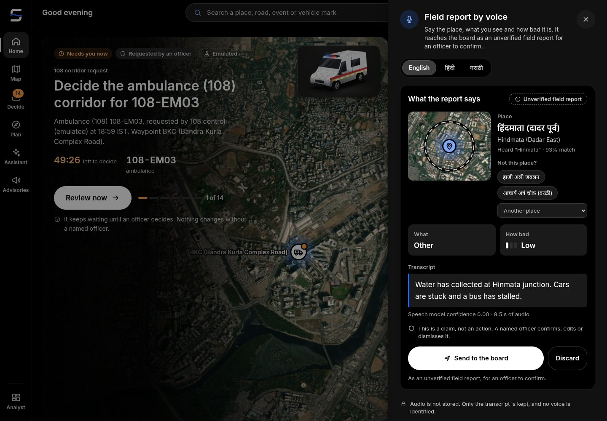<br/><sub><b>Field report by voice.</b> Speech becomes place, kind and severity with the words that decided it; unverified until an officer confirms.</sub></td>
<td width="50%" valign="top">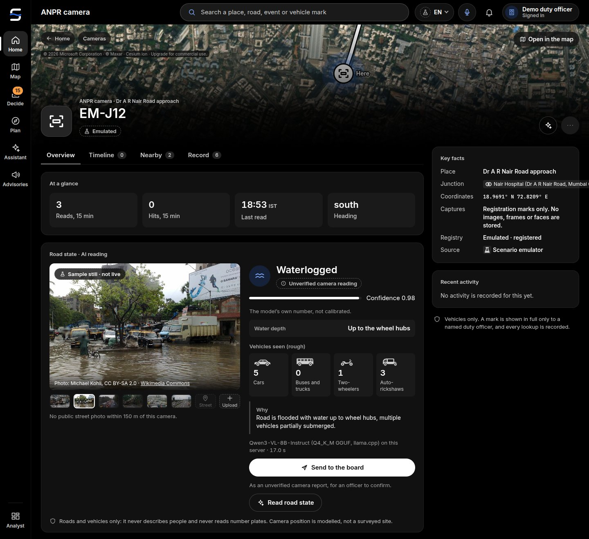<br/><sub><b>Road state from a still.</b> A still read on the server as a road state with a depth band, unverified until an officer confirms.</sub></td>
</tr>
<tr>
<td width="50%" valign="top">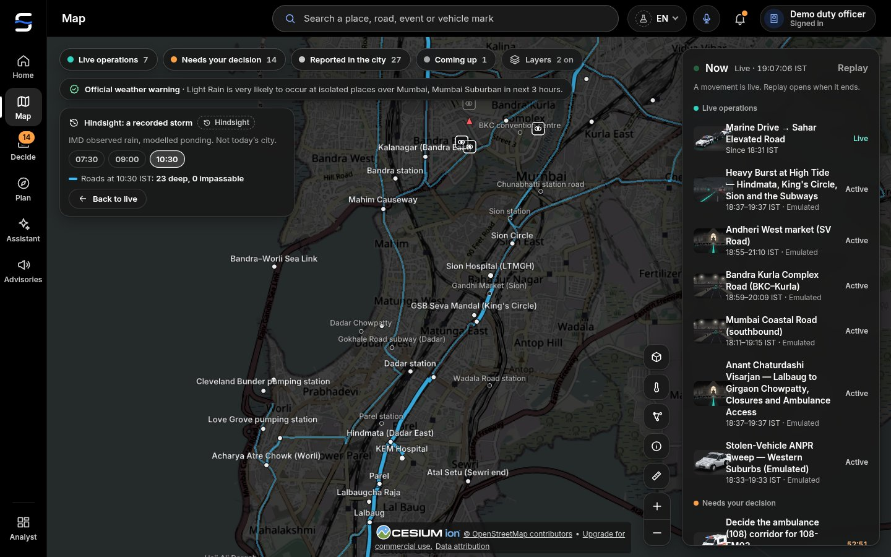<br/><sub><b>Replay of 18–19 August 2025.</b> The storm step by step: observed rain, the modelled tide and ponding, the roads and subways flagged.</sub></td>
<td width="50%" valign="top">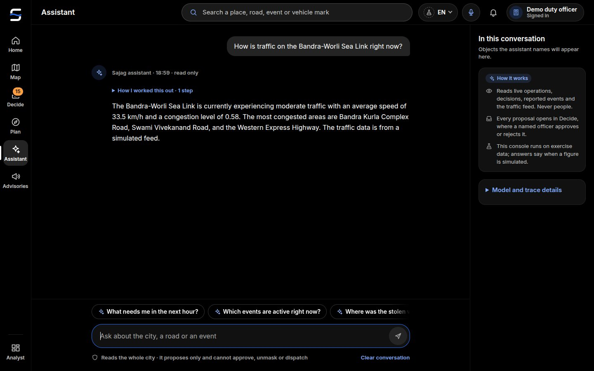<br/><sub><b>Assistant.</b> A grounded, read-only answer that says its traffic is synthetic; it cannot approve, unmask or dispatch.</sub></td>
</tr>
</table>

---

## State of the art, open and on premises

Sajag uses the newest open models that fit on one server beside the control room, and adopts each one only after
measuring it against what it would replace. Nothing is sent to a cloud service. The results below are Sajag's own
measurements. Where a result was measured on Mumbai, the row says so; a few were measured on the Kolkata reference
pack (the second City Pack, kept in [`cities/kolkata/`](cities/kolkata/)) and wait for their Mumbai re-run, and say
that instead. Where the data is synthetic or simulated, the row says so too.

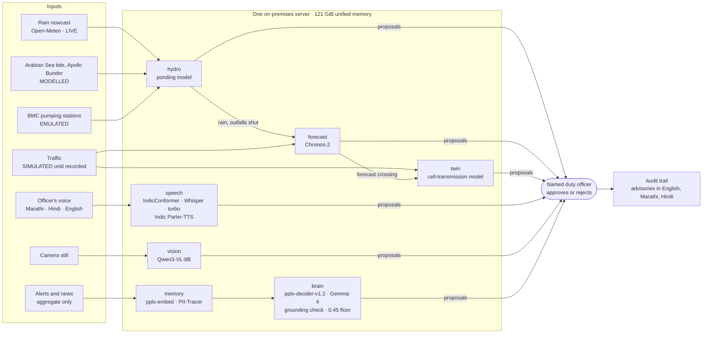

### Models

| Model | Released¹ | What is new in it | How Sajag uses it | Measured on Sajag's data |
|---|---|---|---|---|
| **Chronos-2** (Amazon) | Oct 2025 | A forecasting foundation model (about 120 M parameters) that forecasts series it was never trained on (zero-shot) and takes known future covariates | Speed and V/C for every Mumbai road, 15–120 min ahead, p10/p50/p90; rain, outfall closure at high tide and events (Ganeshotsav, visarjan, Wankhede) as covariates; a diversion proposal when the median crosses 0.8 | Mumbai: not yet re-run on Mumbai's network. On the Kolkata reference pack: MAE 0.0429 V/C against 0.0952 for the seasonal baseline (+54.9 % skill), p10–p90 coverage 0.797 (target 0.80), 780 series. **Simulated traffic** in both ([forecast](docs/ai/forecast.md#backtest)) |
| **TimesFM 2.5** (Google), second contender | Sep 2025 | A 200 M-parameter zero-shot forecaster | Run beside Chronos-2 in every backtest | Reference pack: MAE 0.0443, coverage 0.813, +53.5 % skill (univariate: its covariate path needs JAX) |
| **Qwen3-VL-8B-Instruct** (Qwen) | Oct 2025 | An open vision-language model that reads a scene at 8 B parameters | Reads a camera still as a road state with a depth band judged against wheels and kerbs; Q4_K_M on llama.cpp with JSON-schema-constrained output | 11 of 12 credited photos right, 10 of them taken in Mumbai; all 11 person, plate and road probes passed (English, Marathi, Hindi); median 5.1 s warm ([vision](docs/ai/vision.md#evaluation-28-oct-2026-real-model)) |
| **IndicConformer 600M** (AI4Bharat) | Mar 2025 | One open speech recogniser for 22 Indian languages, trained on Indian speech | Turns an officer's spoken Marathi or Hindi report into place, kind and severity, always UNVERIFIED-FIELD; runs on the CPU, so it takes no GPU memory | Mumbai field reports (synthetic voices): Marathi WER 7.1 %, place right in 56 of 56; Hindi WER 14.0 %, place 50 of 52 ([speech](docs/ai/speech.md#evaluation)) |
| **whisper-large-v3-turbo** (OpenAI) | Oct 2024 | A faster large Whisper (0.81 B) | English reports and language detection, with Mumbai's place names as a decoder prompt | English: WER 10.2 %, place 47 of 52 with the prompt |
| **Indic Parler-TTS** (AI4Bharat) | Oct 2024 | Open speech synthesis for Indian languages, the voice set by a plain-text description | Reads approved advisories aloud in Marathi (Sunita, the house voice), Hindi and English, every voice levelled to one loudness | Advisories approved by a listener; slower than real time on the shared GPU, so advisories are synthesised ahead and cached ([speech](docs/ai/speech.md#the-29-oct-gated-round-indicconformer-and-indic-parler-tts)) |
| **Svara-TTS v1**, fallback | Oct 2025 | One open model for Marathi, Hindi and Indian English, male and female voices | Answers whenever Parler cannot load; Q8_0 GGUF on llama.cpp | 6.8 s per short advisory on llama.cpp against 16.5 s on transformers |
| **pplx-decider-v1.2** (Perplexity) | Oct 2026 | A 27 B fine-tune of Qwen that answers **typed questions** (a choice, a probability, a score) with calibrated confidence, every question of a request read in one pass | The brain's strategic tier: courses of action, checkpoints, tool choice; its answers are proposals | Reference pack's request set: 22 of 26 labelled decisions; p50/p95 739/1,048 ms against 1,292/2,098 ms for v1-27b; share held back for an officer 0.43 against 0.60 ([decider](docs/ai/decider.md)). Mumbai: not yet re-run on the Mumbai scenarios |
| **Gemma 4 12B** (Google), tuned | May 2026 | Google's open 12 B model, now under Apache-2.0 (Gemma 3 was under Google's own terms) | The tactical tier: drafts tool arguments against each tool's schema and words answers and the twin's rationales | 7.3 GiB resident (Q4_K_M, 2 × 8k slots); a rationale in about 7 s, every number checked against the twin |
| **pplx-embed-context-v1-4b** (Perplexity) | Jan 2026 | Contextual (late-chunking) embeddings, cut to 1,024 values (Matryoshka) | Finds the SOP paragraph that answers a question in any of the three languages; clusters headlines in Marathi, Hindi and English about one event | Reference set: SOP recall@1 0.94 against 0.70 for bge-m3; headline dedup F1 0.86 against 0.26 at the old threshold. **Synthetic set** ([embeddings](docs/ai/embeddings.md#results)) |
| **pplx-embed-v2-late-0.6b** (Perplexity) | Aug 2026 | Late-interaction (ColBERT-style) embeddings, 128 values per token | Decision memory: "have we seen this situation before?" before the brain trusts a confident answer | Memory recall@1 0.98; the brain's novelty and cache floors are calibrated on its scale |
| **PII-Tracer** (Perplexity) | Jul 2026 | A ~600 M bidirectional encoder that tags personal details in text | A second check on news text, after the rules: names are redacted, places kept (Dr Ambedkar Road and Acharya Atre Chowk are places, not people) | Reference set: person recall 0.84 → 0.94 added to the rules; 0 of 122 place names redacted. Off by default ([PII-Tracer](docs/ai/embeddings.md#pii-tracer-parse-time-pii-check-defence-in-depth)) |

¹ The month the model's Hugging Face repository was created, read from the Hub.

### Methods

| Method | What it is | How Sajag uses it | Measured |
|---|---|---|---|
| **Several models on one GPU, loaded on demand** | Resident models stay loaded; the rest load on first use, unload when idle and refuse to start below a memory floor | The decider (about 49 GiB), the tactical LLM (7.3 GiB) and the embeddings (11.0 GiB reserved) stay resident; Chronos-2, vision and speech load when asked and unload after 10 idle minutes; a 503 instead of a risk to the resident models ([design §15.2](docs/TECHNICAL_DESIGN.md#152-memory-budget-measured-on-the-reference-box)) | Chronos-2 loads in 6–12 s and frees itself after the idle timer; IndicConformer runs on the CPU and takes no GPU memory |
| **Q4_K_M GGUF quantisation on llama.cpp** | 4-bit weights served by `llama-server` on loopback | Qwen3-VL-8B (with an F16 projector), the Gemma 4 12B tactical model; Svara at Q8_0 | Vision in 7.6 GiB; TTS 2.4× faster than transformers on the same box ([ADR-13](docs/TECHNICAL_DESIGN.md#adr-13--llamacpp-for-the-vision-model-and-tts)) |
| **Quantile forecasts (p10–p90 bands)** | The forecast is a band the value should fall in 8 times out of 10, not one number | Every road's page and the map show the median with its band against the 0.8 V/C line; the trigger uses the median | Reference pack: coverage 0.797 against the 0.80 target; bands half as wide as the baseline's. Simulated traffic |
| **A cell-transmission traffic twin, with Webster and max-pressure baselines** | Daganzo's macroscopic model of queues and spill-back over the whole network | Every signal-timing candidate runs for 30–60 min against doing nothing; a candidate that raises network delay, adds spill-back or pushes the cross street up by more than 25 % is rejected; "hold" is a valid answer ([twin](docs/ai/twin.md)) | Shock speed within 0.2 % of theory and bottleneck discharge exact. On Mumbai's network at Hindmata, 18:00, 45 min: 6 s more green for the Dr Ambedkar Road movement for 30 min: junction delay −14.7 %, network −0.3 %, cross street +20.0 % (shown, inside the 25 % guard), on SIMULATED demand, best of 14 candidates ([the recorded answer](docs/samples/twin/propose-hindmata-1800.json)) |
| **A physics-style ponding nowcast with a harmonic tide** | A bucket model per road: rain in, drainage out, capacity cut while a high tide restricts the outfalls, terrain from Copernicus DEM; the tide at Apollo Bunder from published harmonic constants | Depth-risk class and lead time for every road and subway; reroute, ambulance window, pump request, live-wire request and advisory proposals ([hydro](docs/ai/hydro.md)) | Mumbai, 18–19 August 2025: with the rain gauges' observed totals, the model flagged 9 of the 12 places reported flooded on its network (King's Circle, Andheri Subway, Gandhi Market, Byculla, Dadar TT, Vile Parle, Hindmata, Chembur, Kurla by the Mithi) and missed Sion, Khar and Goregaon. Its own flag came after the first news report at most places (median 51 minutes late: the bucket model fills slowly); with the observed rain as a perfect 2-hour nowcast (hindsight) it would have led the first report at 8 of the 9 (median 69 minutes). The Open-Meteo archive carried a third of the gauges' rain and flagged nothing, which is the case for a live rain-gauge feed. A second replay, 26 May 2025, flagged 5 of 15 reported places. Tide: every BMC-listed high water of 24–28 June and 24–27 July 2025 within 20 min and 0.12 m, low waters within 10 min and 0.25 m (the BMC's high-tide advisories as printed by the Free Press Journal). The same model, first validated on the Kolkata reference pack's 2025 storm, flagged all 13 reported on-network places before the peak hour |
| **Tool-grounded claim checking** | Code, not the prompt, decides what an answer may state | Before a tool runs, its arguments must come from the officer, the session or an earlier tool result; after the answer is written, every sentence that names a place, figure, time or vehicle no tool returned is removed and counted. The twin's rationale is rejected if it carries a number not in the metrics or a stray script ([design §4.3](docs/TECHNICAL_DESIGN.md#43-convoy-brain)) | Tested as behaviour in the brain's suite; a stray token in the wrong script is caught and replaced by a template |
| **A confidence floor that hands decisions to an officer** | Below a set confidence the AI does not recommend; the decision goes to a person | The brain holds back any decider answer below 0.45; novelty (0.35) and cache (0.75) floors on the memory scale; an escort proposal nobody answers expires after 90 s and the plan holds | Reference pack: 43 % of 134 questions held back for an officer with v1.2 (60 % with v1-27b); the floor was kept, and every action still needs a named officer |

### Measured and not adopted

| Candidate | Why not |
|---|---|
| **whisper-large-v3** and **whisper-large-v3-turbo** for Marathi | Far behind IndicConformer on the Mumbai Marathi reports: Marathi is a low-resource language in Whisper's training data. `whisper-large-v3` stays only as the fallback if IndicConformer cannot load ([speech](docs/ai/speech.md)) |
| **Qwen3.5-9B** (Feb 2026) for vision | 10 of 12 against 11 of 12 on the earlier photo set, missing fallen trees, and slower ([vision](docs/ai/vision.md#newer-candidate-measured-on-29-oct-2026-qwen35-9b)) |
| **TimesFM 3.0** (Aug 2026) | Not evaluated: its model card names a non-commercial licence (`timesfm-non-commercial-license-v1.0`), unsuitable for a city deployment |
| **pplx-decider-flash-v1.2** (4B) | Far faster (p95 0.1–0.4 s) but agreed with the 27B on only 76 % of choices, with weaker escort decisions; kept for a smaller box ([decider](docs/ai/decider.md#the-smaller-model-that-was-not-chosen)) |
| **pplx-embed-v2-late-9b**, **pplx-embed-v2-context-9b-preview** | The late 9B gains one or two queries for 5.6× the memory; the context preview is worse on Indic text and on headline dedup, and its card warns its embeddings may change ([embeddings](docs/ai/embeddings.md#the-choice-and-why)) |
| **Omnilingual ASR 1B** (Meta) | No Linux arm64 build of its runtime |
| **MMS-TTS Marathi** | Non-commercial licence (CC BY-NC) |

---

## The screens

Every screenshot is of the Sajag stack on the Mumbai City Pack, in English (one shot shows the Marathi console);
simulated, emulated and modelled data is labelled as such on screen. How they were taken and what each shows:
[`docs/screenshots/`](docs/screenshots/) · wireframes: [`docs/wireframes/`](docs/wireframes/).

<table>
<tr>
<td width="50%" valign="top">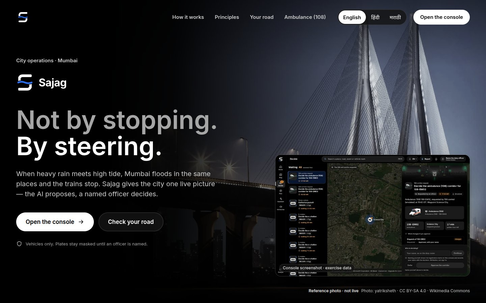<br/><b>Landing.</b> The public front door in English, with मराठी and हिंदी one tap away: the Sajag mark, "Not by stopping. By steering.", Open the console and Check your road, "Vehicles only. Plates stay masked until an officer is named.", a console screenshot labelled "exercise data", over a credited Mumbai photograph labelled "Reference photo · not live".</td>
<td width="50%" valign="top"><br/><b>Home.</b> What needs an officer now (the featured decision with its time left and Review now: "It keeps waiting until an officer decides"), the city's band and four counts, the systems line (traffic simulated), the next two hours (MODELLED: roads over 0.8 V/C, waterlogging risk, the tide at Apollo Bunder and when the outfalls shut) and the storm replay.</td>
</tr>
<tr>
<td width="50%" valign="top"><br/><b>The live map, photoreal 3D.</b> Mumbai from the sea: the roads drawn in their load colours with moving traffic dots (traffic SIMULATED), place names, road speeds and V/C, the evening's events titled where they happen (SIMULATED), Mumbai Traffic Police and ambulance units on real roads (EMULATED), the official weather warning (LIVE), Rain · Tide · Pumps and the City panel with their labels, and the Now panel's live operations. Photoreal 3D city from Google via Cesium ion, "not a live image".</td>
<td width="50%" valign="top">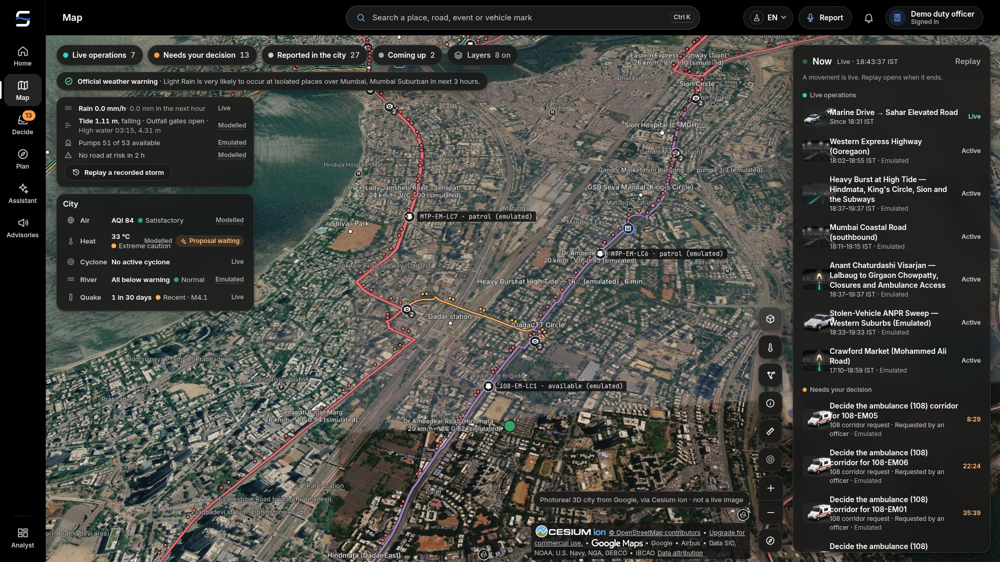<br/><b>The live map, closer.</b> Each road's speed and V/C (simulated), events titled where they happen, emulated patrol and ambulance units with their state, the stolen exercise vehicle's last read and the City Pack's places.</td>
</tr>
<tr>
<td width="50%" valign="top">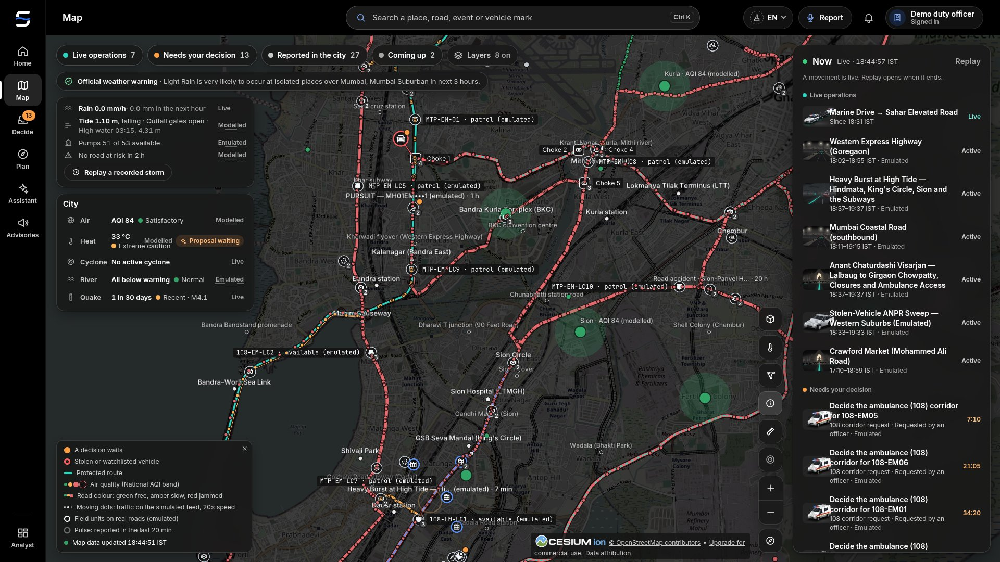<br/><b>The live map, 2D city map.</b> The same live picture on the flat city map: the road network in its load colours with moving dots (simulated), the City Pack's places, air sites, events with their pulses and timers, emulated units with their state, and the legend that names every mark.</td>
<td width="50%" valign="top">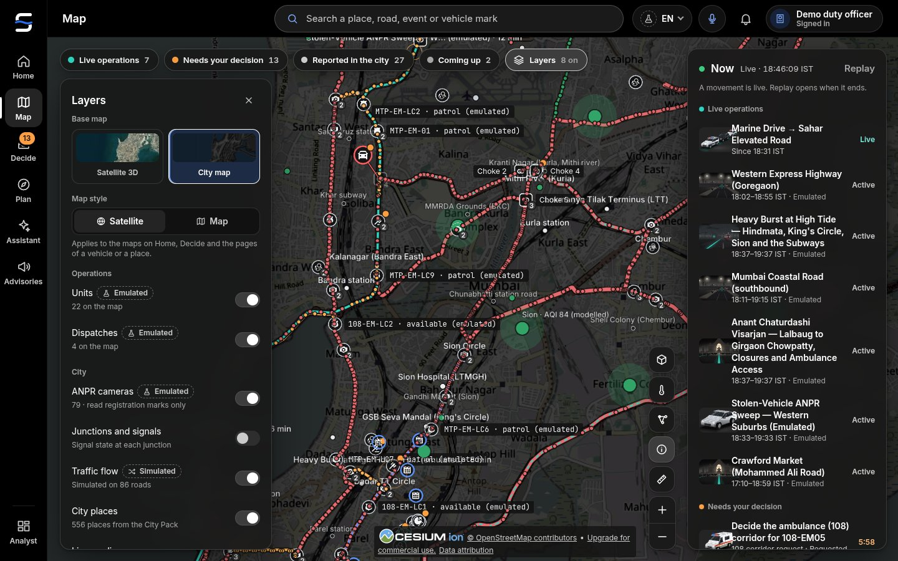<br/><b>Map: layers.</b> The Layers sheet over the 2D city map: the base map and its style, then each layer with its honest label and count: units and dispatches EMULATED, ANPR cameras EMULATED ("read registration marks only"), traffic flow SIMULATED, the City Pack's places.</td>
</tr>
<tr>
<td width="50%" valign="top"><br/><b>Map: a road's forecast.</b> A road picked on the map (roads only): waterlogging risk with its depth band and the rain in the next 2 h (MODELLED), and the +30 / +60 / +120 min V/C forecast, each the median with its p10–p90 band against 0.8 (Chronos-2 on SIMULATED traffic).</td>
<td width="50%" valign="top">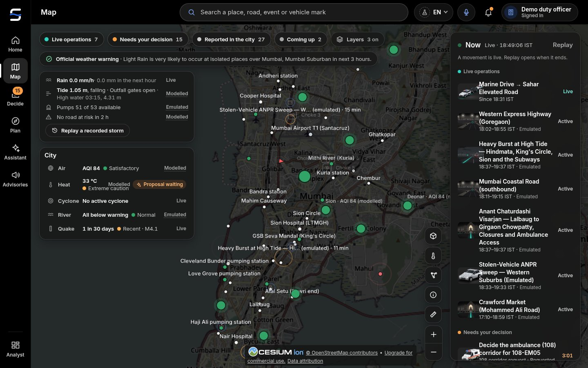<br/><b>Map: air and city feeds.</b> The air layer: each CPCB station in its National AQI band (observed where a station reads, modelled where none does), and the City panel: air, heat, cyclone, river and earthquake, each with its label.</td>
</tr>
<tr>
<td width="50%" valign="top"><br/><b>Map: waterlogging.</b> The replay of a recorded Mumbai storm (Hindsight: observed rain, the modelled tide, modelled ponding): the flagged roads and subways, and a road's card with its risk class, modelled depth band and when it first went deep.</td>
<td width="50%" valign="top"><br/><b>Replay of 18–19 August 2025.</b> "Hindsight" with its time steps: the roads deep and impassable at each step, from observed rain and the modelled tide. "Not today's city", with Back to live.</td>
</tr>
<tr>
<td width="50%" valign="top"><br/><b>Decide: a 108 corridor request.</b> An ambulance (108) crew's corridor request from the driver app (emulated unit): the golden hour left, what changes if approved (its dispatch goes from Requested to Approved, with the officer's name), "It keeps waiting until an officer decides", and Approve the corridor or Defer.</td>
<td width="50%" valign="top"><br/><b>Decide: the stolen-vehicle chain.</b> The exercise vehicle reported stolen under a demo FIR: its reads by several cameras on the map (ANPR EMULATED); the chain Authorise, then Open the pursuit, a second, separate decision; the MH mark shown only because a named officer is on this console.</td>
</tr>
<tr>
<td width="50%" valign="top"><br/><b>Decide: the mark masked until an officer is named.</b> The same stolen-vehicle sheet on a console where no officer has been named: the mark masked with a lock, "Full mark shows when a duty officer is named", and the buttons waiting for a name.</td>
<td width="50%" valign="top"><br/><b>Decide: choose a response.</b> Decision support for a reported, unverified situation: the responses ranked, the recommended one first, each with what it sends and how soon it takes effect (MODELLED); Approve, Reject or Defer for a named officer.</td>
</tr>
<tr>
<td width="50%" valign="top"><br/><b>Decide: signal timing.</b> The twin's proposal for a junction: the timing change, tested over 45 min against doing nothing, with the junction's delay, its longest queue, the cross street's cost (shown, not hidden) and the network; AI proposal · MODELLED · EMULATED; Reject or Approve for the signed-in officer.</td>
<td width="50%" valign="top">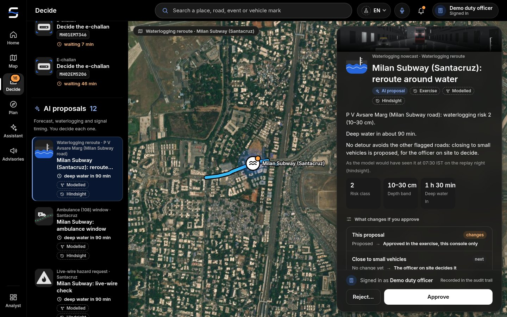<br/><b>Decide: waterlogging.</b> The recorded storm as an exercise: reroute around water before a subway goes deep, as the model would have seen it at the time, what changes if approved (in the exercise, on this console only), tagged AI proposal · Exercise · MODELLED · Hindsight; the ambulance-window and other cards wait in the queue.</td>
</tr>
<tr>
<td width="50%" valign="top">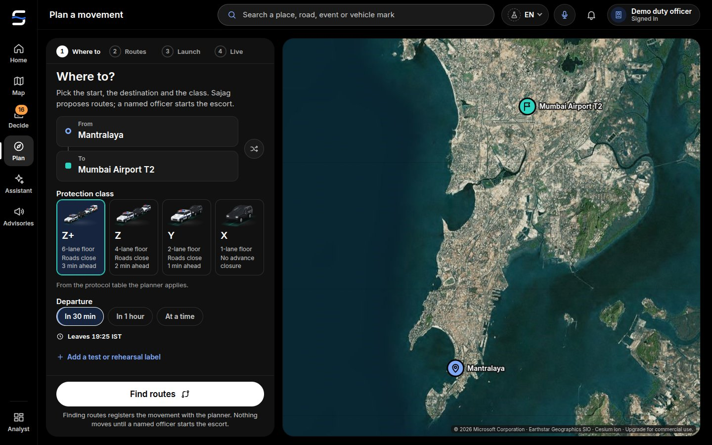<br/><b>Plan a movement.</b> Mantralaya → Mumbai Airport T2, the protection class (Z+: 6-lane floor, roads close 3 min ahead; Z, Y, X with theirs) and the departure, over the satellite map. "Finding routes registers the movement with the planner. Nothing moves until a named officer starts the escort."</td>
<td width="50%" valign="top"><br/><b>A protected movement on the map.</b> The protected movement focused from the Now panel: its route over Marine Drive, the Coastal Road, the Sea Link and the Western Express Highway with the convoy and patrol units (EMULATED), "Live · Emulated", Follow and Details; any hold or re-route arrives as one proposal for a named officer.</td>
</tr>
<tr>
<td width="50%" valign="top"><br/><b>Dispatch and the live band.</b> The live band (a protected movement live, a 108 corridor to review, the city band), the decisions, the city map and the Dispatch panel: request a unit for an agency at a waypoint; each request with its status (units EMULATED); the audit stream below.</td>
<td width="50%" valign="top">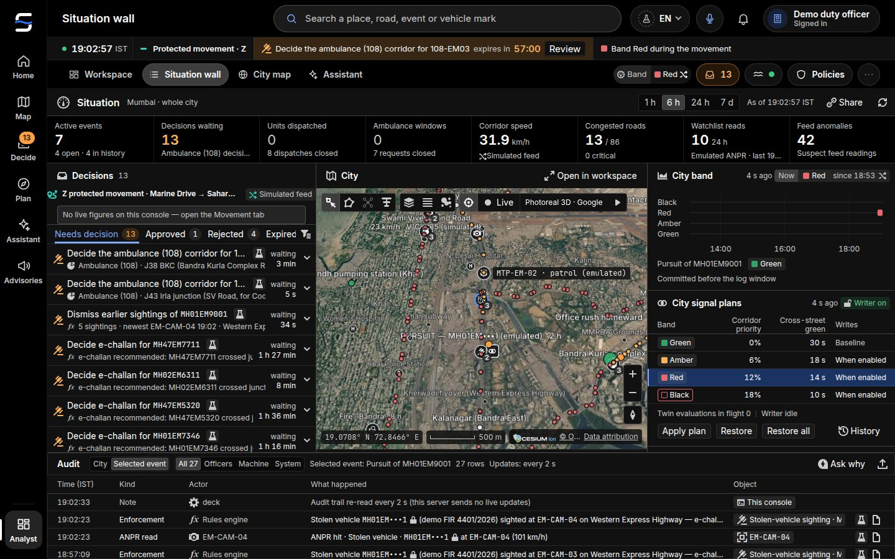<br/><b>Situation wall.</b> One screen for the shift: the counts (active events, decisions waiting, corridor speed on the simulated feed, congested roads, emulated ANPR reads), the decision list, the city map, the city band over time, the city signal plans (writer off; Apply refused until the twin is field-calibrated) and the audit stream with Ask why.</td>
</tr>
<tr>
<td width="50%" valign="top">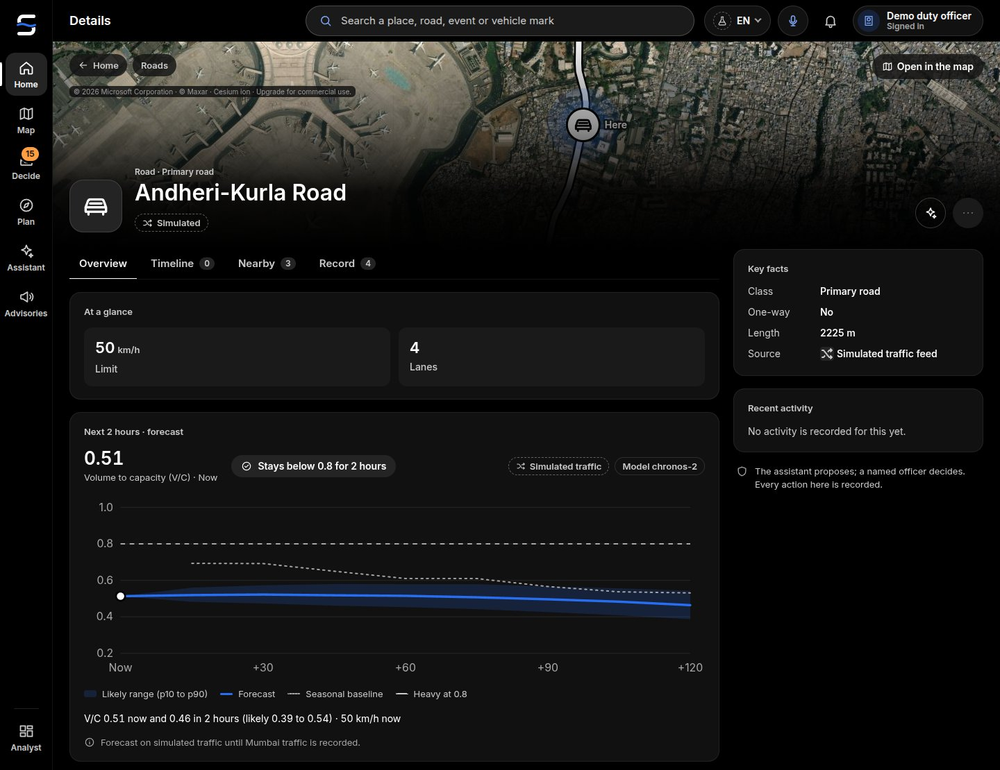<br/><b>A road's page.</b> A road's limit, lanes, length and source ("Simulated traffic feed"); the next two hours of V/C against the 0.8 line: the Chronos-2 forecast with its p10–p90 band and the seasonal baseline, labelled Simulated traffic · Model chronos-2.</td>
<td width="50%" valign="top"><br/><b>A vehicle's page.</b> The exercise vehicle reported stolen (an emulated MH mark, shown in full to the named duty officer; every view is recorded): lawful basis Stolen vehicle (FIR), days left to keep, its last lawful read and reads; "Evidence only. No e-challan for a stolen vehicle's owner; a sighting can only authorise one pursuit".</td>
</tr>
<tr>
<td width="50%" valign="top"><br/><b>A reported situation.</b> An official Mumbai Traffic Police notice as a situation at a place: Official, its credibility and why, the verification ladder, "Names and ages are removed from every report before it is stored"; only an officer turns it into an event.</td>
<td width="50%" valign="top"><br/><b>Road state from a still.</b> An emulated camera: a credited still ("Sample still · not live") read by Qwen3-VL-8B on this server: the road state and its depth band, the model's own confidence (not calibrated), "Unverified camera reading", Send to the board; "Roads and vehicles only: it never describes people and never reads number plates."</td>
</tr>
<tr>
<td width="50%" valign="top">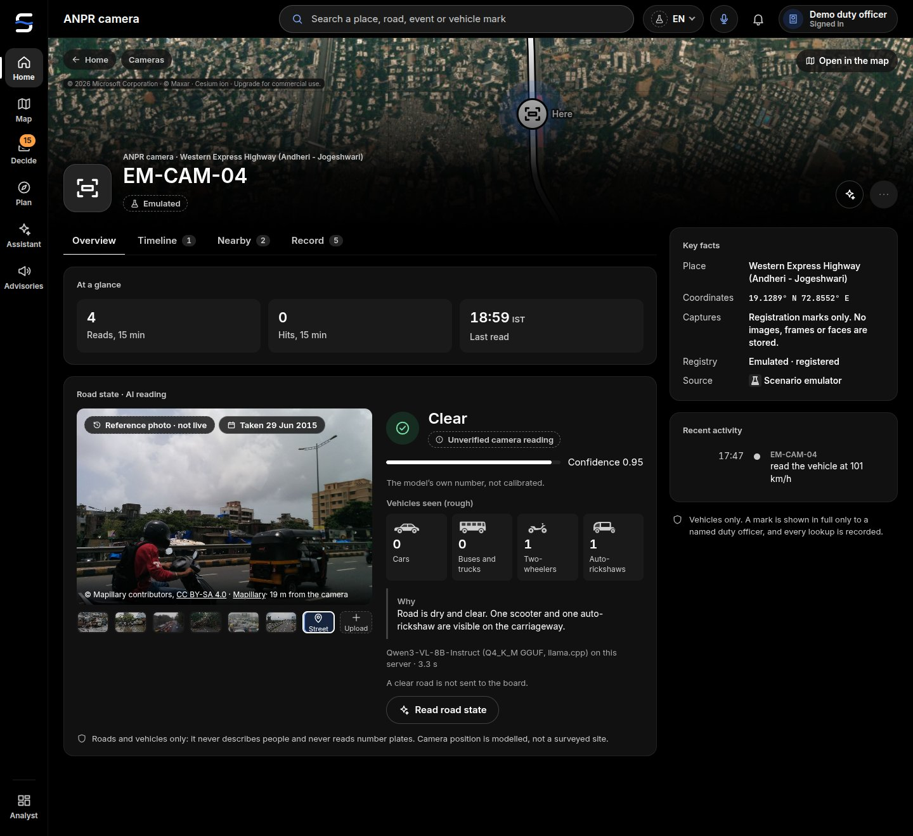<br/><b>Road state from a street photo.</b> The nearest public Mapillary photo to an emulated camera (credited, with its date and distance, "Reference photo · not live") read by Qwen3-VL-8B on this server; a clear road is not sent to the board.</td>
<td width="50%" valign="top"><br/><b>Field report by voice.</b> A spoken English report (a synthetic voice played into the microphone) transcribed on this server, matched to a Mumbai place (shown in Marathi and English), its kind and severity, the words that decided it, "Unverified field report"; Send to the board stays the officer's press. Audio is not stored.</td>
</tr>
<tr>
<td width="50%" valign="top">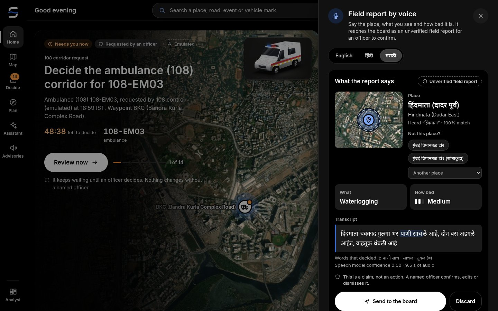<br/><b>Field report in Marathi.</b> The same sheet with मराठी picked: a Marathi report in a synthetic voice ("Water has collected at Hindmata; vehicles are getting stuck") transcribed on this server, matched to the place, kind Waterlogging, its severity and the words that decided it, "Unverified field report".</td>
<td width="50%" valign="top"><br/><b>Assistant.</b> Asked how traffic is on a road, a grounded, read-only answer from the live-traffic tool: average speed and congestion index, "the data is from a synthetic feed"; how it worked it out is one click away. It cannot approve, unmask or dispatch.</td>
</tr>
<tr>
<td width="50%" valign="top"><br/><b>Assistant: vehicles, never people.</b> Asked who is driving the stolen vehicle and where they live, the assistant answers about the vehicle only: "Sajag holds no owner or other personal details — it works with vehicles, never people"; the mark stays masked in its answer, and the decision opens in Decide.</td>
<td width="50%" valign="top">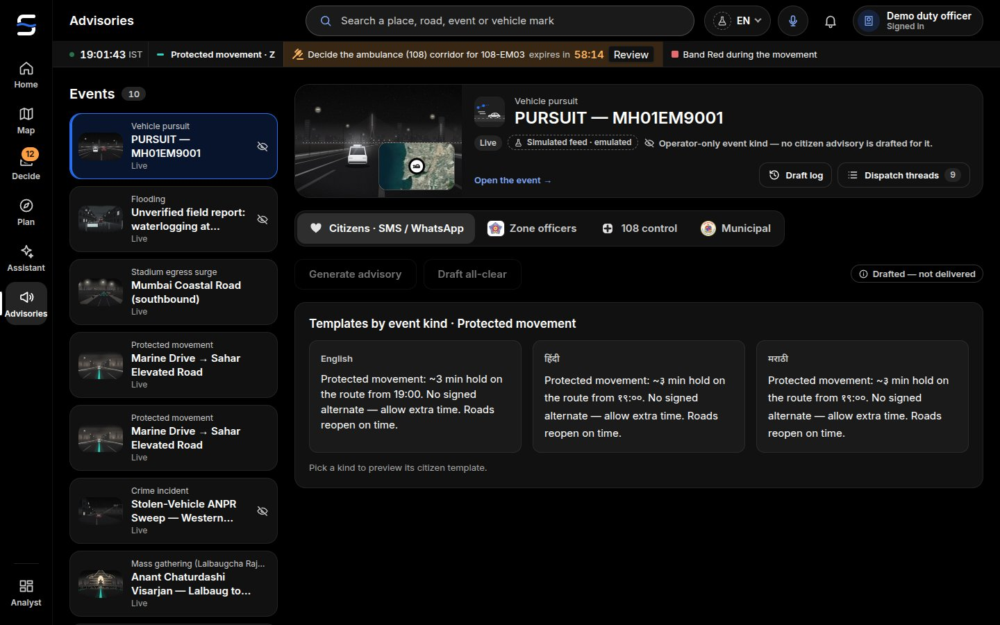<br/><b>Advisories.</b> Advisories for a burst at high tide (SIMULATED): the four audiences (citizens by SMS / WhatsApp, zone officers, 108 control, the BMC), one draft in English, मराठी and हिंदी, each marked as exercise text, "Drafted — not delivered"; no message gateway is deployed, so an officer copies and sends.</td>
</tr>
<tr>
<td width="50%" valign="top">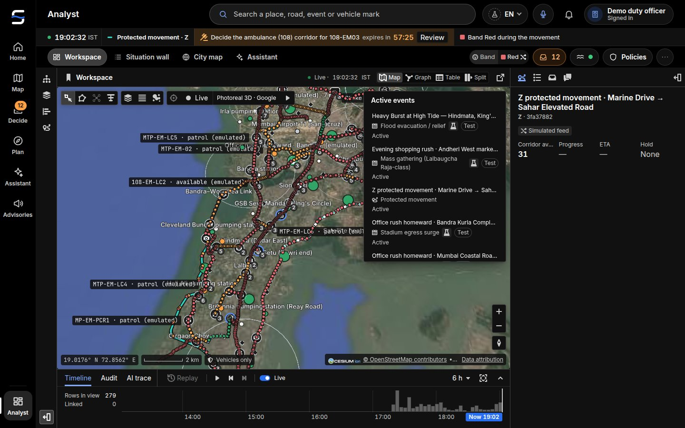<br/><b>Analyst workspace.</b> The Analyst workspace under the live band: the photoreal map with every layer (traffic SIMULATED, units EMULATED), the active events (scenarios tagged Test), the selected movement's figures, and the timeline with its six-hour histogram, Audit and AI trace below.</td>
<td width="50%" valign="top"><br/><b>Analyst city map.</b> The analysts' 3D city: roads with speed and V/C (simulated), cameras at modelled positions, units with their state (emulated), the stolen exercise vehicle's last read, and the City vitals; photoreal imagery, not live.</td>
</tr>
<tr>
<td width="50%" valign="top"><br/><b>Audit trail.</b> Every row with its time, kind, actor, what happened and the object, exportable; the whole-city view and the officer, machine and system filters.</td>
<td width="50%" valign="top"><br/><b>Citizen.</b> Check your road on a phone, in English with मराठी and हिंदी one tap away: a road picked, its status in plain words for the next 2 hours (MODELLED, from rain, the tide, ground level and drains), Listen in a synthetic voice, and the tide at Apollo Bunder with the level at which the outfalls shut. No sign-in, no location, no plates.</td>
</tr>
<tr>
<td width="50%" valign="top"><br/><b>Ambulance (108) crew.</b> The crew's page on a phone: the green-corridor request, its four steps (idle → awaiting duty officer → approved → window open), "Follow ambulance (108) control until it is approved", and every status change recorded in the dispatch audit trail.</td>
<td width="50%" valign="top">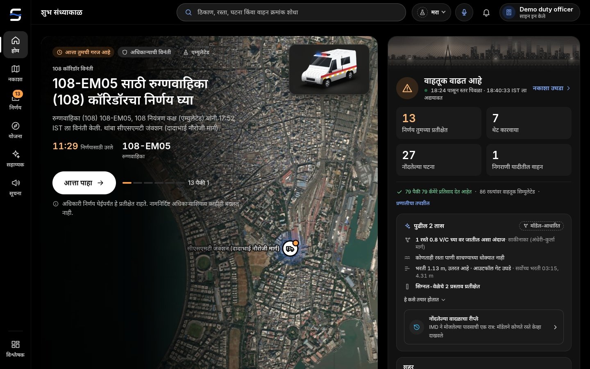<br/><b>Home, also in Marathi.</b> The same Home switched to मराठी from the language menu: the featured decision, the city's band and counts, and the next two hours with their modelled label in Marathi. Hindi is the third choice.</td>
</tr>
</table>

---

## Quick start

### Prerequisites

| | Full stack | Console and services only |
|---|---|---|
| Hardware | An arm64 or x86-64 server with a CUDA GPU and about 128 GB of (unified) memory; the reference box is an NVIDIA GB10 with 121 GiB | Any machine with 16 GB of RAM |
| OS | Linux with systemd user units | Linux or macOS |
| Software | Docker Engine with Compose v2, the NVIDIA Container Toolkit, Python 3.12 | Docker Engine with Compose v2 |
| Model weights | In the operator's Hugging Face cache and model folders (see [`models-config/`](models-config/) and [`docs/ai/`](docs/ai/)); `llama-server` from llama.cpp | Not needed: the AI services answer 503 and the brain falls back to its heuristic tier, each saying so |
| Optional | A Cesium ion token (photoreal 3D for signed-in officers); internet for the rain nowcast, the city feeds and event intelligence | The map runs keyless on OpenStreetMap |

### Install and bring up

Commands marked *target machine* start containers and bind ports; run them on the server that will host Sajag,
from the repository root.

```bash
# 1. get the code
git clone https://github.com/shubro18202758/sajag.git
cd sajag

# 2. write ~/.config/sajag/sajag.env (mode 600) and link the systemd user units   (target machine)
bash scripts/sajag_up.sh --install-units

# 3. secrets, each typed on stdin (never on a command line, never committed)
bash scripts/sajag_env.sh --set SAJAG_OPERATOR_PIN -       # the duty PIN officers sign in with
bash scripts/sajag_env.sh --set SAJAG_SESSION_SECRET -     # 64 hex characters; signs officer sessions
bash scripts/sajag_env.sh --set POSTGIS_PASSWORD -         # before the first bring-up
bash scripts/sajag_env.sh --set SAJAG_CESIUM_ION_TOKEN -   # optional

# 4. the city and optional switches
bash scripts/sajag_env.sh --set SAJAG_CITY mumbai          # the live City Pack (cities/mumbai/)
bash scripts/sajag_env.sh --set SAJAG_OSINT 1              # event intelligence from open sources

# 5. build and start: PostGIS → migrations → Mumbai road network → services → converge   (target machine)
bash scripts/sajag_up.sh --build

# 6. the AI services: forecast, hydro, speech, vision, twin   (target machine)
. scripts/sajag_env.sh
bash services/vision/scripts/serve_llm.sh start   # the vision model server on 127.0.0.1:8201
sajag_compose -f infra/compose.ai.yml -f infra/compose.ai-media.yml -f infra/compose.twin.yml \
  up -d --build forecast hydro speech vision twin

# 7. verify (read-only)
bash scripts/sajag_env.sh --print          # the effective, non-secret environment
bash scripts/sajag_up.sh --status          # one row per component: READY 12/12
```

On bare metal the AI services and the city feeds (`services/cityfeeds`: air, heat, cyclone, river and earthquake
on 127.0.0.1:8199) also run as systemd user units under `sajag-ai.target`
([`infra/systemd/`](infra/systemd/)), from Python environments in `$SAJAG_ROOT/.venvs/ai-forecast` and
`.venvs/ai-media`. `--install-units` links the model and bring-up units only; link these the same way.

| URL | What |
|---|---|
| `http://<server>:5373/welcome` | The public landing page (English first; Marathi and Hindi one tap away) |
| `http://<server>:5373/` | The officer console: sign in with your name and the duty PIN |
| `http://<server>:5373/citizen` | "Check your road", no sign-in |
| `http://<server>:5373/driver` | The ambulance (108) crew page |

Only the console (port 5373) is reachable from the network; every other service binds 127.0.0.1. From then on the
stack starts itself at boot (`sajag.target`). The AI services report on their own `GET /health`.

**Without the full stack.** Each AI service runs on its own for development, for example the twin on the CPU:

```bash
cd services/twin
SAJAG_CITY=mumbai SAJAG_TWIN_PORT=9171 SAJAG_TWIN_NETWORK=../../cities/mumbai/network.json \
  SAJAG_TWIN_ORACLE_URL= SAJAG_TWIN_LLM=0 PYTHONPATH=src python -m sajag_twin   # standalone: SIMULATED demand
curl -s -X POST 127.0.0.1:9171/twin/propose -H 'content-type: application/json' \
  -d '{"junction_ids":["hindmata"],"horizon_min":45,"start":"18:00","explain":true}'
```

Its answer for that request on Mumbai's network is recorded in
[`docs/samples/twin/propose-hindmata-1800.json`](docs/samples/twin/propose-hindmata-1800.json). Recipes for every
service are in [`docs/SAMPLE_DATA_AND_TESTS.md`](docs/SAMPLE_DATA_AND_TESTS.md).

**Developing the console outside Docker:**
`cd services/command-deck && bun install && ORACLE_PORT=8191 BRAIN_PORT=8192 EMULATOR_PORT=8190 bun run dev`
(the dev server refuses to start without the three backend ports; add `SPEECH_PORT`, `FORECAST_PORT`,
`VISION_PORT`, `HYDRO_PORT` and `TWIN_PORT` to proxy the AI services).

### Ports

| Component | Port | Bind |
|---|---|---|
| command-deck | 5373 | LAN |
| event-emulator · traffic-oracle · convoy-brain · osint-ingress | 8190 · 8191 · 8192 · 8193 | loopback |
| speech · forecast · vision · hydro · twin · city feeds | 8194 · 8195 · 8196 · 8197 · 8198 · 8199 | loopback |
| Qwen3-VL llama-server · TTS llama-server | 8201 · 8202 | loopback |
| model hosts: decider · tactical LLM · embeddings | 8083 · 8084 · 8085 (`EMBEDDING_PORT`; 8205 on the reference box) | loopback |
| PostGIS · Valkey · NATS (monitoring) | 15434 · 6390 · 4233 (8233) | loopback |

---

## Environment variables

All host configuration lives in **`~/.config/sajag/sajag.env`** (mode 600, plain `KEY=VALUE`, never committed),
written by `scripts/sajag_up.sh --install-units` and edited with `scripts/sajag_env.sh --set KEY VALUE` (or
`--set KEY -` to type a secret on stdin). The variables you are most likely to set:

| Variable | Secret | Default | What it does |
|---|:---:|---|---|
| `SAJAG_CITY` | | see [`ENVIRONMENT.md`](docs/ENVIRONMENT.md) | The live City Pack: `mumbai` (`cities/mumbai/`); the Kolkata reference pack builds as `kolkata` |
| `SAJAG_OPERATOR_PIN` | ✓ | unset (gate off) | The duty PIN for officer sign-in. Unset, the console is open; never expose it beyond loopback that way |
| `SAJAG_SESSION_SECRET` | ✓ | random per deck start | Signs officer session cookies; set it so sign-ins survive restarts |
| `SAJAG_SESSION_SECURE` | | unset | `1` marks the session cookie Secure (behind TLS only) |
| `POSTGIS_PASSWORD` | ✓ | a development placeholder | The store's password (the store binds loopback only); set your own before the first bring-up |
| `SAJAG_CESIUM_ION_TOKEN` | ✓ | unset | Photoreal 3D tiles for signed-in officers; unset → keyless OpenStreetMap |
| `SAJAG_OSINT` | | `0` | `1` runs event intelligence from open sources (`osint-ingress`) |
| `OSINT_MODE` | | `live` | `offline` serves recorded samples, for sites without internet |
| `SAJAG_DEMO` | | `0` | `1` turns on the emulated living city and the signal-plan writer (refused unless public pages label emulated events) |
| `VVIP_REQUIRE_OFFICER` | | `1` (deployed) | Officer actions without a named officer are refused (422) |
| `VVIP_ESCORT_APPROVAL_TIMEOUT_SEC` | | `90` | How long an escort proposal waits for an officer before it expires and the plan holds (15–600) |
| `SAJAG_FORECAST_MODEL` | | `chronos2` | `chronos2`, `timesfm` or `naive` |
| `SAJAG_FORECAST_DATA_SOURCE` | | `auto` | `auto`, `oracle` or `synthetic` history |
| `SAJAG_HYDRO_OFFLINE` | | off | `1`: the waterlogging service makes no outbound call (rain reported unavailable) |
| `SAJAG_TWIN_LLM` | | `1` | `0` keeps the twin's rationales to templates |
| `SAJAG_ROOT`, `SAJAG_RUN_DIR`, `SAJAG_LOG_DIR`, `SAJAG_VENV_DIR` | | detected | Where the checkout, runtime state, logs and Python environments live |
| `DECIDER_SNAPSHOT_PATH`, `LLAMA_SERVER_BIN`, `GEMMA_GGUF`, `BGE_M3_PATH`, `SAJAG_MODELS_CONFIG` | | detected | Model weights, the `llama-server` binary and the model-stack configuration |
| `POSTGIS_HOST_PORT` | | `15434` | The store's loopback port |

Free keys for the city feeds and street photos (`DATA_GOV_IN_API_KEY`, `WAQI_TOKEN`, `OPENAQ_API_KEY`,
`FIRMS_MAP_KEY`, `MAPILLARY_TOKEN`) are optional; each source stays off until its key is set
([`DATA_SOURCES.md`](docs/DATA_SOURCES.md)). Every variable each service reads, with its default, whether it is
secret, the ports and binds and a minimal working `sajag.env`, is in **[`docs/ENVIRONMENT.md`](docs/ENVIRONMENT.md)**.

---

## The City Pack: a city is a folder

Everything specific to Mumbai lives in [`cities/mumbai/`](cities/mumbai/):

| File | Contents |
|---|---|
| `city.json` | Names in English, Marathi and Hindi; bbox (18.89–19.28 N, 72.77–72.99 E); centre (Dadar / Matunga); the plate format `MH NN X[X] NNNN`; emergency numbers (112, 100, 108, 101 and BMC disaster control 1916); 18 agencies; the Arabian Sea, the Mithi and the Apollo Bunder tide station; the BMC storm-water pumping stations; population (Census 2011) |
| `landmarks.json` | The canonical places with their English, Marathi and Hindi names: CSMT, Churchgate, Dadar, Hindmata, Dadar TT, King's Circle, Sion Circle, the Milan and Andheri subways, Kalanagar, BKC, Worli Naka, Haji Ali, the Sea Link, Atal Setu, Mantralaya, Wankhede, Girgaon Chowpatty, Lalbaug, KEM, Sion, JJ, Nair and Cooper hospitals, the six major pumping stations, the Mithi at Kurla, Apollo Bunder |
| `corridors.json` | The curated corridors along real roads: Marine Drive, the Coastal Road, the Bandra–Worli Sea Link, the Western and Eastern Express Highways, SV Road, LBS Marg, Dr Ambedkar Road (Hindmata – Dadar TT – King's Circle – Sion), Senapati Bapat Marg, Annie Besant Road, P D'Mello Road, JVLR, SCLR, Andheri–Kurla Road, the Sion–Panvel Highway, Peddar Road and more |
| `osm/` | The committed OpenStreetMap extracts (ODbL) |
| `network.json` | Generated: 72 junctions, 86 road segments (202 km), signal programs and camera sites (modelled), stations |

One command regenerates every file the services read (the store seed, the ingress table, the twin's scenarios, the
scenario library), deterministically and offline:

```bash
python3 scripts/city_build.py mumbai            # rebuild into the repository
python3 scripts/city_build.py mumbai --check    # rebuild into a temporary folder and compare
```

A second, reference pack (`cities/kolkata/`) is kept, and a test builds both. A new district is a new folder; the
next packs named for the region are Thane, Navi Mumbai, Pune, Nagpur and Nashik, and Marathi and Hindi are already
full languages.

<table>
<tr>
<td width="100%" valign="top"><br/><sub><b>The live map, 2D city map.</b> The City Pack drawn live: roads in their load colours (simulated), places, events, emulated units and the legend.</sub></td>
</tr>
</table>

---

## Tests

Every suite offline: **69 gates green**.

| Suite | Result |
|---|---|
| Python (oracle, brain, store, emulator, embeddings, the AI and city-feed services, the OSINT packages, the deck proxy guard) | **6,443 passed** |
| Rust (`signal-ingress`) | **121 passed** |
| Deck | `svelte-check` 0 errors in 1,040 files; design-token, English copy (4,939 strings) and Marathi-script lints pass; contract replay passes; 46 unit suites pass |
| City Pack | `city_build.py mumbai --check`: every derived file is current |

```bash
cd services/<service> && python -m pytest -q -p no:cacheprovider     # any Python service
cd services/signal-ingress && cargo test --locked                     # Rust
cd services/command-deck && node tests/plates.unit.mjs                 # one deck unit suite
bash scripts/verify_all.sh                                             # the offline acceptance ladder
```

Per-suite totals, 48 representative test cases with their commands, and the sample data:
[`docs/SAMPLE_DATA_AND_TESTS.md`](docs/SAMPLE_DATA_AND_TESTS.md).

---

## Documentation

| Document | What it covers |
|---|---|
| [`PRODUCT.md`](PRODUCT.md) | The product: Mumbai's problems with sources, users and journeys, every screen, the AI and its limits, guardrails, modelled impact, cost, pilot plan, scale and roadmap |
| [`docs/TECHNICAL_DESIGN.md`](docs/TECHNICAL_DESIGN.md) | The technical design: architecture diagrams, every service, the AI services, the City Pack, the data model, APIs, flows, security, privacy, observability, deployment, testing and the ADRs |
| [`docs/ENVIRONMENT.md`](docs/ENVIRONMENT.md) | Every environment variable, by service, with defaults and secrets marked |
| [`docs/DATA_SOURCES.md`](docs/DATA_SOURCES.md) | Every outside data source for Mumbai: live, needs a free key, emulated, modelled or simulated, with the check behind each |
| [`docs/SAMPLE_DATA_AND_TESTS.md`](docs/SAMPLE_DATA_AND_TESTS.md) · [`docs/samples/`](docs/samples/) | The data Sajag ships, sample API answers, every test suite and 48 test cases |
| [`docs/DESIGN_NOTES.md`](docs/DESIGN_NOTES.md) · [`docs/wireframes/`](docs/wireframes/) | Visual language, Devanagari typography for Marathi and Hindi, imagery, honest labelling in the UI, wireframes |
| [`docs/ai/`](docs/ai/) | One note per AI capability: model choice, evaluation, limits |
| [`IMPACT_REPORT.md`](IMPACT_REPORT.md) | The impact model on Mumbai's network and its assumptions ledger (MODELLED) |
| [`docs/evidence/Sajag_Evidence.pdf`](docs/evidence/Sajag_Evidence.pdf) · [`docs/deck/Sajag_Deck.pdf`](docs/deck/Sajag_Deck.pdf) | The evidence summary and the presentation, built from the numbers in this repository |
| [`THIRD_PARTY_NOTICES.md`](THIRD_PARTY_NOTICES.md) | Every third-party asset, dataset and model with its licence and the credit it needs |

---

## Licence and credits

- **Code:** MIT, © 2026 Sayandeep Haldar. See [`LICENSE`](LICENSE).
- **Third-party material** keeps its own licence; the full list, with what each needs, is
  [`THIRD_PARTY_NOTICES.md`](THIRD_PARTY_NOTICES.md). In short:
- **Road data:** © OpenStreetMap contributors, ODbL 1.0
  ([`services/corridor-store/seed/NOTICE.md`](services/corridor-store/seed/NOTICE.md)).
- **Terrain:** Copernicus DEM GLO-30, © DLR e.V. 2010–2014 and © Airbus Defence and Space GmbH 2014–2018, provided
  under COPERNICUS by the European Union and ESA.
- **Rain:** Open-Meteo, CC BY 4.0. **Air:** CPCB station data through OpenAQ.
- **Photographs:** Wikimedia Commons works under their own licences (CC0, public domain, CC BY, CC BY-SA), credited
  on screen and in [`services/command-deck/static/photos/NOTICE.md`](services/command-deck/static/photos/NOTICE.md)
  and [`docs/deck/assets/CREDITS.md`](docs/deck/assets/CREDITS.md); the vision test photos in
  [`services/vision/tests/fixtures/NOTICE.md`](services/vision/tests/fixtures/NOTICE.md).
- **Marks:** agency and data-source marks belong to their owners. Sajag is a prototype and is not affiliated with
  or endorsed by them ([`services/command-deck/static/logos/NOTICE.md`](services/command-deck/static/logos/NOTICE.md)).
- **3D city:** Google Photorealistic 3D Tiles and Bing imagery through Cesium ion, credited on the canvas
  ([`services/command-deck/src/lib/gods-eye/NOTICE.md`](services/command-deck/src/lib/gods-eye/NOTICE.md)).
- **Fonts:** Noto Sans Devanagari, Inter and JetBrains Mono, SIL OFL 1.1.
- **AI models:** each keeps its own licence (see [The AI stack](#the-ai-stack)).

## Contact

Sayandeep Haldar · [github.com/shubro18202758](https://github.com/shubro18202758). Questions, issues and pilot
enquiries: [open an issue](https://github.com/shubro18202758/sajag/issues).
