# Sajag — design notes

How Sajag looks and why: the visual language, colour, Marathi and Hindi typography, imagery of Mumbai, honest
labelling in the interface, the screen patterns, accessibility, and wireframes of the key screens. The tokens named here live in
[`services/command-deck/src/lib/v3/tokens.css`](../services/command-deck/src/lib/v3/tokens.css) and
[`services/command-deck/src/lib/design/`](../services/command-deck/src/lib/design/); lint tests keep the code to
these rules.

---

## Contents

1. [Design intent](#1-design-intent)
2. [Visual language](#2-visual-language)
3. [Colour: only for meaning](#3-colour-only-for-meaning)
4. [The Sajag mark](#4-the-sajag-mark)
5. [Typography: Marathi and Hindi](#5-typography-marathi-and-hindi)
6. [Imagery](#6-imagery)
7. [Honest labelling in the interface](#7-honest-labelling-in-the-interface)
8. [Screen patterns](#8-screen-patterns)
9. [The AI surfaces](#9-the-ai-surfaces)
10. [Copy rules in three languages](#10-copy-rules-in-three-languages)
11. [Accessibility](#11-accessibility)
12. [Wireframes](#12-wireframes)
13. [Known gaps](#13-known-gaps)

---

## 1. Design intent

**Simple by default, deep on demand.** A duty officer at the Worli traffic control room, at 02:00 on a red-alert
night with a 4.6 m high tide due at Apollo Bunder, has seconds, not minutes. Each screen has one job and one primary
action:

| Screen | Its one job | Its primary action |
|---|---|---|
| Home | What needs me, what is happening, what is coming | Review now |
| Map | Where things are, by layer | Select |
| Decide | One decision at a time | Approve (with my name) |
| Plan | Plan a movement | Find routes → Start escort |
| Report | Tell the system what I see | Hold to speak |
| Citizen | Is my road all right? | Search / Listen |

Every power tool (tables, filters, saved views, the situation wall, the 3D city) is kept one level deeper under
**Analyst**. Nothing was removed; some things moved down.

Three rules come before taste:

1. **A human decides.** Approve controls appear only where a named officer decides (Decide and the analyst
   workspace). The map, the assistant, object pages and public pages have none.
2. **Honest labels.** Anything not from a live feed says what it is, in words, next to the figure (§7).
3. **Vehicles and places, never people.** No interface element shows, asks about or describes a person.

## 2. Visual language

- **Neutral black, white and grey.** The operator console is dark (ground `#000000`, surfaces `#111111` to
  `#2E2E2E`, text `#FFFFFF` / `#CBCBCB` / `#A6A6A6`); the public pages are light (ground `#F6F6F6`). The primary
  button is white on the dark theme and black on the light one, not a brand colour. There is no city colour: the
  kaali-peeli taxi's black and yellow and the BEST bus's red appear in pictures, never as interface colour.
- **Large, calm type** with one display size per screen; numbers set in tabular figures.
- **Rounded, quiet surfaces** (radii 8 / 12 / 16 / 22 px), soft elevation, a 36 / 44 / 56 px control scale.
- **Short motion** (120 / 200 / 320 ms, one easing curve), switched off under "reduce motion".
- **Maps are graded to the theme:** a dark, desaturated base so that colour on the map is always meaning.
- **Pictures, not only maps:** reference photographs, key art for every event kind, vehicle artwork and time-of-day
  scenes of Mumbai (§6).

| The live map, 2D city map | The live map, closer |
|---|---|
| 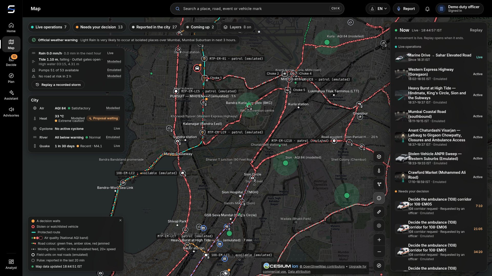 | 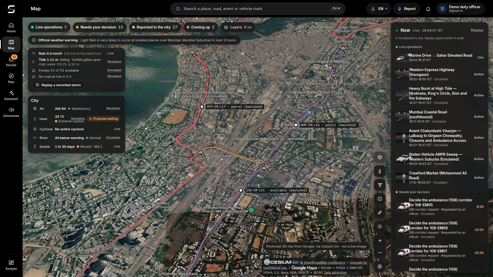 |
| *The City Pack drawn live: roads in their load colours (simulated), places, events, emulated units and the legend.* | *Closer in: each road's speed and V/C (simulated), events where they happen, units with their state (emulated).* |

## 3. Colour: only for meaning

Colour is never decoration in the console. Each role has one meaning and appears with a word or an icon, never
alone.

| Role | Dark theme | Light theme | Meaning |
|---|---|---|---|
| `--v3-decide` | `#FF9F43` orange | `#E07A1F` | A named officer must decide; the Decide badge; a countdown |
| `--v3-alert` | `#FF5C61` red | `#C62828` | Danger: impassable water (class 3), a stolen or watchlisted vehicle, a failure |
| `--v3-ok` | `#3CCB7F` green | `#1E9E5A` | Approved, healthy, dry |
| `--v3-ai` | `#5B91F5` blue | `#276EF1` | Text the AI wrote; an AI proposal's accent; links |
| `--v3-route` | `#2DD4BF` teal | `#0F9F8E` | A protected route and its progress |
| `--v3-dashed` | grey, dashed outline | grey, dashed | Emulated, simulated or unverified |

Waterlogging classes use a grey-to-red ramp with the class number and its name (0 dry, 1 shallow, 2 deep,
3 impassable) printed beside the swatch; forecast bands are drawn as a grey band with the median line, turning
orange only where the median crosses 0.8.

| Map: a road's forecast | Map: waterlogging, 18–19 August 2025 |
|---|---|
| 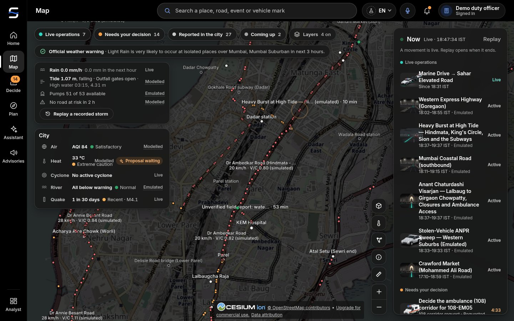 | 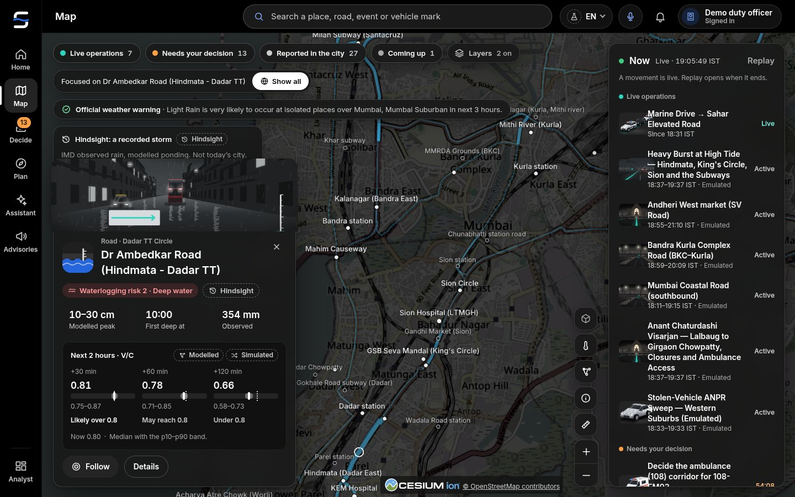 |
| *A road's card: waterlogging now (modelled) and its two-hour V/C band against 0.8 (simulated traffic).* | *A past Mumbai storm replayed: roads by risk class at Hindmata, King's Circle and the subways, a road's depth band and when it went deep (Hindsight, MODELLED).* |

## 4. The Sajag mark

The **Sajag mark** is the tide line through the S. Sajag (सजग) means *alert, watchful*, and what Mumbai must always
watch is where the water stands: a heavy burst at high tide closes the sea outfalls and the city floods. The mark is a
geometric "S" (two round bowls, one constant stroke with round ends) whose spine is a single wave in the accent blue
`#276EF1`, running out past both bowls: the top stroke dips into the water on the left, the bottom stroke rises out of
it on the right. A clear gap (a mask, never a background colour) keeps the wave and the S apart, so it reads the same
on night, on paper and in one colour, and it holds at 16 px.

The identity is **neutral**: white on black, black on paper, `currentColor` in the mono version. The blue tide line is
the only colour, the same blue the console uses for links and the AI, so the mark never borrows a meaning colour (no
orange, red, green or teal) and there is **no yellow anywhere** in the product's mark, favicon or landing page (the
kaali-peeli taxi keeps its yellow roof only in the vehicle artwork, where it is the vehicle's own colour). The wordmark
is "Sajag" in Inter, outlined; "सजग" (the same word in Marathi and Hindi) is outlined from Noto Sans Devanagari for
Marathi and Hindi use, but is not part of the lockup (the product speaks English first; मराठी and हिंदी are one press
away).

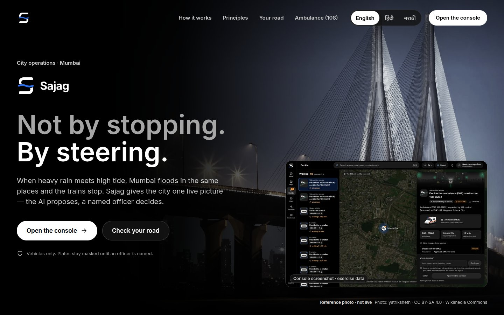

*Landing. The mark in its night lockup over the landing page's hero: neutral white on black, the one blue tide line, no yellow; English first, with मराठी and हिंदी one tap away.*

Brand files in [`services/command-deck/static/brand/`](../services/command-deck/static/brand/), all generated by
[`scripts/brand/build_brand.py`](../scripts/brand/build_brand.py) (never edited by hand): the mark (night, day, mono,
solid for 32 px and below), the wordmark and the lockups (horizontal and stacked, for dark and light grounds), the app
icon and the favicon. [`scripts/brand/render_icons.mjs`](../scripts/brand/render_icons.mjs) renders the PNGs: the
PWA and touch icons, `favicon.png`, `sajag-mark-512.png`, and `sajag-lockup.png` / `sajag-lockup-day.png` (2×,
transparent) for documents and decks. Unit tests hold the rules: `tests/v3-assets.unit.mjs` (neutral, exactly one
accent element, the tide line, per mark; no warm colour) and `tests/v3-tokens.unit.mjs` (no yellow in any token or brand file).

## 5. Typography: Marathi and Hindi

- **Faces:** Inter for Latin; **Noto Sans Devanagari** for both मराठी and हिंदी; JetBrains Mono for identifiers and
  coordinates only. All self-hosted (SIL OFL 1.1), no font CDN on public pages. There is one Devanagari face for both
  languages, so a page that mixes a Marathi place name into a Hindi sentence never switches fonts mid-word.
- **Stack order:** Inter, Noto Sans, Noto Sans Devanagari. Latin (codes, acronyms, plate marks, figures) takes Inter;
  every Devanagari character, the danda and the joiners included, comes from the one Devanagari face, so a shaping
  run is never split across two fonts.
- **Language tags.** `<html lang>` is `mr` or `hi` (never left untagged), so screen readers pick
  the right voice and the font can apply its Marathi forms where it has them. Marathi place names inside Hindi copy
  keep their Marathi spelling from `cities/mumbai/landmarks.json` (वरळी in Marathi, वर्ली in Hindi: the pack holds
  both).
- **Marathi letters.** Marathi uses **ळ** (U+0933), as in परळ, वरळी, मंडळ, and the **eyelash ऱ** (U+0931 + virama),
  as in दुसऱ्या, ऱ्हास. Both are ordinary Devanagari code points that Noto Sans Devanagari draws; they are never
  replaced by ल or र, and the Marathi-script check allows them.
- **Full stops.** Marathi sentences end with a full stop (.), as Maharashtra's newspapers and government notices
  write them; Hindi sentences end with the purna viram (।). The packs keep to that per language.
- **Digits.** The console uses Western digits (0–9) in every language, so figures read the same across officers.
  Public pages may show Marathi digits (०–९) **only through the formatter**, never typed into a string, as in
  रुग्णवाहिका (१०८); Hindi keeps international digits, as in एम्बुलेंस (108). Times, distances and plate marks are
  never converted.
- **Script check.** `tests/mr-script.unit.mjs` checks every Marathi pack: the same keys as English, every visible
  piece in Devanagari once acronyms and codes are removed, and no other script (Gujarati, Urdu or any other) mixed
  in. The Hindi packs run under the same rules.

## 6. Imagery

| Kind | What | Rule |
|---|---|---|
Mumbai is a city people know by sight: the Sea Link at dusk, Marine Drive's curve at night, a suburban local at
Dadar, a red BEST double-decker, a kaali-peeli taxi in the rain. Sajag uses that recognition so an officer or a
citizen knows at once which place a card is about, and it never lets a picture pass for a live view.

| Kind | What | Rule |
|---|---|---|
| Reference photographs | Gateway of India, CSMT, Marine Drive (day and night), the Bandra–Worli Sea Link, Atal Setu, Haji Ali, Girgaon Chowpatty, Wankhede Stadium, Dadar and Churchgate stations, a suburban local, Mumbai Metro, a BEST double-decker, a Ganeshotsav pandal and a visarjan procession seen from a distance, a monsoon-flooded street and a subway | Wikimedia Commons (or another open licence), credited; always captioned **"Reference photo · not live"**; no face or legible plate as the subject (a painted taxi number or a crowd close-up is cropped or the photo is dropped) |
| Generated scenes | Mumbai at dawn, day, dusk, monsoon and night; "all clear" | Illustration, never shown as a photograph |
| Vehicle artwork | Kaali-peeli taxi, auto-rickshaw, red BEST bus and double-decker, suburban local, ambulance (108), Mumbai Fire Brigade tender, convoy classes | Silhouettes and illustrations, no plates |
| Event key art | Monsoon flooding at high tide, cyclone, procession (visarjan), mass gathering, stadium egress, station surge (locals stopped), race (marathon), work zone and more | One picture per event kind |
| Agency and source marks | Mumbai Police, Mumbai Traffic Police, Maharashtra Police, BMC, MMRDA, Maharashtra SDMA, Mumbai Fire Brigade, NDMA (and Sachet), IMD, BEST, Central and Western Railway, Mumbai Metro, MSRDC, Mumbai Port Authority, Open-Meteo, Copernicus, OpenStreetMap | Credit line: "marks belong to their owners; Sajag is not affiliated with them" |
| 3D city | Google Photorealistic 3D Tiles through Cesium ion | Labelled "not a live image"; signed-in officers only |
| Street photos | The nearest public Mapillary photo to a camera's modelled position | "Reference photo · not live", the date it was taken and the Mapillary credit; officers only |

Credits: [`static/photos/NOTICE.md`](../services/command-deck/static/photos/NOTICE.md),
[`static/logos/NOTICE.md`](../services/command-deck/static/logos/NOTICE.md). A photograph or a screenshot of another
city's roads is never used to stand for Mumbai: where no Mumbai picture exists yet, the card shows none.

## 7. Honest labelling in the interface

Every figure that is not from a live feed carries a short label beside it, in the reader's language, with a tooltip
that explains it.

| Label | Marathi | Hindi | Means | Example |
|---|---|---|---|---|
| LIVE | थेट | लाइव | From a live feed | The rain nowcast ("a model product, not a rain gauge"); air quality via WAQI and OpenAQ |
| EMULATED | एम्युलेटेड | एम्युलेटेड | A stand-in for a feed Sajag cannot read yet | BMC pump status; MTP signal controllers; the traffic feed; ANPR reads; BEST and rail running status |
| SIMULATED | सिम्युलेटेड | सिम्युलेटेड | A scenario, not recorded | Visarjan night; Wankhede egress; a station surge; forecast history; twin demand |
| MODELLED | मॉडेल-आधारित | मॉडल-आधारित | Computed, not measured | The Apollo Bunder tide; waterlogging risk; twin results; impact figures; camera positions |
| OBSERVED | — | — | Measured and published by IMD | Rain in the storm replay |
| HINDSIGHT | — | — | Observed rain replayed as if it had been a perfect nowcast | The replay snapshot ("Not today's city") |
| Field report · unverified | — | — | A voice report waiting for an officer | The voice sheet |
| Camera · AI reading · unverified | — | — | A vision reading waiting for an officer | Road state |
| Reference photo · not live | संदर्भ छायाचित्र · थेट नाही | संदर्भ फ़ोटो · लाइव नहीं | A credited photograph | Landing, object pages |
| Synthetic voice | कृत्रिम आवाज | कृत्रिम आवाज़ | Generated speech | Listen on the citizen page |
| Unavailable | — | — | The feed did not answer | "Nothing is shown as zero" |

The Marathi and Hindi words above are the design's reference; the language packs and their glossary are the
source of truth for the shipped copy.

Rules:

- A label is text, not only a colour or an outline. The dashed outline is a second signal.
- A missing feed shows "unavailable", never zero.
- A hindsight or exercise view says so in its title and keeps a way "Back to live".
- Plates show masked (`MH01AB•••4`, with a lock) until a named officer is on the console; the officer pill says
  what naming does.

| Map: layers | Decide: the mark masked until an officer is named |
|---|---|
| 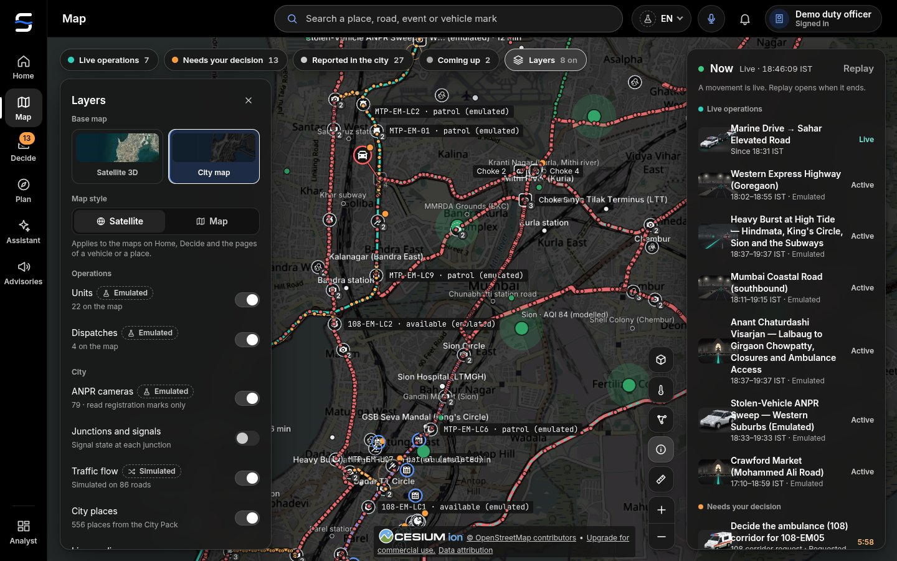 | 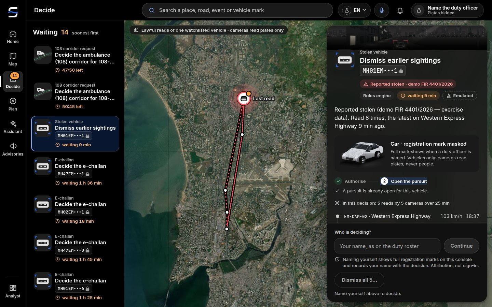 |
| *Each layer with its label and count: units and cameras emulated, traffic simulated, the City Pack places, BMC pumping stations emulated.* | *No officer named: the mark is masked and every button waits for a name.* |

## 8. Screen patterns

- **The shell.** Left rail (Home · Map · Decide · Plan · Assistant · Advisories, Analyst below); a slim top bar with
  one search box (Mumbai places, roads, events and vehicle marks), **Report**, the language menu (मराठी · English ·
  हिंदी), the alerts bell and the officer pill. Decide
  carries the only badge.
- **The decision card** (Decide): what is being decided → why → the key facts with labels → what changes if you
  approve or reject → one primary button with the officer's name. Buttons are visible but disabled, with the reason,
  until an officer is named. After a decision the card collapses to its outcome. A refusal is shown in the server's
  words, inside the card.
- **Object pages** (`/o/<urn>`): a hero map, the title and its tags, key facts, a timeline, then depth in tabs.
- **Sheets** for focused tasks (voice report, layers, replay) slide over the current screen and keep the map visible.
- **Empty states** say what would appear and why it is empty ("No road at risk in the next 2 hours", even on a
  monsoon afternoon at low tide).
- **Public pages** are one column on a phone, no sign-in, large touch targets and a visible language switch.

| Decide: choose a response | A road's page |
|---|---|
| 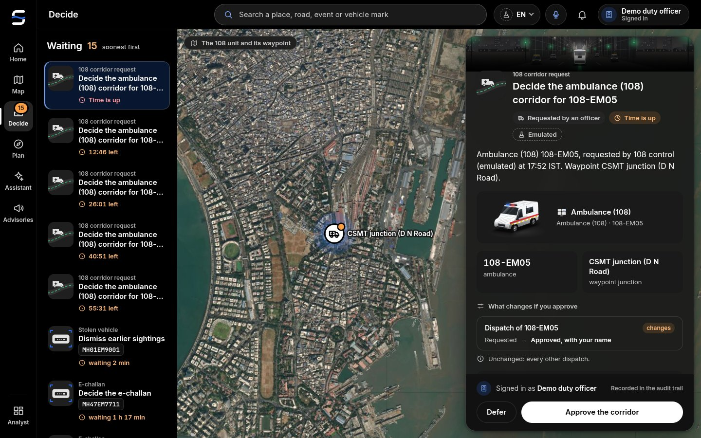 | 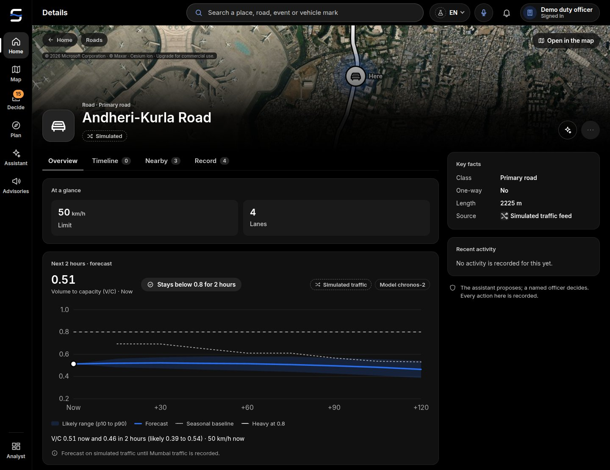 |
| *Ranked responses, the recommended one first (MODELLED); approval only creates dispatch requests.* | *A road's page: the two-hour V/C forecast with its p10–p90 band against the 0.8 line (simulated traffic).* |

| Citizen | Ambulance (108) crew |
|---|---|
| 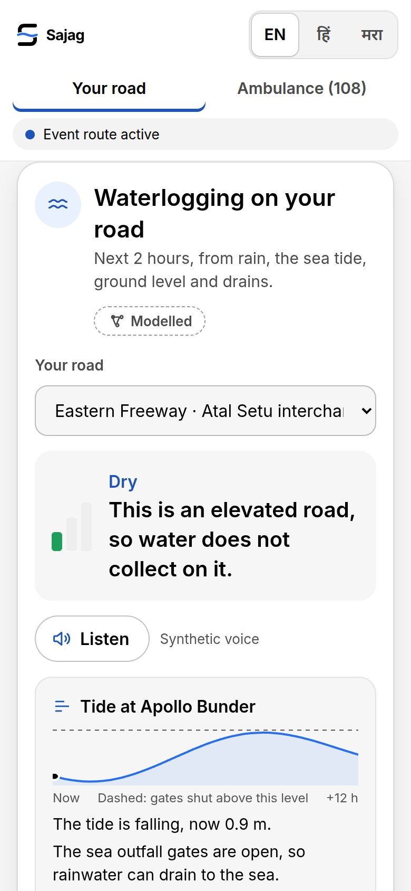 | 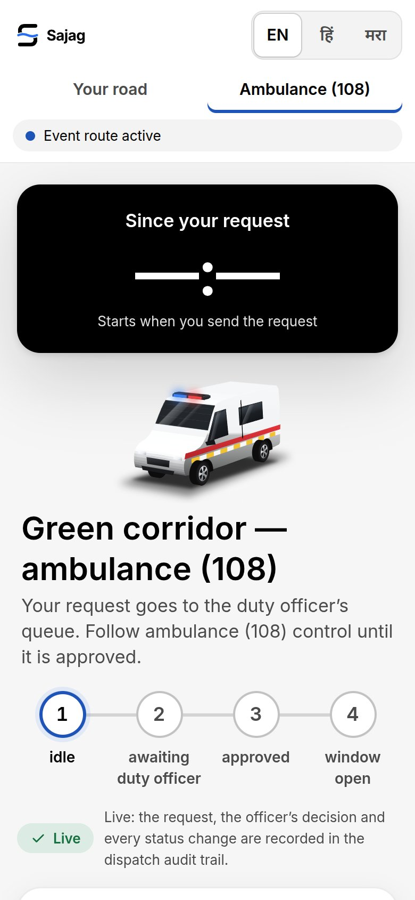 |
| *Check your road: the status in plain words (modelled), Listen, the Arabian Sea tide; no sign-in, no location.* | *One request for a corridor window, its four steps; a duty officer decides.* |

## 9. The AI surfaces

| Surface | Where | Design choices |
|---|---|---|
| **Rain · Tide chip** | Home and Map | Rain now (LIVE), the Apollo Bunder tide and gate state ("Outfall gates open / shut", MODELLED), roads at risk in 2 h; each part has its own label and goes "unavailable" on its own |
| **Next 2 hours** | Home | Two short lists: roads likely or possibly over 0.8 V/C, roads at waterlogging risk, each with the band or class and the label |
| **Waterlogging layer** | Map | Class 0–3 on the road itself, lead time on selection, the four drivers listed with their labels; the BMC pumping stations as emulated points; the subways (Andheri, Milan) and Hindmata named on the map |
| **Forecast layer and band** | Map, object page | Median line with the p10–p90 band and the 0.8 line; "Likely over 0.8" / "May reach 0.8" |
| **Storm replay (18–19 August 2025)** | Map, Home | A time slider over the storm; the title "Hindsight: 18–19 August 2025"; "IMD observed rain, modelled ponding. Not today's city."; "Back to live" |
| **AI proposals** | Decide | "Forecast, waterlogging and signal timing. You decide each one." The twin card shows do-nothing against the change (delay at the junction, longest queue, cross street, network), confidence, assumptions and the rationale in English and Marathi |
| **Field report by voice** | Top bar → Report | Hold to speak in Marathi, Hindi or English; the transcript; the place with "Not this place?"; kind, severity and "Words that decided it"; "Audio is not stored" |
| **Road state** | Map, object page | "Road state · AI reading"; "Sample still · not live" or "Your still, not stored"; depth judged against wheels and kerbs |
| **Listen** | Citizen | A play button beside the advisory, read in the page's language; "synthetic voice" |

The AI's text is set in the AI colour (blue) or carries an "AI" tag, so an officer can always tell what the system
wrote from what a person wrote.

| Assistant | Field report by voice |
|---|---|
| 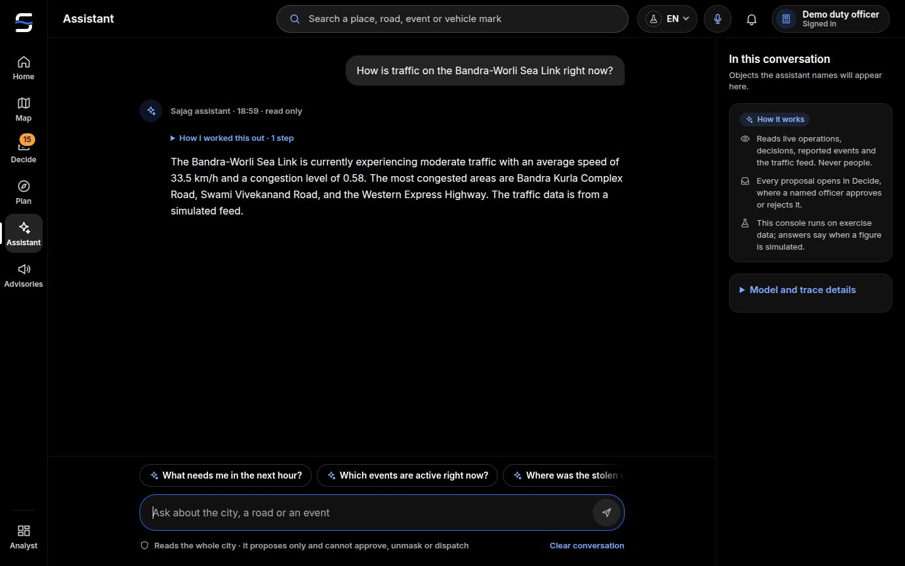 | 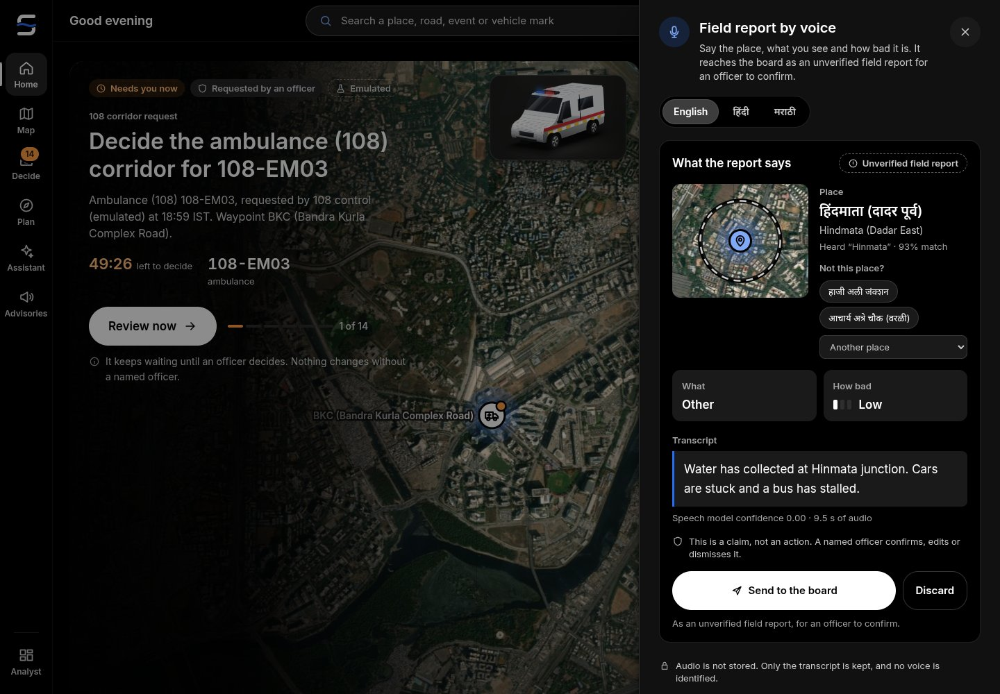 |
| *A grounded, read-only answer that says its traffic is synthetic; it cannot approve, unmask or dispatch.* | *Speech becomes place, kind and severity with the words that decided it; unverified until an officer confirms.* |

## 10. Copy rules in three languages

- Short, plain sentences. One idea per sentence. Verbs for buttons ("Review now", "Approve", "Hold to speak").
- Every string exists in English, Marathi and Hindi; every page, public pages included, opens in English, with Marathi and Hindi one tap away.
- Marathi in the plain, polite register of BMC and Mumbai Traffic Police public notices; "आपण" for citizens;
  consistent terms from the glossary: प्रस्ताव (proposal), निर्णय (decision), पाणी साचणे (waterlogging), भरती and
  ओहोटी (high and low tide), पर्यायी मार्ग (diversion), गणेशोत्सव and विसर्जन; place names exactly as in
  `landmarks.json` (हिंदमाता, किंग्ज सर्कल, अंधेरी सबवे, गिरगाव चौपाटी).
- Hindi in plain, everyday Hindi as heard in Mumbai, with "आप" for citizens: प्रस्ताव, निर्णय, जलभराव (waterlogging),
  ज्वार (high tide), वैकल्पिक मार्ग (diversion); place names as in `landmarks.json` (किंग्स सर्कल, वर्ली नाका).
- "Ambulance (108)" in the console, रुग्णवाहिका (१०८) on Marathi public pages and एम्बुलेंस (108) on Hindi ones; no
  claim of a partnership.
- Neutral, respectful language about every public body; no party names or symbols (Maharashtra's included).
- The English copy lint (`tests/copy-lint.mjs`) checks every English string (4,939) for all-caps shouting;
  acronyms (BMC, MTP, BEST, CSMT, BKC, WEH …) are allow-listed.

## 11. Accessibility

- Contrast: the design-token test checks every text and meaning colour against its ground.
- Colour is never the only signal: every state has a word, and labels are text.
- Controls have visible focus states (`:focus-visible`) and labels; icons have accessible names.
- Keyboard: the omnibar opens with `Ctrl K` or `/`.
- `<html lang>` follows the reader's language so screen readers pick the right voice.
- Motion respects "reduce motion".
- The landing page collapses to one column below 640 px with no sideways scroll at 390 px (tested); the citizen and
  driver pages are single-column phone layouts.
- The voice report has a typed alternative; the Listen button is optional, the text is always shown.

## 12. Wireframes

Low-fidelity wireframes of the key screens are in [`wireframes/`](wireframes/) (SVG). They show layout, order of
information and the rules each screen keeps; the figures in them are samples.

| Wireframe | Screen |
|---|---|
| [`wf-shell.svg`](wireframes/wf-shell.svg) | The operator shell and the honest-label legend |
| [`wf-home.svg`](wireframes/wf-home.svg) | Home: what needs you, what is happening, what is coming |
| [`wf-map.svg`](wireframes/wf-map.svg) | Map with layer toggles and a selected road's drivers |
| [`wf-decide.svg`](wireframes/wf-decide.svg) | Decide: a twin-tested signal-timing proposal |
| [`wf-object.svg`](wireframes/wf-object.svg) | Object page for a road (Dr Ambedkar Road → Hindmata) |
| [`wf-voice.svg`](wireframes/wf-voice.svg) | Field report by voice in Marathi |
| [`wf-citizen.svg`](wireframes/wf-citizen.svg) | Citizen: check your road, in the reader's language (English by default), with Listen |
| [`wf-driver.svg`](wireframes/wf-driver.svg) | Ambulance (108) crew: one-tap corridor request |
| [`wf-plan.svg`](wireframes/wf-plan.svg) | Plan a movement |

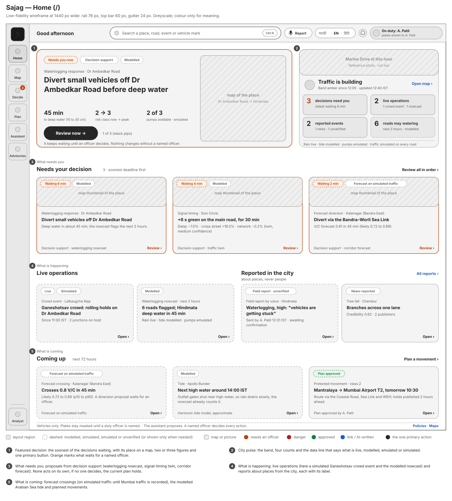

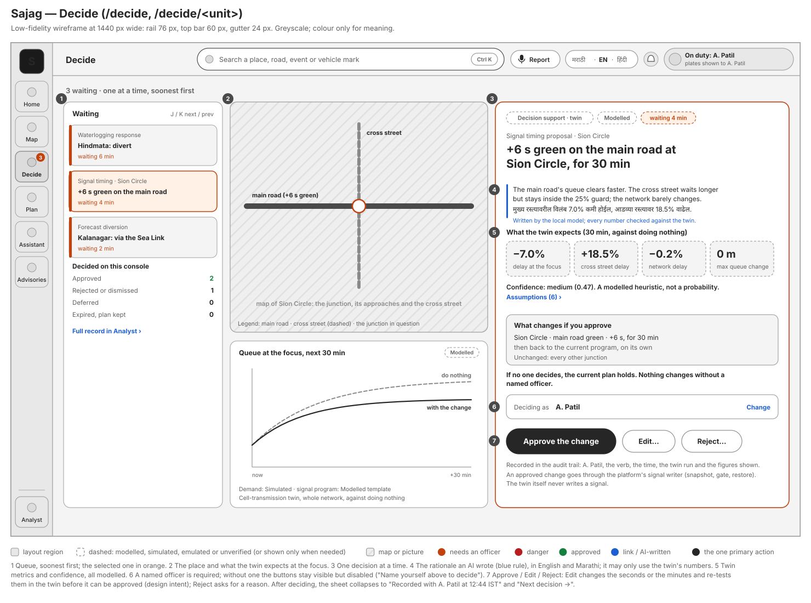

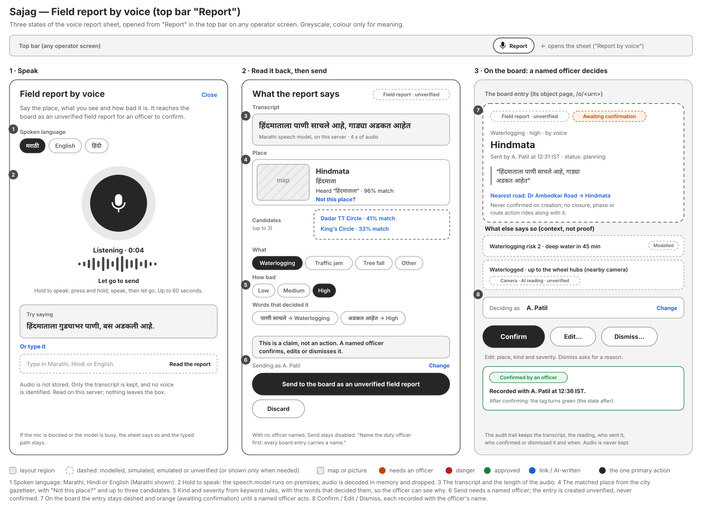

The live screens are in [`screenshots/`](screenshots/).

## 13. Known gaps

- Marathi and Hindi copy has been written with a glossary and checked by script; a native read by a Mumbai Traffic
  Police officer, a BMC ward officer and a citizen panel is still recommended before a pilot.
- The Mumbai reference-photo set and the Mumbai agency marks replace the earlier set file by file; until a picture
  exists for a place, the card shows none rather than another city's.
- An "Edit" control on twin proposals (adjust the duration or the seconds before approving) is design intent, drawn
  in the Decide wireframe, and not built yet.
- Marathi digits (०–९) on public pages are optional, go only through the formatter, and are not on by default.
- The tablet layout follows the desktop one; a field-phone layout of the console beyond the voice sheet is future
  work.
